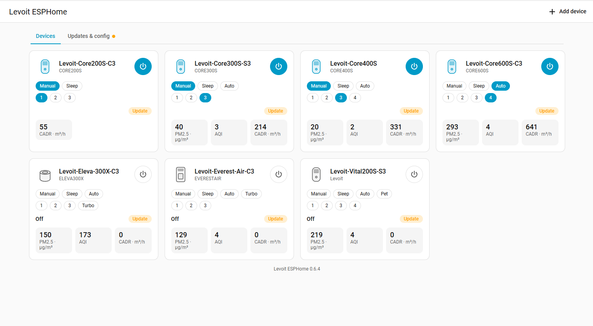
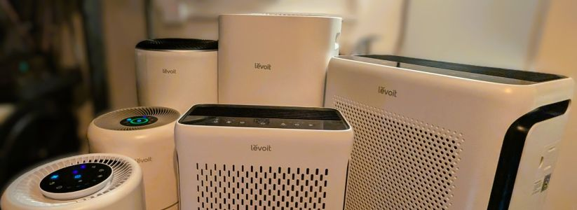

# Project - ESPHome hacked Air Purifiers and Humidifiers for Home Assistant

- Collection of air purifiers and humidifiers that can be more or less easily hacked to run ESPHome instead of cloud-based firmware.
- Eliminating cloud dependency and enabling native Home Assistant integration for air purifiers.

> [!TIP]
> **New: [Levoit ESPHome](https://github.com/tuct/levoit-esphome-ha), a Home Assistant integration for these purifiers.**
> It finds every device running the `levoit` or `philips` component and shows its installed and latest component version.
> When a new release is out, it appears under *Settings → Updates*, and *Install* compiles and uploads it through the ESPHome Device Builder.
> *Add device* makes a ready-to-flash config from a template (original ESP, [Seeed XIAO ESP32-C3](https://www.seeedstudio.com/Seeed-XIAO-ESP32C3-p-5431.html) / [ESP32-S3](https://www.seeedstudio.com/XIAO-ESP32S3-p-5627.html), or your own board).
> Its optional sidebar page shows every purifier as a card to use it (power, mode, speed, PM2.5, AQI, CADR), a page per device with its settings grouped and its air quality history, and a tab with versions, channel and filter %.
> Install it from the Marketplace as a custom repository: [setup steps](https://github.com/tuct/levoit-esphome-ha#installation).

I like Wi-Fi enabled air purifiers! But I hate the fact that they all depend on a cloud service.

I've run Home Assistant and custom-built ESPHome devices at home for quite some time, and found a project that let me flash custom, ESPHome-based firmware onto a Levoit Core 300S (which I already owned).
Wi-Fi enabled air purifiers often use an ESP32 for the Wi-Fi side plus a separate MCU to manage the purifier itself (speeds, air-quality sensor, auto mode, …), with a UART link between the two.

This started as a handful of custom ESPHome firmware and hardware projects for Levoit air purifiers, and is slowly growing into the broader collection you see here.

## Overview of existing / tested esphome-ified Air Purifiers

Every purifier that runs ESPHome at a glance — how it's converted, its specs, and how involved the teardown is. Click a model or its **Guide** for the full write-up.

Devices that *can't* run ESPHome but are still controllable locally on stock firmware are listed separately in [Cloud-free without ESPHome](./docs/philips-coap.md) below.

| Model | Manufacturer | Support | Methods | CADR (spec) | Noise | Disassembly | Guide | Links | Comments |
|-------|--------------|---------|---------|-------------|-------|-------------|-------|-------|----------|
| [Core 200S](./devices/levoit-core200s) | Levoit | 🏠 [`levoit`](./components/levoit/README.md) | 🟢 Flash / 🔵 Add ESP | 167 m³/h | 24–48 dB | Easy | [Guide](./devices/levoit-core200s) | [Amazon](https://amzn.to/3SGH513) | ✅ Tested · 3 speeds, no air-quality sensor |
| [Core 300S](./devices/levoit-core300s) | Levoit | 🏠 [`levoit`](./components/levoit/README.md) | 🟢 Flash / 🔵 Add ESP | 214 m³/h | 24–50 dB | Easy | [Guide](./devices/levoit-core300s) | [Amazon](https://amzn.to/4aMVbnO) | ✅ Tested · PM2.5 + Auto mode |
| [Core 400S](./devices/levoit-core400s) | Levoit | 🏠 [`levoit`](./components/levoit/README.md) | 🟢 Flash / 🔵 Add ESP | 442 m³/h | 24–52 dB | Hard | [Guide](./devices/levoit-core400s) | [Amazon](https://amzn.to/4vOT9vt) | ✅ Tested · 4 speeds |
| [Core 600S](./devices/levoit-core600s) | Levoit | 🏠 [`levoit`](./components/levoit/README.md) | 🟢 Flash / 🔵 Add ESP | 641 m³/h | 26–54 dB | Hard | [Guide](./devices/levoit-core600s) | [Amazon](https://amzn.to/4opVx9z) | ✅ Tested · 4 auto modes |
| [Vital 100S](./devices/levoit-vital100s) | Levoit | 🏠 [`levoit`](./components/levoit/README.md) | 🟢 Flash / 🔵 Add ESP | 221 m³/h | 23–52 dB | Easy | [Guide](./devices/levoit-vital100s/README.md#teardown--disassembly) | [Amazon](https://amzn.to/3SaFron) | ✅ Tested · Pet mode; detailed teardown |
| [Vital 200S (Pro)](./devices/levoit-vital200s) | Levoit | 🏠 [`levoit`](./components/levoit/README.md) | 🟢 Flash / 🔵 Add ESP | 415 m³/h | 23–58 dB | Easy | [Guide](./devices/levoit-vital200s) | [Amazon](https://amzn.to/4xMiJn1) | ✅ Tested |
| [Everest Air](./devices/levoit-everest-air) | Levoit | 🏠 [`levoit`](./components/levoit/README.md) | 🟢 Flash / 🔵 Add ESP | 612 m³/h | 24–56 dB | Easy | [Guide](./devices/levoit-everest-air) | [Amazon](https://amzn.to/3Q1cMB) | ✅ Tested · vent louver, PM1.0/2.5/10, Turbo |
| [Sprout](./devices/levoit-sprout) | Levoit | 🏠 [`levoit`](./components/levoit/README.md) + [`levoit_audio`](./components/levoit_audio/README.md) | 🟢 Flash / 🔵 Add ESP | 145 m³/h | 22–47 dB | Easy | [Guide](./devices/levoit-sprout) | [Amazon](https://amzn.to/4oAJs1n) | 🚧 WIP · white-noise audio (I2S MP3) |
| [Eleva 300X](./devices/levoit-eleva-300x) | Levoit | 🏠 [`levoit`](./components/levoit/README.md) | 🟢 Flash / 🔵 Add ESP | 273 m³/h | 20–50 dB | — | [Guide](./devices/levoit-eleva-300x) | — | ✅ Runs on a XIAO ESP32-C3 replacement (fan speed, PM/AQI confirmed) · stock-module config untested · PM1.0/2.5/10, quiet period, timer |
| [LV-PUR 131S](./devices/levoit-lv131s/) | Levoit | 🏠 Guide + YAML | 🔴 Custom HW | — | — | Medium | [Guide](./devices/levoit-lv131s/) | — | ESP12F → ESP32-C3, PM1003 → PM5003 |
| [LV-PUR 131](./devices/levoit-lv131/) | Levoit | 🏠 Guide + YAML | 🔴 Custom HW | — | — | Medium | [Guide](./devices/levoit-lv131/) | — | As above + temperature sensor |
| [Levoit Mini](./devices/levoit-mini) | Levoit | 🏠 Guide + YAML | 🔴 Custom HW | 78 m³/h | 41.8 – 53.6 dBA | Easy | [Guide](./devices/levoit-mini) | [Amazon](https://amzn.to/4acovEh) | Custom PCB + 3D parts; original PCB bypassed, reversible |
| [Core 300](https://www.reddit.com/r/homeassistant/comments/1rqz9gq/turned_a_broken_dumb_air_purifier_into_a_smart/) | Levoit | 🔗 External | 🔴 Custom HW | 214 m³/h | 24–50 dB | Easy | [Reddit ↗](https://www.reddit.com/r/homeassistant/comments/1rqz9gq/turned_a_broken_dumb_air_purifier_into_a_smart/) | — | **Non-smart Core 300** with broken PCB; ESP32 wired straight to the fan-speed lines → 3 interlocked GPIO switches (no MCU/UART, no sensors) |
| [Core 300-P](https://shop.silocitylabs.com/products/core300-p) | Levoit | 🔗 External | 🔴 Custom HW | 214 m³/h | 24–50 dB | Easy | [Shop ↗](https://shop.silocitylabs.com/products/core300-p) | [Silo City Labs](https://shop.silocitylabs.com/products/core300-p) | **Non-smart Core 300-P** — a ready-made ESP32-C6 replacement controller running ESPHome, reusing the stock fan controller and PSU. 4 fan speeds, 14 RGB LEDs, 3 spare GPIOs for AQ/VOC add-ons. Check the Intertek model on the back (5014566 vs 5030453) before ordering |
| [AC0650](./devices/philips-600-series) | Philips / MUJI | 🏠 [`philips`](./components/philips/README.md) | 🔵 Add ESP | 170 m³/h | 19–49 dB | Easy | [Guide](./devices/philips-600-series) | [Amazon](https://amzn.to/4vS5Ohs) | ✅ Tested · secure boot → replace module; no AQ sensor |
| [AC0651](./devices/philips-600-series) | Philips / MUJI | 🏠 [`philips`](./components/philips/README.md) | 🔵 Add ESP | 170 m³/h | 19–49 dB | Easy | [Guide](./devices/philips-600-series) | [Amazon](https://amzn.to/4elkSyg) | ✅ Tested · adds PM2.5 (PM1003), allergen index, Auto mode |
| [AC0951](./devices/philips-900-series) | Philips | 🏠 [`philips`](./components/philips/README.md) | 🔵 Add ESP | — | — | Easy | [Guide](./devices/philips-900-series) | — | ✅ Tested · MXCHIP module parked, ESP32-C3 added; PM2.5, allergen index, child lock, beep, display brightness, sleep timer |
| [AC0950](./devices/philips-900-series) | Philips | 🏠 [`philips`](./components/philips/README.md) | 🔵 Add ESP | — | — | Easy | [Guide](./devices/philips-900-series) | — | ⚠️ Untested · same protocol assumed as the AC0951, minus the PM sensor |
| [Förnuftig](https://edvoncken.net/2024/04/ikea-fornuftig-with-esphome/) | IKEA | 🔗 External | 🔴 Custom HW | 120 m³/h | 28–60 dB | Easy | [Blog ↗](https://edvoncken.net/2024/04/ikea-fornuftig-with-esphome/) · [C6 ↗](https://github.com/horvathgergo/esp32c6-for-fornuftig) | — | Dumb 3-speed fan, ESP added for control |
| [Uppåtvind](https://github.com/jonathonlui/esphome-ikea-uppatvind) | IKEA | 🔗 External | 🔴 Custom HW | 95 m³/h | 42.5–53.8 dB | Easy | [GitHub ↗](https://github.com/jonathonlui/esphome-ikea-uppatvind) | — | Small desk purifier, ESP added for control |
| [Mi Air Purifier 3 / 3H / 3C · Pro H · Smart 4 / 4 Lite / 4 Pro / Elite](https://github.com/dhewg/esphome-miot) | Xiaomi | 🔗 External | 🟢 Flash | — | — | — | [GitHub ↗](https://github.com/dhewg/esphome-miot) | — | MIoT UART component; flashes the built-in ESP gateway. Also covers other Xiaomi MIoT devices |

**Support** — where the firmware/guide lives:
- 🏠 **This repo** — maintained here: an in-repo ESPHome component (`levoit`, `philips`) or a full build guide with YAML.
- 🔗 **External** — someone else's project; the Guide column links straight to it. Listed for completeness, not maintained here.

**Methods** — how the custom firmware ends up on the device:
- 🟢 **Flash** — flash ESPHome straight onto the device's own ESP32 (works where it isn't locked — most Levoits). Easiest; back up the stock firmware first.
- 🔵 **Add ESP** — wire in a separate ESP32 and disable the original (`EN`→GND). Needed when secure boot blocks reflashing, and fully reversible.
- 🔴 **Custom HW** — replace the controller board / build custom hardware.

**CADR** and **Noise** are manufacturer specs. **Disassembly** is a rough effort estimate (Easy / Medium / Hard) — check the linked **Guide** before you start.

> ### ➕ Add your own!
> Got another air purifier running ESPHome? Add it to the list — open a **[Pull Request](https://github.com/tuct/esphome-projects/pulls)** or share it in **[Discussions](https://github.com/tuct/esphome-projects/discussions)**.
> Two requirements: it has to be an **air purifier**, and it has to run (or be made to run) **ESPHome**. In-repo components or external projects (like the IKEA ones above) are both welcome.

## Overview of existing / tested esphome-ified Humidifiers

Humidifiers use the same MCU-over-UART approach as the purifiers above, and the
same in-repo components — a Levoit humidifier is just another `model:` for the
[`levoit`](./components/levoit/README.md) component. The plan for bringing every
Levoit humidifier onto it, and where each one stands, is
[docs/humidifiers.md](./docs/humidifiers.md).

| Model | Manufacturer | Support | Methods | Tank | Output (spec) | Disassembly | Guide | Links | Comments |
|-------|--------------|---------|---------|------|---------------|-------------|-------|-------|----------|
| [LV600S / LUH-A602S-WEUR](./devices/levoit-lv600s) | Levoit | 🏠 [`lv600s_humidifier`](./components/lv600s_humidifier) | 🟢 Flash original ESP | 6 L | — | Easy | [Guide](./devices/levoit-lv600s) | — | 🚧 Development: warm/cool mist, verified on one EU unit with MCU 1.0.56 |
| [Superior 6000S](./devices/levoit-superior-6000s) | Levoit | 🏠 [`levoit`](./components/levoit/README.md) | 🟢 Flash / 🔵 Add ESP | 6 L | 500 mL/h | Easy | [Guide](./devices/levoit-superior-6000s) | — | 🚧 **Untested on hardware** · evaporative; 9 fan speeds, target humidity, auto-dry, temperature + humidity sensors |
| Dual 200S (LUH-D302S) | Levoit | 🏠 [`levoit`](./components/levoit/README.md), planned | 🔵 Add ESP / 🟢 Flash (untried) | — | — | Easy | [Plan](./docs/humidifiers.md) | — | 📋 **Planned** · ultrasonic; a working single-file YAML and the teardown are in [#66](https://github.com/tuct/levoit/issues/66), to be folded into the component as `model: DUAL200S`, see the [humidifier plan](./docs/humidifiers.md) |

The legend is the same as for the purifiers above — **Tank** and **Output** are
manufacturer specs and replace the CADR/Noise columns.

> ### ➕ Add your own!
> Got a humidifier running ESPHome? Same deal as the purifiers — open a
> **[Pull Request](https://github.com/tuct/esphome-projects/pulls)** or start a
> **[Discussion](https://github.com/tuct/esphome-projects/discussions)**.

## Cloud-free *without* ESPHome

Many Philips / Versuni purifiers can be driven locally over **CoAP** on stock
firmware — no flashing, no hardware changes. The supported-model list and
setup live in [docs/philips-coap.md](./docs/philips-coap.md).

# Components

Two external components live here. Each README carries its own supported
models, configuration reference, feature list and change log.

| Component | Devices | Docs |
|-----------|---------|------|
| [`levoit`](./components/levoit/README.md) | Levoit air purifiers and the Superior 6000S humidifier | [README](./components/levoit/README.md) · [compile tests](./components/levoit/tests) |
| [`philips`](./components/philips/README.md) | Philips / MUJI 600 and 900 series purifiers | [README](./components/philips/README.md) |

Per-device wiring, teardowns and example YAML live under
[`devices/`](./devices/README.md) — one folder per model, linked from the
tables above.

### Other Models / Levoit Projects

* [Levoit LV-PUR 131S](./devices/levoit-lv131s/) – Custom Firmware + MCU & sensor upgrade + hardware hack
* [Levoit LV-PUR 131](./devices/levoit-lv131/) – Custom Firmware + temperature sensor + MCU & sensor upgrade + hardware hack
* [Levoit Mini](./devices/levoit-mini) – Custom PCB, 3D parts, hardware hack

## Related external components

Not part of this repo, but built on the same idea — an ESPHome component talking the vendor's UART protocol to the purifier's MCU:

* **[dhewg/esphome-miot](https://github.com/dhewg/esphome-miot)** — Xiaomi **MIoT** serial protocol. Flashes the device's built-in ESP gateway (no extra hardware) and covers a range of Xiaomi/Mi air purifiers: Mi Air Purifier 3 / 3H / 3C, Pro H, and Smart 4 / 4 Lite / 4 Pro / Elite. Also supports other Xiaomi MIoT devices (humidifiers, fans, …).

## Change Log

See [CHANGELOG.md](./CHANGELOG.md) for project-level changes, and the
[levoit component change log](./components/levoit/README.md#change-log) for
component releases.

## Contributing

See [CONTRIBUTING.md](./CONTRIBUTING.md) — issues, pull requests, what CI
runs, and what a good contribution looks like.

Adding a model that is not listed above? Start with
[docs/adding-a-new-device.md](./docs/adding-a-new-device.md).

Planned: firmware updates from Home Assistant (prebuilt images for the original
ESP, a HACS integration, a way back to stock) — see
[docs/firmware-updates.md](./docs/firmware-updates.md).

## Info
Not my projects, but worth checking out:
* [levoit-vital-200s + levoit-vital-200s pro, levoit-vital-100s?](https://github.com/targor/levoit_vital/?tab=readme-ov-file)
* https://github.com/mulcmu/esphome-levoit-core300s
* https://github.com/acvigue/esphome-levoit-air-purifier
* [levoit-matter](https://github.com/tadhglewis/levoit-matter) – Local Matter firmware for Levoit Core air purifiers, without ESPHome
* [esphome-levoit-matter](https://github.com/tadhglewis/esphome-levoit-matter) – Local Matter firmware for Levoit Core air purifiers, built with ESPHome and the `levoit` component

## Helpful links
* [How to open Levoit's](https://www.youtube.com/watch?v=6wxHpUVcGFc)
* [How to open Levoit's smaller](https://www.youtube.com/watch?v=rAjLNR1jQkw)

## Details about generic protocol / etc
[Levoit UART Protocol Details](./LEVOIT_UART.md)
