

<picture>
  <source media="(prefers-color-scheme: dark)" srcset="./docs/images/logo/levoit-esphome-dark.svg">
  
</picture>

# Levoit ESPHome

**Local firmware for Levoit air purifiers and humidifiers.** 
No cloud, native Home Assistant, and the features of the stock app.

[Devices](#devices) · [Get started](#get-started) · [Home Assistant](#home-assistant) · [Components](#components) · [Contributing](#contributing)

## Why

I like Wi-Fi air purifiers, but not that they all depend on a cloud service.
Most of them pair an ESP32 for Wi-Fi with a separate MCU that runs the purifier
(fan, sensors, auto mode), linked over UART. This project replaces the ESP32's
firmware with ESPHome and speaks the MCU's protocol, so the purifier works
without the vendor app.

- **No cloud.** The device talks to Home Assistant over the local ESPHome API. No VeSync account.
- **The stock features.** Speeds, modes, sensors, filter life, display and child lock, as far as each model has them.
- **Updates from Home Assistant.** The [Levoit ESPHome](#home-assistant) integration installs new releases for you.
- **Reversible.** Back up the stock firmware before flashing, or leave the original ESP in place and add your own.

The protocol, frame by frame: [LEVOIT_UART.md](./LEVOIT_UART.md).

## Devices

Click a model for its guide: teardown, wiring and YAML. How the firmware gets on the device:

- 🟢 **Flash**: flash the device's own ESP32. Works on most Levoits; back up the stock firmware first.
- 🔵 **Add ESP**: wire in your own ESP32 and hold the original in reset (`EN` to GND). Needed where secure boot blocks flashing, and reversible.
- 🔴 **Custom HW**: replace the controller board.

🪛 shows how hard the unit is to open: ●○○ Easy, ●●○ Medium, ●●● Hard.

### Levoit air purifiers

All on the <a href="./components/levoit/README.md"><code>levoit</code></a> component.

<table>
<tr>
<td align="center" valign="top" width="33%">
<a href="./devices/levoit-core200s">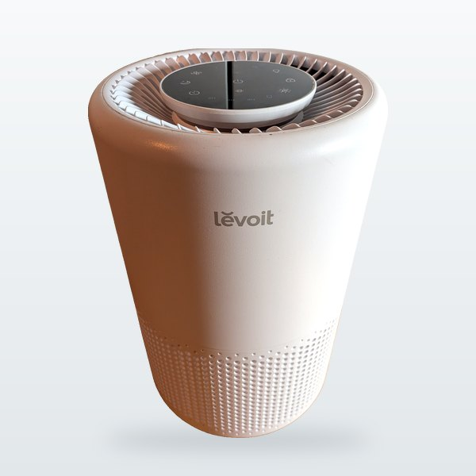</a> 
<b><a href="./devices/levoit-core200s">Core 200S</a></b> 
✅ Tested · 167 m³/h 
3 speeds, no air-quality sensor 
🪛 ●○○ Easy to open 
🟢 Flash · 🔵 Add ESP 
<a href="./devices/levoit-core200s">Guide</a> · <a href="https://amzn.to/3SGH513">Amazon</a>
</td>
<td align="center" valign="top" width="33%">
<a href="./devices/levoit-core300s">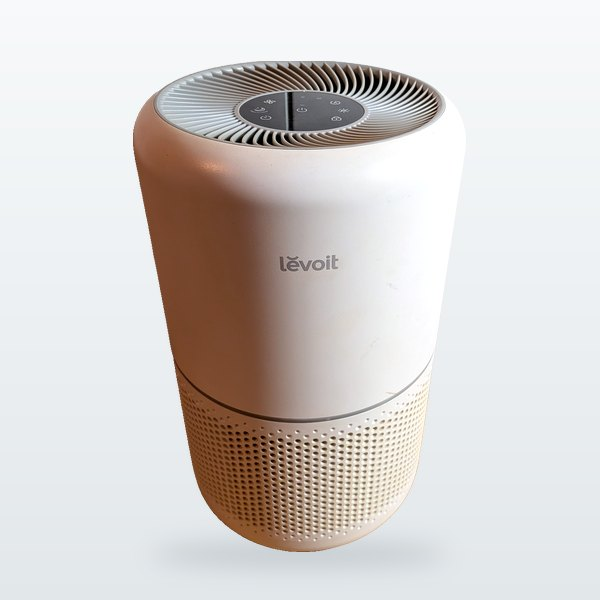</a> 
<b><a href="./devices/levoit-core300s">Core 300S</a></b> 
✅ Tested · 214 m³/h 
PM2.5 and Auto mode 
🪛 ●○○ Easy to open 
🟢 Flash · 🔵 Add ESP 
<a href="./devices/levoit-core300s">Guide</a> · <a href="https://amzn.to/4aMVbnO">Amazon</a>
</td>
<td align="center" valign="top" width="33%">
<a href="./devices/levoit-core400s">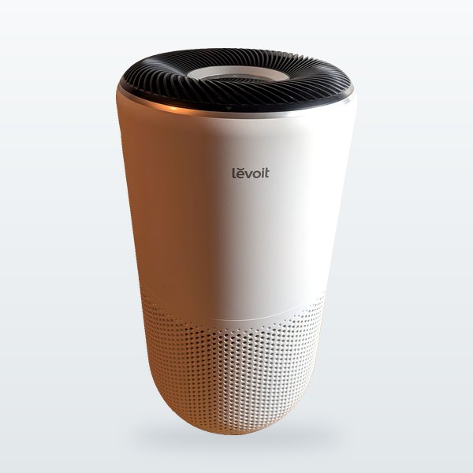</a> 
<b><a href="./devices/levoit-core400s">Core 400S</a></b> 
✅ Tested · 442 m³/h 
4 speeds 
🪛 ●●● Hard to open 
🟢 Flash · 🔵 Add ESP 
<a href="./devices/levoit-core400s">Guide</a> · <a href="https://amzn.to/4vOT9vt">Amazon</a>
</td>
</tr>
<tr>
<td align="center" valign="top" width="33%">
<a href="./devices/levoit-core600s">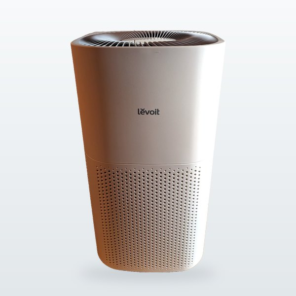</a> 
<b><a href="./devices/levoit-core600s">Core 600S</a></b> 
✅ Tested · 641 m³/h 
4 auto modes 
🪛 ●●● Hard to open 
🟢 Flash · 🔵 Add ESP 
<a href="./devices/levoit-core600s">Guide</a> · <a href="https://amzn.to/4opVx9z">Amazon</a>
</td>
<td align="center" valign="top" width="33%">
<a href="./devices/levoit-vital100s">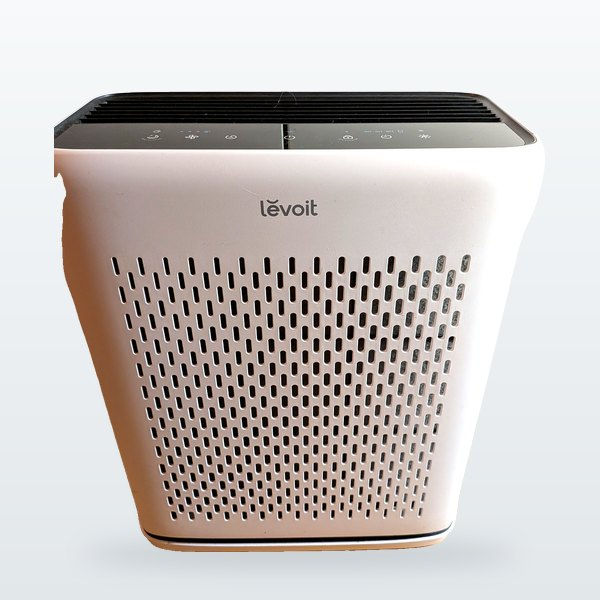</a> 
<b><a href="./devices/levoit-vital100s">Vital 100S</a></b> 
✅ Tested · 221 m³/h 
Pet mode, detailed teardown 
🪛 ●○○ Easy to open 
🟢 Flash · 🔵 Add ESP 
<a href="./devices/levoit-vital100s">Guide</a> · <a href="https://amzn.to/3SaFron">Amazon</a>
</td>
<td align="center" valign="top" width="33%">
<a href="./devices/levoit-vital200s">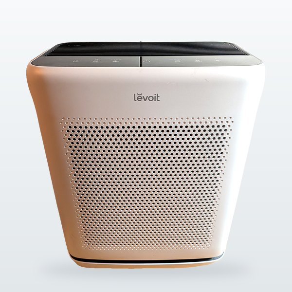</a> 
<b><a href="./devices/levoit-vital200s">Vital 200S (Pro)</a></b> 
✅ Tested · 415 m³/h 
Pet mode 
🪛 ●○○ Easy to open 
🟢 Flash · 🔵 Add ESP 
<a href="./devices/levoit-vital200s">Guide</a> · <a href="https://amzn.to/4xMiJn1">Amazon</a>
</td>
</tr>
<tr>
<td align="center" valign="top" width="33%">
<a href="./devices/levoit-everest-air">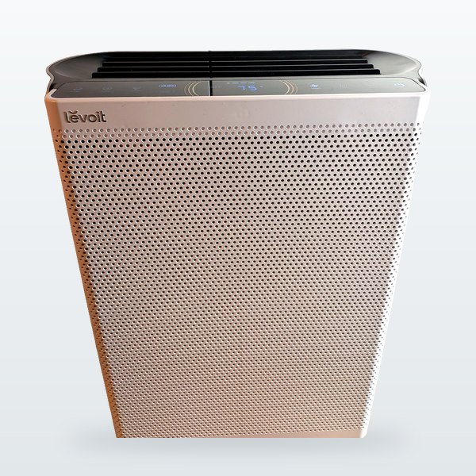</a> 
<b><a href="./devices/levoit-everest-air">Everest Air</a></b> 
✅ Tested · 612 m³/h 
Vent louver, PM1.0/2.5/10, Turbo 
🪛 ●○○ Easy to open 
🟢 Flash · 🔵 Add ESP 
<a href="./devices/levoit-everest-air">Guide</a> · <a href="https://amzn.to/3Q1cMB">Amazon</a>
</td>
<td align="center" valign="top" width="33%">
<a href="./devices/levoit-eleva-300x">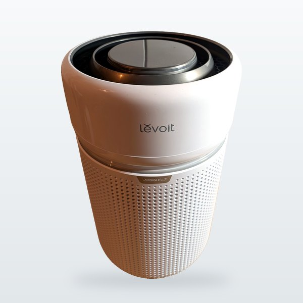</a> 
<b><a href="./devices/levoit-eleva-300x">Eleva 300X</a></b> 
✅ Tested on a XIAO C3 · 273 m³/h 
PM1.0/2.5/10, quiet period, timer 
🪛 ●●○ Medium to open 
🟢 Flash · 🔵 Add ESP 
<a href="./devices/levoit-eleva-300x">Guide</a>
</td>
<td align="center" valign="top" width="33%">
 
<b><a href="./devices/levoit-sprout">Sprout</a></b> 
🚧 Work in progress · 145 m³/h 
White-noise audio (I2S MP3) 
🪛 ●○○ Easy to open 
🟢 Flash · 🔵 Add ESP 
<a href="./devices/levoit-sprout">Guide</a> · <a href="https://amzn.to/4oAJs1n">Amazon</a>
</td>
</tr>
</table>

### Levoit humidifiers

The same approach: a Levoit humidifier is another `model:` of the <a href="./components/levoit/README.md"><code>levoit</code></a>
component. Where each one stands: [docs/humidifiers.md](./docs/humidifiers.md).

<table>
<tr>
<td align="center" valign="top" width="33%">
 
<b><a href="./devices/levoit-superior-6000s">Superior 6000S</a></b> 
🚧 Untested on hardware · 6 L · 500 mL/h 
Evaporative, 9 fan speeds, target humidity, auto-dry 
🪛 ●○○ Easy to open 
🟢 Flash · 🔵 Add ESP 
<a href="./devices/levoit-superior-6000s">Guide</a>
</td>
<td align="center" valign="top" width="33%">
 
<b><a href="./devices/levoit-lv600s">LV600S</a></b> 
🚧 Development · 6 L 
Warm and cool mist, one EU unit on MCU 1.0.56 
Component: <a href="./components/lv600s_humidifier">lv600s_humidifier</a> 
🪛 ●○○ Easy to open 
🟢 Flash original ESP 
<a href="./devices/levoit-lv600s">Guide</a>
</td>
<td align="center" valign="top" width="33%">
 
<b><a href="./docs/humidifiers.md">Dual 200S</a></b> 
📋 Planned 
Ultrasonic; YAML and teardown in <a href="https://github.com/tuct/levoit/issues/66">#66</a> 
🪛 ●○○ Easy to open 
🔵 Add ESP · 🟢 Flash (untried) 
<a href="./docs/humidifiers.md">Plan</a>
</td>
</tr>
</table>

<b>Specs and comparison</b>: CADR, noise, disassembly effort

| Model | Methods | CADR (spec) | Noise | Disassembly | Comments |
|-------|---------|-------------|-------|-------------|----------|
| [Core 200S](./devices/levoit-core200s) | 🟢 / 🔵 | 167 m³/h | 24–48 dB | Easy | 3 speeds, no air-quality sensor |
| [Core 300S](./devices/levoit-core300s) | 🟢 / 🔵 | 214 m³/h | 24–50 dB | Easy | PM2.5 + Auto mode |
| [Core 400S](./devices/levoit-core400s) | 🟢 / 🔵 | 442 m³/h | 24–52 dB | Hard | 4 speeds |
| [Core 600S](./devices/levoit-core600s) | 🟢 / 🔵 | 641 m³/h | 26–54 dB | Hard | 4 auto modes |
| [Vital 100S](./devices/levoit-vital100s) | 🟢 / 🔵 | 221 m³/h | 23–52 dB | Easy | Pet mode; [detailed teardown](./devices/levoit-vital100s/README.md#teardown--disassembly) |
| [Vital 200S (Pro)](./devices/levoit-vital200s) | 🟢 / 🔵 | 415 m³/h | 23–58 dB | Easy | |
| [Everest Air](./devices/levoit-everest-air) | 🟢 / 🔵 | 612 m³/h | 24–56 dB | Easy | Vent louver, PM1.0/2.5/10, Turbo |
| [Sprout](./devices/levoit-sprout) | 🟢 / 🔵 | 145 m³/h | 22–47 dB | Easy | White-noise audio (I2S MP3) via [`levoit_audio`](./components/levoit_audio/README.md) |
| [Eleva 300X](./devices/levoit-eleva-300x) | 🟢 / 🔵 | 273 m³/h | 20–50 dB | Medium | Runs on a XIAO ESP32-C3 replacement (fan speed, PM/AQI confirmed); stock-module config untested |
| [LV-PUR 131S](./devices/levoit-lv131s/) | 🔴 | — | — | Medium | ESP12F → ESP32-C3, PM1003 → PM5003 |
| [LV-PUR 131](./devices/levoit-lv131/) | 🔴 | — | — | Medium | As above + temperature sensor |
| [Levoit Mini](./devices/levoit-mini) | 🔴 | 78 m³/h | 41.8–53.6 dBA | Easy | Custom PCB + 3D parts; original PCB bypassed, reversible |
| [Philips AC0650](./devices/philips-600-series) | 🔵 | 170 m³/h | 19–49 dB | Easy | Secure boot → replace module; no AQ sensor |
| [Philips AC0651](./devices/philips-600-series) | 🔵 | 170 m³/h | 19–49 dB | Easy | Adds PM2.5 (PM1003), allergen index, Auto mode |
| [Philips AC0951](./devices/philips-900-series) | 🔵 | — | — | Easy | MXCHIP module parked, ESP32-C3 added |
| [Philips AC0950](./devices/philips-900-series) | 🔵 | — | — | Easy | Untested; same protocol assumed as the AC0951, minus the PM sensor |

| Humidifier | Methods | Tank | Output (spec) | Disassembly | Comments |
|------------|---------|------|---------------|-------------|----------|
| [LV600S / LUH-A602S-WEUR](./devices/levoit-lv600s) | 🟢 | 6 L | — | Easy | Warm/cool mist, verified on one EU unit with MCU 1.0.56 |
| [Superior 6000S](./devices/levoit-superior-6000s) | 🟢 / 🔵 | 6 L | 500 mL/h | Easy | Untested on hardware; temperature + humidity sensors |
| Dual 200S (LUH-D302S) | 🔵 / 🟢 untried | — | — | Easy | Planned as `model: DUAL200S`, see [#66](https://github.com/tuct/levoit/issues/66) |

CADR, noise, tank and output are manufacturer specs. Disassembly is a rough
effort estimate; check the guide before you start.

### More Levoit: custom hardware

Older or non-smart models, rebuilt around a new controller. Each has a full
build guide and YAML here.

<table>
<tr>
<td align="center" valign="top" width="33%">
<a href="./devices/levoit-lv131s">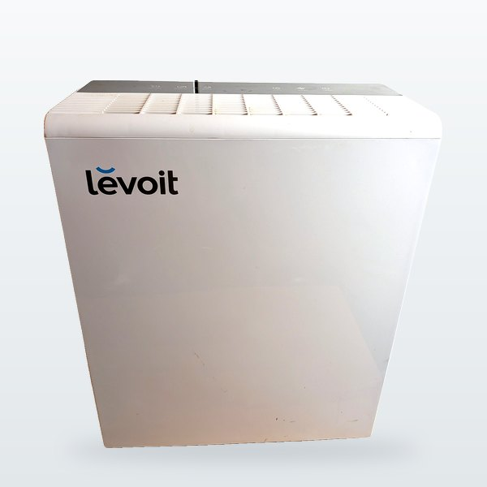</a> 
<b><a href="./devices/levoit-lv131s">LV-PUR 131S</a></b> 
🏠 Guide + YAML 
ESP12F → ESP32-C3, PM1003 → PM5003 
🪛 ●●○ Medium to open 
🔴 Custom HW 
<a href="./devices/levoit-lv131s">Guide</a>
</td>
<td align="center" valign="top" width="33%">
 
<b><a href="./devices/levoit-lv131">LV-PUR 131</a></b> 
🏠 Guide + YAML 
As the 131S, plus a temperature sensor 
🪛 ●●○ Medium to open 
🔴 Custom HW 
<a href="./devices/levoit-lv131">Guide</a>
</td>
<td align="center" valign="top" width="33%">
<a href="./devices/levoit-mini">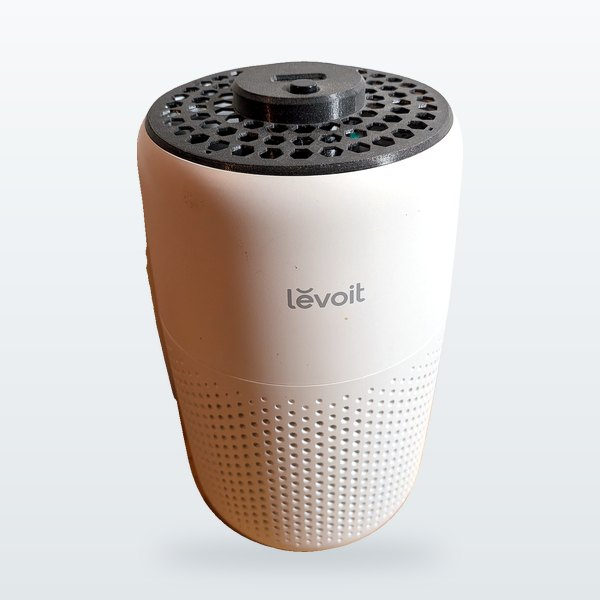</a> 
<b><a href="./devices/levoit-mini">Levoit Mini</a></b> 
🏠 Guide + YAML · 78 m³/h 
Custom PCB and 3D parts, reversible 
🪛 ●○○ Easy to open 
🔴 Custom HW 
<a href="./devices/levoit-mini">Guide</a> · <a href="https://amzn.to/4acovEh">Amazon</a>
</td>
</tr>
</table>

Elsewhere: a [non-smart Core 300 with a broken PCB](https://www.reddit.com/r/homeassistant/comments/1rqz9gq/turned_a_broken_dumb_air_purifier_into_a_smart/)
wired straight to an ESP32 (Reddit), and the
[Core300-P](https://shop.silocitylabs.com/products/core300-p), a ready-made
ESP32-C6 controller for the non-smart Core 300-P from Silo City Labs (check the
Intertek number on the back, 5014566 or 5030453, before ordering).

### Philips

On the [`philips`](./components/philips/README.md) component.

<table>
<tr>
<td align="center" valign="top" width="33%">
<a href="./devices/philips-600-series">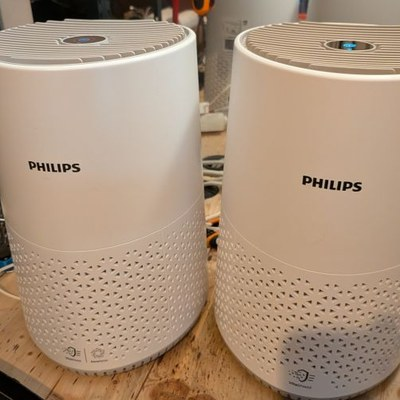</a> 
<b><a href="./devices/philips-600-series">600 series: AC0650, AC0651</a></b> 
✅ Tested · 170 m³/h 
Secure boot, so add an ESP; the AC0651 adds PM2.5, allergen index, Auto 
🪛 ●○○ Easy to open 
🔵 Add ESP 
<a href="./devices/philips-600-series">Guide</a> · <a href="https://amzn.to/4vS5Ohs">AC0650</a> · <a href="https://amzn.to/4elkSyg">AC0651</a>
</td>
<td align="center" valign="top" width="33%">
 
<b><a href="./devices/philips-900-series">900 series: AC0951, AC0950</a></b> 
✅ AC0951 tested · ⚠️ AC0950 untested 
PM2.5, allergen index, child lock, beep, sleep timer 
🪛 ●○○ Easy to open 
🔵 Add ESP 
<a href="./devices/philips-900-series">Guide</a>
</td>
</tr>
</table>

Many Philips / Versuni purifiers also work locally on stock firmware over
CoAP, with no flashing: [docs/philips-coap.md](./docs/philips-coap.md).

### Other brands

Someone else's projects, listed so you can find them. Not maintained here.

| Model | Brand | Method | Project |
|-------|-------|--------|---------|
| Förnuftig | IKEA | 🔴 ESP added to a 3-speed fan | [Blog](https://edvoncken.net/2024/04/ikea-fornuftig-with-esphome/) · [ESP32-C6 build](https://github.com/horvathgergo/esp32c6-for-fornuftig) |
| Uppåtvind | IKEA | 🔴 ESP added to a desk purifier | [esphome-ikea-uppatvind](https://github.com/jonathonlui/esphome-ikea-uppatvind) |
| Mi Air Purifier 3 / 3H / 3C, Pro H, Smart 4 / 4 Lite / 4 Pro / Elite | Xiaomi | 🟢 Flashes the built-in ESP | [dhewg/esphome-miot](https://github.com/dhewg/esphome-miot), also other MIoT devices |

> [!TIP]
> **Got another purifier or humidifier running ESPHome?** Open a
> [pull request](https://github.com/tuct/levoit/pulls) or start a
> [discussion](https://github.com/tuct/levoit/discussions). In-repo components
> and external projects are both welcome.

[↑ Back to top](#readme-top)

## Get started

1. **Find your model** above and open its guide.
2. **Choose a route.** 🟢 Flash the purifier's own ESP32, after backing up the
   stock firmware. Or 🔵 add your own board and leave the original in place;
   the recommended modules are the [Seeed XIAO ESP32-S3](https://www.seeedstudio.com/XIAO-ESP32S3-p-5627.html?sensecap_affiliate=3gGMlPv&referring_service=link) and
   [Seeed XIAO ESP32-C3](https://www.seeedstudio.com/Seeed-XIAO-ESP32C3-p-5431.html?sensecap_affiliate=3gGMlPv&referring_service=link).
3. **Make the config.** In Home Assistant, *Add device* in the
   [Levoit ESPHome](#home-assistant) integration builds a ready-to-flash config
   from the model's template; you add a name and your Wi-Fi. Or start from the
   YAML in the device folder and the [component README](./components/levoit/README.md).

[↑ Back to top](#readme-top)

## Home Assistant

**[Levoit ESPHome](https://github.com/tuct/levoit-esphome-ha)** is the
companion integration. It finds every device running the `levoit` or `philips`
component.

 

- **Updates**: a new release shows up under *Settings → Updates*, and *Install* compiles and uploads it through the ESPHome Device Builder.
- **Add device**: a ready-to-flash config from a template, for the original ESP, a [XIAO ESP32-C3](https://www.seeedstudio.com/Seeed-XIAO-ESP32C3-p-5431.html?sensecap_affiliate=3gGMlPv&referring_service=link) or [ESP32-S3](https://www.seeedstudio.com/XIAO-ESP32S3-p-5627.html?sensecap_affiliate=3gGMlPv&referring_service=link), or your own board.
- **Sidebar page**: every purifier as a card (power, mode, speed, PM2.5, AQI, CADR), a page per device with its settings and air quality history, and a tab with versions, channel and filter %.

or follow the [setup steps](https://github.com/tuct/levoit-esphome-ha#installation).

[↑ Back to top](#readme-top)

## Components

The ESPHome external components in this repo. Each README has its supported
models, configuration reference and change log.

| Component | Devices |
|-----------|---------|
| [`levoit`](./components/levoit/README.md) | Levoit air purifiers and the Superior 6000S humidifier ([compile tests](./components/levoit/tests)) |
| [`levoit_audio`](./components/levoit_audio/README.md) | White-noise audio on the Sprout |
| [`lv600s_humidifier`](./components/lv600s_humidifier/README.md) | The LV600S humidifier |
| [`philips`](./components/philips/README.md) | Philips / MUJI 600 and 900 series purifiers |

Per-device wiring, teardowns and example YAML live under
[`devices/`](./devices/README.md), one folder per model.

## Related projects

Not mine, but worth a look:

- [targor/levoit_vital](https://github.com/targor/levoit_vital/?tab=readme-ov-file): Vital 200S and 200S Pro
- [mulcmu/esphome-levoit-core300s](https://github.com/mulcmu/esphome-levoit-core300s)
- [acvigue/esphome-levoit-air-purifier](https://github.com/acvigue/esphome-levoit-air-purifier)
- [tadhglewis/levoit-matter](https://github.com/tadhglewis/levoit-matter): local Matter firmware for Levoit Core purifiers, without ESPHome
- [tadhglewis/esphome-levoit-matter](https://github.com/tadhglewis/esphome-levoit-matter): the same with ESPHome and the `levoit` component

Opening a Levoit: [video 1](https://www.youtube.com/watch?v=6wxHpUVcGFc) · [video 2, smaller models](https://www.youtube.com/watch?v=rAjLNR1jQkw)

## Contributing

See [CONTRIBUTING.md](./CONTRIBUTING.md): issues, pull requests, what CI runs,
and what a good contribution looks like. Adding a model that is not listed?
Start with [docs/adding-a-new-device.md](./docs/adding-a-new-device.md).

- Change log: [CHANGELOG.md](./CHANGELOG.md) for the project, and the [levoit component change log](./components/levoit/README.md#change-log) for component releases
- Firmware updates from Home Assistant, prebuilt images and a way back to stock: [docs/firmware-updates.md](./docs/firmware-updates.md)

[↑ Back to top](#readme-top)
