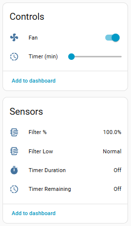
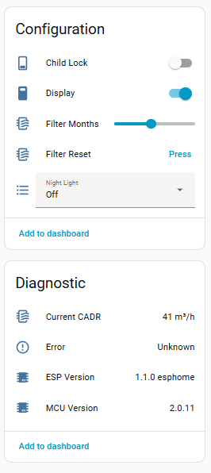
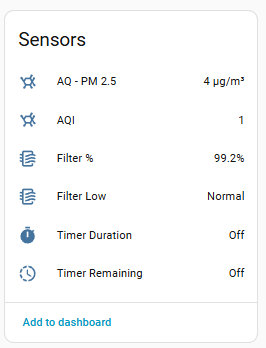
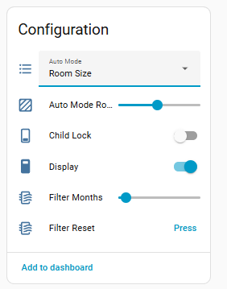

[← Back to Components](../README.md)

# Levoit ESPHome Component

Custom ESPHome component for Levoit air purifiers (Core and Vital series) and
humidifiers (Superior 6000S), enabling local control without cloud dependency.

> The **Superior 6000S** is a humidifier rather than a purifier, but it speaks
> the same MCU protocol, so it is just another `model:` here. It is ported from
> [Jyers/esphome-projects](https://github.com/Jyers/esphome-projects) and
> **has not been verified on hardware** — see
> [devices/levoit-superior-6000s](../../devices/levoit-superior-6000s).

[See Supported Models and Feature Matrix and Changelog](../../README.md)


## Installation

### Hardware Setup

- ⚠️ Requires disassembly and serial access (TX, RX, GND, EN, GPIO0) initially
- 💡 Before opening anything, the FCC filing for most Levoit models includes
  **internal photos of the bare PCB** — browse grantee
  [`2ARBY`](https://fccid.io/2ARBY) (Arovast Corporation) to find yours and
  see the module and test pads in advance


#### Option 1: Flash Original ESP32 Directly
Flash ESPHome directly onto the factory ESP32-Solo-1 module using serial connection.

#### Option 2: Dual ESP Setup (Preserve Original)
Keep the original ESP32 functional while adding a custom ESP32 for ESPHome control. This approach allows switching between firmware versions and enables MCU firmware updates.

**Hardware Setup:**
1. Install a **2-position switch** to select which ESP32 is active, only use during power down!
2. Wire the switch:
   - **Common (middle)**: Connect to GND
   - **Position A**: Connect to EN pin of original ESP32
   - **Position B**: Connect to EN pin of new ESP32

3. Connect new ESP32:
   - Power (3.3V) and GND from purifier PCB
   - TX/RX to MCU UART pins (parallel to original ESP32)

**Benefits:**
- ✅ Revert to factory firmware anytime
- ✅ Perform official MCU firmware updates when needed
- ✅ Test ESPHome changes without risk
- ⚠️ **Note**: New MCU firmware may require protocol updates in this component


**Recommended modules:**
- **XIAO Seeed ESP32-S3** - Compact form factor, easy to integrate
- **XIAO Seeed ESP32-C3** - Budget-friendly alternative
- Any ESP32 module with UART and sufficient GPIO pins

### Hardware Access

Each model requires different disassembly procedures. See model-specific guides in [projects/free-levoit](../../projects/free-levoit/) for:
- PCB pinout diagrams
- Disassembly instructions
- UART pin locations
- Photos and wiring diagrams


### Software Installation

#### Step 1: Add External Component
In your ESPHome YAML configuration:

**Local Development:**
```yaml
external_components:
  - source:
      type: local
      path: ../../../components  # Relative to your YAML file
    components: [levoit]
```

**Production (GitHub):**
```yaml
external_components:
  - source:
      type: git
      url: https://github.com/tuct/esphome-projects
      ref: main
    components: [levoit]
```

#### Step 2: Set esp32 variant

For Core 300/400s and Levoit 100s/200s:

esp32:
  board: esp32dev
  framework:
    type: esp-idf
    sdkconfig_options:
      CONFIG_FREERTOS_UNICORE: y

for custom esp, set accordingly 


#### Step 3: Configure UART
Match your hardware connections:
```yaml
uart:
  tx_pin: GPIO17   # ESP TX → MCU RX for original ESP32!
  rx_pin: GPIO16   # ESP RX → MCU TX for original ESP32!
  baud_rate: 115200
```

#### Step 4: Add Levoit Component
Specify your model (must match device):
```yaml
levoit:
  id: air_purifier
  model: CORE300S  # Options: VITAL100S, VITAL200S, CORE200S, CORE300S, CORE400S,
                   #          CORE600S, SPROUT, EVERESTAIR, SUPERIOR6000S, ELEVA300X
```

#### Step 5: Compile and Flash
```bash
# Compile only (check for errors)
esphome compile your-config.yaml

# Compile and upload via serial
esphome run your-config.yaml

# Upload via OTA (after initial flash)
esphome upload your-config.yaml --device your-device.local
```

For complete working examples, see the [free-levoit project configurations](../../projects/free-levoit/).

### Troubleshooting Installation

**No communication with MCU:**
- Verify TX/RX are not swapped (common mistake)
- Check 3.3V power supply voltage under load
- Enable UART debugging: `uart: debug: { direction: BOTH }`
- Confirm baud rate is 115200

**Boot loops or crashes:**
- Check `model:` matches your actual device
- Verify GPIO pins don't conflict with ESP32 bootstrap pins
- Try disabling PSRAM if using ESP32-S3: `psram_mode: disabled`

**Device not responding in Home Assistant:**
- Confirm ESPHome API is enabled
- Check WiFi credentials and network connectivity
- Review logs: `esphome logs your-config.yaml`
- Verify model detection: Look for "Model set to: CORE300S (ModelType=2)" in logs


## Architecture

### Component Structure
```
levoit/
├── levoit.cpp/.h           # Main component, UART handling, message routing
├── levoit_message.h/.cpp   # Message building and frame construction utilities
├── decoder.cpp/.h          # Frame parsing and message dispatch
├── types.h                 # Enum definitions for commands and entity types
├── core_status.cpp/.h      # Core series status/timer payload decoders
├── vital_status.cpp/.h     # Vital series status payload decoders
├── core_commands.cpp/.h    # Core series command builders (300S/400S)
├── vital_commands.cpp/.h   # Vital series command builders (100S/200S)
├── decoder_helpers.h       # Shared utility functions
├── tlv.cpp/.h             # TLV encoding for complex payloads
└── [platform]/            # ESPHome platform integrations
    ├── fan/               # Fan entity
    ├── switch/            # Switch entities (display, lock, etc.)
    ├── number/            # Number entities (timer, room size)
    ├── select/            # Select entities (auto mode)
    ├── sensor/            # Sensor entities (PM2.5, CADR, filter life)
    ├── binary_sensor/     # Binary sensor entities (filter low status)
    ├── button/            # Button entities (filter reset)
    └── text_sensor/       # Text sensor entities (timer display)
```

### Protocol Details
- **Interface**: UART at 115200 baud
- **Frame Format**: `A5 [type:3] [seq:1] [len:1] [reserved:1] [chk:1] [cmd:1] [payload:N]`
- **Byte Order**: Little-endian for multi-byte values
- **Message Counter**: Global sequence number (`messageUpCounter`) tracks outgoing messages
- **Model Detection**: Automatic based on initial handshake (TODO)
- **Checksum**: Sum of all bytes excluding checksum byte itself


## Configuration Example

```yaml
external_components:
  - source:
      type: local
      path: ../../../components  # or use git source
    components: [levoit]

uart:
  tx_pin: GPIO4
  rx_pin: GPIO5
  baud_rate: 115200

levoit:
  id: air_purifier
  model: CORE300S  # or VITAL100S, VITAL200S, CORE200S, CORE400S, CORE600S,
                   #    SPROUT, EVERESTAIR, ELEVA300X, SUPERIOR6000S (humidifier)

fan:
  - platform: levoit
    levoit: air_purifier
    name: "Air Purifier"

switch:
  - platform: levoit
    levoit: air_purifier
    name: "Display"
    type: display
  - platform: levoit
    levoit: air_purifier
    name: "Child Lock"
    type: child_lock

number:
  - platform: levoit
    levoit: air_purifier
    name: "Timer"
    type: timer
  - platform: levoit
    levoit: air_purifier
    name: "Filter Lifetime (months)"
    type: filter_lifetime_months

sensor:
  - platform: levoit
    levoit: air_purifier
    name: "Current CADR"
    type: current_cadr
  - platform: levoit
    levoit: air_purifier
    name: "Filter Life Left"
    type: filter_life_left

binary_sensor:
  - platform: levoit
    levoit: air_purifier
    name: "Filter Low"
    type: filter_low

button:
  - platform: levoit
    levoit: air_purifier
    name: "Reset Filter Stats"
    type: reset_filter_stats

text_sensor:
  - platform: levoit
    levoit: air_purifier
    name: "Timer Remaining"
    type: timer_duration_remaining
  - platform: levoit
    levoit: air_purifier
    name: "MCU Version"
    type: mcu_version

select:
  - platform: levoit
    levoit: air_purifier
    name: "Night Light"
    type: nightlight  # Core200S only
```

For complete configuration examples, see the [free-levoit project](../../projects/free-levoit/).

## Filter Life Calculation

The **Filter Life Left** sensor tracks filter usage as a percentage (0-100%) based on cumulative CADR consumption.

### How It Works

1. **Baseline Capacity**:
   - Model CADR (e.g., 214 m³/h for Core300S) multiplied by filter lifetime (default 12 months)
   - Formula: `Total Capacity = CADR × 24 hours × 30 days × Filter Lifetime (months)`
   - Example: `214 × 24 × 30 × 12 = 1,844,160 m³` for Core300S at 12 months

2. **Real-Time Tracking**:
   - Every minute, the component accumulates CADR based on current fan speed
   - Tracks `used_cadr_` (total m³ processed) persisted to device preferences
   - Updates `total_runtime_` (minutes fan has been on)

3. **Speed-Dependent CADR**:
   - Level 1: `CADR × 1 ÷ max_speed` (derates to ~63% in Sleep mode)
   - Level 2: `CADR × 2 ÷ max_speed`
   - Level 3: `CADR × 3 ÷ max_speed`
   - Level 4: `CADR × 4 ÷ max_speed` (Core400S/Vital series only)

4. **Percentage Calculation**:
   ```
   Filter Life % = 100 - (used_cadr ÷ Total Capacity × 100)
   ```
   - Clamped to 0-100% range
   - Published every 10 seconds as a float with one decimal place

5. **Binary Sensor Threshold**:
   - **Filter Low** binary sensor activates when `Filter Life % < 5%`
   - Useful for automations (e.g., order replacement reminders)

### Resetting Filter Stats

- Use the **Reset Filter Stats** button to reset `used_cadr` and `total_runtime` to 0
- This resets the filter life percentage back to 100%
- Persists immediately to device storage

### Configuration

Adjust filter lifetime expectancy via the **Filter Lifetime (months)** number entity:
```yaml
number:
  - platform: levoit
    levoit: air_purifier
    name: "Filter Lifetime (months)"
    type: filter_lifetime_months
    min_value: 1
    max_value: 24
    step: 1
```

Default: 12 months. Adjust based on your filter's actual rated lifespan or usage pattern.

## Development Notes

### Code Organization
- **Message Building**: Centralized in `levoit_message.h/.cpp` with inline functions for efficiency
- **Command Builders**: Separated into `core_commands.cpp` and `vital_commands.cpp` for model-specific logic
- **Global Counter**: `messageUpCounter` tracks outgoing message sequence (inline variable in `levoit_message.h`)

### Adding New Commands
1. Add enum to `CommandType` in [types.h](types.h)
2. Implement in `build_core_command()` or `build_vital_command()` depending on model series
3. Pattern: Define `msg_type` and `payload` vectors, return `build_levoit_message(msg_type, payload, messageUpCounter)`
4. The `build_levoit_message()` function handles frame construction, counter insertion, and checksum calculation

### Debugging
Enable verbose logging in your YAML:
```yaml
logger:
  level: VERBOSE
  
uart:
  debug:
    direction: BOTH  # Monitor raw UART traffic
```


## Known Issues & TODO
- [ ] Implement custom sleep mode settings for Vital series
- [ ] Model-specific room size validation based on CADR ratings
- [x] Verify Core 300S/400S protocol differences (MCU version dependency)
- [x] WiFi LED control and status indication after connection
- [x] Add filter life time and current CADR sensors
- [x] Add filter low binary sensor (< 5% threshold)
- [x] Add reset filter stats button
- [x] Enable filter reset from Home Assistant
- [x] Enable filter reset from Device (Long press sleep)
- [x] Add appropriate icons for entities
- [x] Test compatibility with ESPHome 2025.12+ (preset mode API changes)
- [x] Update to ESPHome 2025.12.5 (completed)


## Credits

Special thanks to the original developers who reverse-engineered the Levoit protocols:
- [targor](https://github.com/targor/) - [Levoit Vital integration](https://github.com/targor/levoit_vital/)
- [mulcmu](https://github.com/mulcmu/) - [Levoit Core 300S](https://github.com/mulcmu/esphome-levoit-core300s)
- [acvigue](https://github.com/acvigue/) - [Levoit Core integration](https://github.com/acvigue/esphome-levoit-air-purifier)
- [Jyers](https://github.com/Jyers/) - [Superior 6000S humidifier support](https://github.com/Jyers/esphome-projects)

## License

This component is provided as-is for educational and personal use. Levoit and related trademarks are property of their respective owners.

## Features

Core200s




Core300s - with Air Quality and Auto




#### Fan

Native Home Assistant Fan component, with preset support.
Available speed levels and presets are based on model.

| Model | Speed Levels | Preset Modes |
|---------|------------|-------------|
| C200S | 1–3 | Manual, Sleep |
| C300S | 1–3 | Auto, Manual, Sleep |
| C400S | 1–4 | Auto, Manual, Sleep |
| C600S | 1–4 | Auto, Manual, Sleep |
| V100S | 1–4 | Auto, Manual, Sleep, Pet |
| V200S | 1–4 | Auto, Manual, Sleep, Pet |
| Sprout | 1–4 | Auto, Manual |
| EverestAir | 1–3 | Auto, Turbo, Manual |
| Eleva 300X | 1–4 (4 = Turbo) | Auto, Manual, Sleep |

The `fan_operating_mode` select exposes the active fan mode as a normal ESPHome select for dashboards that do not render fan presets directly. It stays synchronized with MCU fan-mode status and uses the same Manual / Sleep / Auto / Pet / Turbo model-specific modes as the fan preset path.


#### Vent Angle & Cover (EverestAir)

The Everest Air adds a **motorized vent louver** and a **cover/door sensor** not present on the other models:

| Feature | Type | Config Key | Description |
|---------|----|------------|-------------|
| Vent Angle | number | `vent_angle` | Motorized louver angle, 45–90° (CMD `02 12 55`, status TLV `0x14`) **EverestAir only** |
| Cover Open | binary_sensor | `cover_open` | Back/filter door open — the unit powers itself off while open (TLV `0x15`) **Sprout + EverestAir** |

The vent angle is set as a number entity (45° = nearly closed/upward, 90° = fully open/forward). The MCU echoes the current angle back in status tag `0x14`, and it reads `0` while the unit is powered off.


#### Mute, AQI Ring & AQI (Eleva 300X)

The Eleva 300X speaks the Vital protocol, with a few additions. Its MCU pushes status (`02 00 55`) as a REPORT frame (type `0x02`) instead of SEND (`0x22`), and every sensor report (`02 23 55`) is echoed back to the MCU, as the stock firmware does. Turbo is fan level 4, not a fan mode as on the EverestAir.

| Feature | Type | Config Key | Description |
|---------|----|------------|-------------|
| Mute | switch | `mute` | Panel beeps off (CMD `02 17 55`, 4-byte value, status TLV `0x2D`) **Eleva 300X only** |
| AQI Ring Dim | switch | `aqi_ring_dim` | Dim the AQI light ring (CMD `02 04 55` key `0x02`, status TLV `0x32`) **Eleva 300X only** |
| AQI | sensor | `aqi_index` | Numeric AQI 0–500 (status TLV `0x2C`); `aqi` carries the 1–4 air-quality level **Eleva 300X only** |
| Ambient Light | sensor | `ambient_light` | Raw light sensor reading (status TLV `0x34`) **Eleva 300X only** |
| Quiet Period | switch | `quiet_period` | Quiet period on/off; lowers the fan one level while active (CMD `02 21 55` key `0x05`) **Eleva 300X only** |
| Quiet Trigger | select | `quiet_trigger` | Light (darkness) / Timer (`quiet_start`–`quiet_end`) (key `0x06`) **Eleva 300X only** |
| Quiet Start / End | number | `quiet_start`, `quiet_end` | Quiet window in hours after midnight, 22.5 = 22:30 (keys `0x07`/`0x08`) **Eleva 300X only** |
| Quiet Active | binary_sensor | `quiet_active` | Quiet period currently active (MCU event key `0x09`: 7 start, 8 end) **Eleva 300X only** |
| Adaptive Start | switch | `adaptive_start` | Adaptive start flag (key `0x02`); VeSync runs the on/off logic in the cloud **Eleva 300X only** |
| Dynamic Manual | switch | `dynamic_manual` | Manual speed jumps to turbo on pollution (key `0x03`) **Eleva 300X only** |
| Dynamic Sleep | switch | `dynamic_sleep` | Dynamic sleep (key `0x04`) **Eleva 300X only** |

The MCU runs the quiet period itself. For the Timer trigger it needs the local time, which it asks for at boot (`02 22 55`): give the `levoit:` block a `time_id` (e.g. Home Assistant or SNTP time) and the component answers that request and re-sends the time after every clock sync. The timer uses the Vital `timer` number; the MCU pushes its countdown as a REPORT every second. Filter life is estimated on the ESP as for the other models: the `reset_filter_stats` button also sends the stock reset pair to the MCU (`02 05 55` + `03 00`, then `04 01 00` = not a genuine filter), and a filter reset on the unit's panel (`02 05 55` + `03 01 00` from the MCU) resets the ESP counters. At boot the component reports "not a genuine filter" (`04 01 00`), as a stock unit with an unlinked filter does. See [the device README](../../devices/levoit-eleva-300x) for the protocol notes.


#### Display / Light

| Feature | Type | Config Key | Description |
|---------|----|------------|-------------|
| Display | switch | `display` | Toggle the LED display on/off |
| Child Lock | switch | `child_lock` | Disable physical buttons on the device |
| Light Detect | switch | `light_detect` | Auto-dim display when ambient light is low **Vital Series + Core 600S + EverestAir + Eleva 300X** |
| Night Light | select | `nightlight` | Night light brightness: Off / Mid / Full **Only Core200S** |

#### Timer

| Feature | Type | Config Key | Description |
|---------|----|------------|-------------|
| Timer | number | `timer` | Run timer in minutes |
| Timer Set | text_sensor | `timer_duration_initial` | Originally set timer as readable string (e.g. "2h 30 min") |
| Timer Remaining | text_sensor | `timer_duration_remaining` | Time left on active timer (e.g. "1h 15 min") |

#### Filter Lifetime

| Feature | Type | Config Key | Description |
|---------|----|------------|-------------|
| Filter Lifetime | number | `filter_lifetime_months` | Expected filter lifespan in months (1–12); used to compute Filter Life % |
| Filter Life Left | sensor | `filter_life_left` | Remaining filter life as %, computed by the component from accumulated CADR |
| Filter Low | binary_sensor | `filter_low` | `on` when Filter Life % drops below 5% ⁽¹⁾ |
| Current CADR | sensor | `current_cadr` | Calculated Clean Air Delivery Rate at current fan speed in m³/h ⁽¹⁾ |
| Reset Filter Stats | button | `reset_filter_stats` | Reset cumulative CADR and runtime counters — restores Filter Life % to 100%. On Core200S it additionally sends the MCU its own filter reset |

> On every model the filter percentage is computed by the component from
> accumulated CADR — no Levoit MCU reports it. The Core200S MCU keeps a
> counter of its own that the stock app resets, so the button clears that as
> well, but it is not what feeds the sensor.

#### Auto Mode

| Feature | Type | Config Key | Description |
|---------|----|------------|-------------|
| Auto Mode | select | `auto_mode` | Auto mode type — options vary by model (see below) **Not for Core200S** |
| Auto Mode Room Size | number | `efficiency_room_size` | MCU-reported room area for efficient auto mode in m² — reflects device status (`0` outside Room Size). Setting it sends it at once and switches the fan to Auto. In the Core 300S / 400S / 600S and Vital configs it is a **diagnostic** entity: set the Preset instead **Not for Core200S / EverestAir** |
| Auto Mode Room Size Preset | number | `auto_profile_room_size_input` | The room size to use: sent when Room Size/Efficient is selected, and **at once when Room Size is already active**. Persists across reboots so Default/Quiet status resets don't wipe the target. **Not for Core200S / EverestAir** |
| Efficiency Counter | sensor | `efficiency_counter` | Seconds remaining at high fan speed in efficient auto mode **Vital only** |
| Auto Mode High Fan Time | text_sensor | `auto_mode_room_size_high_fan` | Time still running at high speed in efficient auto mode, human readable **Vital only** |

Auto Mode configures the purifier's automatic behavior and is distinct from the active fan preset/mode. On models with fan Auto support, changing Auto Mode enters the fan's Auto preset; direct fan speed changes switch the fan preset to Manual.

When Room Size/Efficient is selected, the purifier uses **Auto Mode Room Size Preset** (`auto_profile_room_size_input`) as the coverage target and sends it to the MCU automatically. Changing the Preset while Room Size is the active auto mode sends the new size right away; the fan mode stays as it is. The **Auto Mode Room Size** number (`efficiency_room_size`) still reflects what the MCU reports back in status payloads — Default and Quiet profiles report `0`, which is normal. So the Preset is the one to set; the device configs show Auto Mode Room Size under *Diagnostic* in Home Assistant (`entity_category: diagnostic`), except on the Sprout, which has no Preset.

Auto mode options per model:

| Model | Options | Room Size Range |
|-------|---------|----------------|
| C200S | — | up to 40 m² (430 ft²) |
| C300S | Default / Quiet / Room Size | 9–50 m² (97–538 ft²) |
| C400S | Default / Quiet / Room Size | 9–38 m² (97–409 ft²) |
| C600S | Default / Quiet / Room Size / ECO | 9–147 m² (97–1,582 ft²) |
| V100S | Default / Quiet / Efficient | 9–52 m² (97–560 ft²) |
| V200S | Default / Quiet / Efficient | 9–87 m² (97–936 ft²) |
| Sprout| Default / Quiet / Efficient | 9–57 m² (97–936 ft²) |
| EverestAir| Default / Eco | — (no room-size setting) |

#### Air Quality Sensors

| Feature | Type | Config Key | Description |
|---------|----|------------|-------------|
| PM2.5 | sensor | `pm25` | Particulate matter concentration in µg/m³ from built-in sensor **Not for Core200S** |
| PM1.0 | sensor | `pm1_0` | Particulate matter concentration in µg/m³ from built-in sensor **only Sprout, EverestAir and Eleva 300X** |
| PM10 | sensor | `pm10` | Particulate matter concentration in µg/m³ from built-in sensor **only Sprout, EverestAir and Eleva 300X** |
| AQI | sensor | `aqi` | Air Quality Index as reported by the MCU **Not for Core200S** |

#### Info and Debug

| Feature | Type | Config Key | Description |
|---------|----|------------|-------------|
| MCU Version | text_sensor | `mcu_version` | Firmware version string of the purifier MCU chip |
| ESP Version | text_sensor | `esp_version` | Component version and the commit it was built from, e.g. `1.7.0+3fa21c4 esphome` |
| Model | text_sensor | `model` | The configured `model:`, e.g. `CORE300S`; lets Home Assistant (the Levoit ESPHome integration) tell the device type without the config |
| Error | text_sensor | `error_message` | Device error status: "Ok" or "Sensor Error" **Not for Core200S** |
| On/Off Button Held | binary_sensor | `power_button_held` | `on` from a few seconds into a hold of the On/Off button until it is released (CMD `01 02 D1`), for a long-press action such as a reset. Seen on a Core 300S **Core models** |

## Change Log

#### ESP Version: 1.7.3 - 2026.11.23

**Philips UART check and new device configs.** The `levoit` component code is
unchanged from 1.7.2. The version moves because the repo has one version, and
`stable` brings the new device configs (Eleva 300X on a XIAO ESP32-C3, Superior
6000S on its stock module, XIAO ESP32-S3 / C3 configs for every model): see the
[project change log](../../CHANGELOG.md).

* **`philips`: UART settings checked at config validation**: the 115200 8N1
  check moves from the deprecated `check_uart_settings()` (a warning on every
  Philips build, removed in ESPHome 2027.3.0) to config validation. A wrong
  UART setting now fails `esphome config` with "Component philips requires
  baud rate 115200" instead of a warning in the device log
  ([#129](https://github.com/tuct/levoit/pull/129))

#### ESP Version: 1.7.2 - 2026.11.22

**Vital fixes from real units.** Timer, filter wear, Wi-Fi LED and the daytime
fan mode, tested on a Vital 100S and a Vital 200S. Most of these came from
wasdennnoch, thanks!

* **Vital timer**: no more status request every 10 seconds forever when no
  timer runs (an empty timer reply left the timer marked active). Duplicate
  frames are now skipped only for the periodic status messages; timer replies,
  button events and other answers are always handled
  ([#114](https://github.com/tuct/levoit/pull/114))
* **Filter wear in Auto at the lowest speed**: when the Vital idles below
  level 1 (`FanLevel` 0), Current CADR and filter wear use the derated sleep
  speed instead of level 1. Changing *Filter Lifetime Months* updates Filter %
  and the remaining filter life at once. The fan entity still shows 25% there
  (four speed steps), now documented in the Vital 100S README
  ([#113](https://github.com/tuct/levoit/pull/113))
* **Wi-Fi LED no longer stuck blinking after boot**: a fixed 2-second
  "blink" command could overwrite the solid LED when Wi-Fi connected quickly.
  The LED now follows the connection state, and is set again once the MCU
  first answers ([#116](https://github.com/tuct/levoit/pull/116))
* **Filter-LED blink at boot only on Core models** (200S / 300S / 400S /
  600S), which have that LED command. On Vital, Everest Air and Sprout the
  same code meant something else: the Vital display was toggled every second
  until Wi-Fi connected ([#112](https://github.com/tuct/levoit/pull/112))
* **Daytime fan mode** (`daytime_fan_mode`, Vital 200S) offers Manual, Sleep,
  Auto and Pet, without the Unknown3 / Unknown4 placeholders; options map to
  the device's mode values by name, through one shared table
  ([#111](https://github.com/tuct/levoit/pull/111))
* **`dark_detected`** no longer has `device_class: light`: Home Assistant read
  that as "light detected" and showed the opposite. It now shows on / off
  ([#110](https://github.com/tuct/levoit/pull/110))
* No compiler warning on ESP32-C3 builds at log level `VERBOSE` (Superior
  6000S dry-time log line) ([#118](https://github.com/tuct/levoit/pull/118))

#### ESP Version: 1.7.1 - 2026.11.22

**Firmware updates from Home Assistant, step one: the version tells the build,
and the device tells its model.** Plus an Everest Air fix and clean ESP32-C3
builds. Needs ESPHome **2026.6.0** or newer.

* **Minimum ESPHome 2026.6.0** (was 2026.5.3)
  ([#105](https://github.com/tuct/levoit/pull/105))
* No compiler warnings on ESP32-C3 / RISC-V builds any more: `uint32_t` log
  values use `PRIu32`, and the number command switch has a `default`
  ([#106](https://github.com/tuct/levoit/pull/106))
* **New `model` text sensor** (`type: model`): reports the configured `model:`,
  e.g. `CORE300S`, so Home Assistant (the Levoit ESPHome integration) can tell
  the device type without its config ([#104](https://github.com/tuct/levoit/pull/104))
* The component version has one source now, `components/levoit/VERSION`. The
  build compiles it in and the `esp_version` sensor reports it as before
  (`1.7.0 esphome`); a new `Version check` workflow keeps it in step with this
  change log and with release tags ([#98](https://github.com/tuct/levoit/pull/98))
* **The version now includes the commit it was built from**, e.g.
  `1.7.0+3fa21c4 esphome` on the `esp_version` sensor (`.dirty` for a local
  checkout with uncommitted changes). Builds from `main` between two releases
  can now be told apart from the release. Without git around the component
  it stays `1.7.1` ([#100](https://github.com/tuct/levoit/pull/100))
* **Everest Air: one "set speed" action now leaves Auto/Sleep/Turbo**, like on
  the other models; no need to set the Manual preset first
  ([#92](https://github.com/tuct/levoit/issues/92)). The Manual mode frame
  (`02 02 55`) is now sent before the fan level (`02 03 55`) on this model
  ([#99](https://github.com/tuct/levoit/pull/99))
* Everest Air: fan level `0xFF` (reported while off) no longer reads as speed 3,
  so setting 100% on a unit that is off also sends the level

#### ESP Version: 1.7.0 - 2026.11.21

**A new device, the Levoit Eleva 300X, and ESPHome 2026.11 support.** Thanks to
@Scags104 for the 2026.11 fix and @benedikt-bartscher for the Ethernet fix.

* **Builds on ESPHome 2026.11**, still on the minimum 2026.5.3
  ([#93](https://github.com/tuct/levoit/pull/93)). 2026.11 removed the
  `format_hex_pretty()` overload returning a `std::string`; the UART logs now
  use `format_hex_pretty_to()` (available since 2026.3). The Sprout light's
  breathing effect is registered through the new pointer-and-count
  `add_effects()` on 2026.11 and the initializer list on older releases
* Add Levoit Eleva 300X support (`model: ELEVA300X`), Vital protocol over the stock ESP32-C3
  ([#95](https://github.com/tuct/levoit/pull/95))
  * MCU status and sensor frames arrive as REPORT (type `0x02`); they are now ACKed and decoded for this model
  * Sensor reports (`02 23 55`) are echoed back to the MCU like the stock firmware
  * New `mute` and `aqi_ring_dim` switches, new `aqi_index` sensor (numeric AQI 0–500), `ambient_light` sensor
  * Quiet period (`quiet_period` switch, `quiet_trigger` select, `quiet_start` / `quiet_end` numbers, `quiet_active` binary sensor), `adaptive_start`, `dynamic_manual` and `dynamic_sleep` switches, all via the MCU's auto-mode config block `02 21 55`
  * New optional `time_id` on `levoit:`: answers the Eleva MCU's time request (`02 22 55`) with local time and re-sends it on every clock sync
  * Timer: countdown REPORTs accepted, set/stop carry the trailing `02 01 00` the stock firmware sends
  * Filter reset in both directions: the button sends the stock `02 05 55` reset pair, a panel reset resets the ESP filter counters
  * Fan level 0 (sleep) and 255 (off) are ignored, so the fan keeps its last manual speed
* ⚠️ Eleva 300X not verified on hardware yet (MCU UART on GPIO18 / GPIO19, same ESP32-C3-SOLO-1 module as the Vital 100S / 200S)
* **Builds on Ethernet boards.** The Wi-Fi LED status read
  `wifi::global_wifi_component`, so a config without the `wifi` component (an
  external ESP32 with Ethernet, e.g. an Olimex ESP32-POE2) failed to compile
  with `wifi/wifi_component.h: No such file or directory`. The LED now follows
  `network::is_connected()`, which covers Wi-Fi and Ethernet; on Wi-Fi nothing
  changes. The "WiFi component not found" warning is gone with it
  ([#86](https://github.com/tuct/levoit/pull/86))
* New compile test `test-ethernet.yaml` covers the wired case in CI
* CI builds every test config against the newest ESPHome and the minimum
  2026.5.3; `components/run-compile-tests.sh` / `.ps1` run the same builds
  locally

#### ESP Version: 1.6.0 - 2026.10.25

**Core 200S filter life, properly this time.** 1.5.0 shipped a guess that made
things worse on some units — see the warning under 1.5.0 below. It is reverted,
and the real causes are fixed. Thanks to everyone in
[#60](https://github.com/tuct/levoit/issues/60) for the reports, the captures
and the byte maps.

* **Fixes filter life never moving off 100%.** The per-minute CADR
  accumulation did `cadr_per_hour / 60` in integer arithmetic, which truncates
  to **zero** for any model under 60 m³/h at the current speed. A Core 200S on
  speed 1 (41 m³/h as it was then calculated) or in Sleep accumulated nothing
  at all, so the sensor sat at exactly 100% indefinitely — for months, in the
  reports. Higher speeds lost 28–46% to the same truncation, which is why the
  graph looked like a staircase where a Core 400S shows a smooth slope. The
  remainder is now carried between minutes
* **Fixes the estimate decaying a further 25% too slowly.** The CADR
  calculation used a 4-speed divisor for the Core 200S, which has 3 speeds
* Fixes the **Superior 6000S losing speeds 5–9** entirely: the accumulator was
  gated on `speed <= 4`, while its fan has 9
* **Reverts the 1.5.0 Core 200S filter mapping.** Status byte 6 is not filter
  life. A capture taken while the stock app displayed 99% still reports byte 6
  as `0x64` (100), and no message in any capture carries a percentage or a
  runtime counter. On MCU 4.0.34 byte 6 is a transient flag, which is why that
  release reported **0.0% or 1.0%** flipping with the display
* **Display works across MCU firmware versions.** Bytes 6 and 7 are a pair —
  one carries the brightness (`0x00`/`0x64`), the other a transient flag that
  trips for a few seconds after any command — and **they swap between firmware
  versions**: 2.0.11 puts brightness in byte 6, 4.0.34 on the Core 200S Plus
  puts it in byte 7. The decoder matches on the value `0x64` across both bytes
  instead of a fixed position, so either layout works
* **A filter reset done on the unit itself now resets the sensor.** `01 E4 A5`
  is bidirectional: the MCU pushes it back when the panel button is used.
  Handled ahead of the payload-dedup cache so two resets in a row both take
  effect, and keyed on message direction rather than payload, because the push
  carries `0x01` on MCU 2.0.11 but `0x00` on 4.0.34
* The full byte map, both firmware layouts and a symptom-to-cause table are in
  [the device README](../../devices/levoit-core200s/README.md)

> **The Core 200S filter percentage is an estimate and always was.** Three
> independent counters exist on these units: the VeSync cloud's, the MCU's own
> timer that drives the red filter light, and ESPHome's CADR estimate. The MCU
> never reports a percentage on the wire, so the number in Home Assistant will
> not track the panel light exactly. Tune `filter_lifetime_months` to taste.

#### ESP Version: 1.5.0 - 2026.09.26

> ⚠️ **Superseded for the Core 200S — upgrade to 1.6.0.** This release read
> status byte 6 as an MCU filter-life percentage and moved the Display switch to
> byte 7. Both were wrong. On MCU 4.0.34 it made `filter_life_left` report
> **0.0% or 1.0%** and `filter_low` show a problem on a brand-new filter; on
> other firmwares it pinned the sensor at a constant 100%. Fixed in 1.6.0.

* **Core 200S: read filter life from the MCU status frame** and suppress the
  ESP-side estimate on that model — incorrect, see the warning above
* **Filter Reset now also resets the MCU's own counter** (`01 E4 A5`, captured
  from the stock firmware). Previously there was no core implementation of
  `resetFilter` at all. This part was right and is kept

* Fix `filter_low` device class — it is a `problem` binary sensor, not a
  `battery` one, so a low filter now shows as a problem in Home Assistant

* Add **Levoit Superior 6000S** (`model: SUPERIOR6000S`) — an evaporative
  humidifier on the same MCU protocol as the purifiers. Ported from
  [Jyers/esphome-projects](https://github.com/Jyers/esphome-projects)
  * New entities: `auto_dry_power_off` / `auto_dry_water_empty` switches,
    `humidity_target` and `timer` numbers, `humidity` / `temperature` /
    `filter_life_mcu` / `timer_remaining` sensors, `auto_profile` /
    `humidity_subtype` / `dry_level` selects, and `water_tank_empty` /
    `humidifying` / `dry_active` binary sensors
  * `select` and `number` gained Superior types; the fan now supports 9 speeds
    and the Humidity / Dry modes
  * **The timer runs on the ESP**, not the MCU: this MCU only stores a
    "remaining" value pushed to it, so the component owns the countdown and
    refreshes it once a minute. The `timer` number is in **hours** here, where
    the purifiers use minutes
  * **`dry_level` does not act on its own** — the select records Low/High and
    the value is applied when Dry is picked on the fan entity
* **Fix two build failures around optional platforms.** A levoit config with
  only a fan did not build at all, and one with an unrelated `template` switch
  (or select, number, …) failed the same way: several sources included
  `number/levoit_number.h` and friends either unguarded or guarded on the
  *generic* `USE_SWITCH` / `USE_NUMBER` macros, which any component defines,
  while ESPHome only copies `levoit/<platform>/` when a **levoit** entity of
  that platform is configured
  * Each platform now defines its own `USE_LEVOIT_*` macro, and the entity
    classes are confined to `levoit.cpp` behind new value accessors
    (`try_get_number_state()`, `try_get_select_index()`,
    `try_get_switch_state()`, `apply_fan_status()`), so the other sources no
    longer need those headers at all
  * Added compile tests in [`tests/`](./tests) covering every entity type and
    both of the above cases, run by GitHub Actions on every PR
* `publish_sensor` widened `uint32_t` → `float` so the humidifier can report
  fractional temperature and humidity (it already converted internally)
* ⚠️ Superior 6000S not verified on hardware — see
  [the device README](../../devices/levoit-superior-6000s)

#### ESP Version: 1.4.1 - 2026.09.08

* Add `fan_operating_mode` select: the active fan mode as a normal ESPHome select, for dashboards that don't render fan presets (@EdenNelson, #50)
  * Stays in sync with MCU fan-mode status and with changes made through the fan entity
* Make fan mode commands coherent between the Manual and Auto paths (@EdenNelson, #48)
* Fix Core room size round trip — value written and value read back now match (@EdenNelson, #46)
* Fix: setting the same fan level while Sleep/Auto was active sent no UART command, so the device stayed in the preset. A speed call that leaves a non-Manual preset now counts as a change (@Bleialf, #53)
* Add `auto_profile_room_size_input` number: persisted Room Size target for Room Size/Efficient auto profile (@EdenNelson, #56)
  * Automatically sent to the MCU when Room Size/Efficient is selected — no manual "Apply" step needed
  * Survives Default/Quiet status resets that report room size as `0`
  * Restores saved target on reboot, clamped to model-specific min/max
  * Model ranges: C300S 9–50 m², C400S 9–38 m², C600S 9–147 m², V100S 9–52 m², V200S 9–87 m²
  * Sprout: Room Size/Efficient mode is protocol-inherited from Vital but unverified on hardware — `auto_profile_room_size_input` not included for Sprout
* Clear the compiler warnings the component emits during an ESP-IDF build (@EdenNelson, #59)
  * `types.h`: `command_type_to_string` is now `inline` instead of `static` — as a static function in a header it was reported unused by each of the nine translation units that include `types.h` without calling it, which accounted for most of the warning output
  * Cast `uint32_t` log arguments to `unsigned` in the `ESP_LOGx` calls that mismatched `%u` (`uint32_t` is `unsigned long` on xtensa), including the VERBOSE-only sites in `core_commands.cpp`, `vital_commands.cpp` and `core_status.cpp`
  * `decoder.cpp`: parenthesize the `&&` operands inside the `||` in the Core300S/400S status ptype test — grouping unchanged, only stated explicitly
  * Fix the restore log labelling `total_runtime` as hours when the counter is incremented once per minute — 60× overstated, and disagreeing with the sibling line that already says "min". Log text only
  * No behaviour change. The one warning left is the `-Wswitch` in `on_number_command`, which needs a decision on whether `white_noise_min` should reach the MCU

#### ESP Version: 1.4.0 - 2026.06.14

* Added Levoit Everest Air support 
* Everest Air motorized vent louver as a number (45–90°, `vent_angle`, CMD `02 12 55`)
* Everest Air back/cover door sensor as a binary_sensor (`cover_open`, status tag `0x15`) — unit powers off while open


#### ESP Version: 1.3.1 - 2026.06.09

* ESPHome min version updated to **2026.5.3**
* Correct Core400S CADR and Room Size limits (@EdenNelson)
* Fix fan preset modes for newer ESPHome (`set_supported_preset_modes` moved to `FanTraits`) (@EdenNelson)
* Fix Core300S/400S falsely reporting "Sensor error" (removed incorrect status byte mapping)
* Add Vital 200S Pro support for MCU FW 2.0.0 with bulk-prefs SET (@TheDave94)
* LevoitSwitch: set has_state on publish to match Select/Number behavior (@TheDave94)
* Fix race condition where the led stays blinking even after conenction is restored (@Ahmed-max)


#### ESP Version: 1.3.0 - 2026.03.28

* Added Core 600S support: 4 fan speeds, 4 auto modes (Default / Quiet / Room Size / ECO), Light Detect switch, CADR 641 m³/h
* Added Vital 200S (Pro) support: same protocol as Vital 100S, tested with original ESP
* Updated Auto Mode select to show model-specific options (3 for Core/Vital, 4 for Core 600S)


#### ESP Version: 1.2.0-esphome - 2026.03.22

* Added Core200s support and readme / example.
* Renamed/moved repo to tuct/levoit - for easier collaboration with pull requests, ...

#### 2026.03.21

* Works with ESPHome 2026.3+
* Sensors - added state class measurement -> allow statistics to be tracked

#### 2026.01.15 ESPHome 2025.12.5+ Compatibility

* The component has been updated for ESPHome 2025.12.5

### Unreleased: UART integrity

The receive loop now decodes both length bytes, bounds the full frame and drops a
partial frame after 250 ms of silence. Ordinary ACKs echo the incoming sequence
and encode the high length byte as zero; the independent transmit counter is
unchanged. Core 600S and Vital 100S reject error/foreign-version envelopes.
`tests/test_uart_integrity.py` exercises the actual C++ methods with synthetic
corrupt/truncated streams and a known Core ACK from this repo's Core 600S trace.
These changes ran on a separate older fork; this revision is host/compile-tested,
not newly installed on hardware. The component release number is unchanged.
