[← Back](../../README.md)

# Levoit Core 200S - Custom Firmware (ESPHome)

ESPHome on the Core 200S and Core 200S-P, through the `levoit` component, in
Home Assistant without the cloud. Supported. Adding your own ESP32 is the
recommended route; flashing the original works too. The steps shared by all
devices are in the [install guide](../../docs/installing.md); this page has
what is particular to the Core 200S.

## Quick Facts

| Item | Value |
|------|-------|
| Model | Core 200S |
| Tested MCU FW | 2.0.11 |
| ESP Module | ESP32-SOLO-1C |
| MCU | SinOne SC95F8616P, LQFP-48: a 1T 8051 core with 64 KB flash (U1, marking in `images/core200sp-board.jpg`) |
| Board | EH-BY-41916-C-V1.0 (SinOne) |
| Fan Speeds | 3 |
| CADR (spec) | 167 m³/h |
| Noise | 24–48 dB |
| Room Size | up to 40 m² (430 ft²) |
| ESPHome | 2026.6.0+ |
| PM Sensor | None  |

## Features

| Feature | Type | Notes |
|---------|------|-------|
| Fan | fan | 3 speeds, presets: Manual / Sleep |
| Display | switch | Toggle LED display |
| Child Lock | switch | |
| Night Light | select | Off / Mid / Full |
| Current CADR | sensor | m³/h, updated every 5s |
| Filter Life Left | sensor | % remaining |
| Filter Low | binary_sensor | On when < 5% |
| Filter Lifetime | number | Configurable in months |
| Reset Filter Stats | button | Resets CADR/runtime counters |
| Timer | number | Run timer in minutes |
| MCU Version | text_sensor | |

> No PM2.5 / AQI sensor on this model. No Auto mode.

## Routes onto the device

There are two ways to put ESPHome on this unit, and they use **different serial
pads** on the logic board. Pick one before you solder anything.

| Route | Serial pads | Original firmware |
|-------|-------------|-------------------|
| [Add your own ESP32](#4-add-your-own-esp32-recommended) | `RX` / `TX` test pads in the middle of the board: the link between the ESP32 and the MCU | Kept, the stock module is only disabled (`EN` to GND) |
| [Flash the original ESP32](#3-flash-the-original-esp32) | `TXD` / `RXD` on the ISP1 header next to the module: the ESP32's own UART0 | Overwritten, so back it up first |

> **Don't flash through the `RX` / `TX` test pads.** They carry the traffic
> between the ESP32 and the MCU, so a USB-UART adapter wired there never reaches
> the ESP32's bootloader: esptool fails with `No serial data received` or
> `Invalid head of packet (0xFF)`, because it is hearing MCU traffic.
>
> The `RX` test pad is also the MCU-to-ESP32 line. If it lifts when that wire
> comes off, ESPHome later sends commands but never receives a frame: only
> `>>> TX:` in the log and `MCU Version` unknown, which looks exactly like the
> [pin swap](#board-revisions-the-mcu-uart-pins-differ). Before blaming the
> YAML, check continuity from the `RX` test pad to the module pin your `rx_pin`
> uses (GPIO16 on the 200S-P). Remove
> flashing wires with heat, never by pulling.

## 1. Build the firmware

**With Home Assistant (recommended):** [Levoit ESPHome](https://github.com/tuct/levoit-esphome-ha)
→ *Add device* → **Core 200S** → the original ESP, Seeed XIAO ESP32-C3 or
ESP32-S3. [Step by step](../../docs/installing.md#with-home-assistant-recommended).

**Manually:** the files in this folder, built with the ESPHome CLI or pasted
into the Device Builder. [Step by step](../../docs/installing.md#manually).

| Board | ESPHome CLI | Device Builder / web builder |
|-------|-------------|------------------------------|
| original ESP32-SOLO-1C | `levoit-core200s.yaml` | `levoit-core200s-builder.yaml` |
| Seeed XIAO ESP32-C3 | `levoit-core200s-c3.yaml` | `levoit-core200s-builder-c3.yaml` |
| Seeed XIAO ESP32-S3 | `levoit-core200s-s3.yaml` | `levoit-core200s-builder-s3.yaml` |

```bash
esphome run levoit-core200s.yaml
```

The original-ESP32 files default to the Core 200S; on a Core 200S-P swap the
two UART pins first, see
[Board revisions](#board-revisions-the-mcu-uart-pins-differ).

## 2. Disassembly

* Place upside down, remove base cover and filter to expose screws 
* Remove all screws — they are soft metal, do not overtighten when reassembling
* Slide a pry tool between the tabs to separate base and top sleeve, the top should go inside
* Unscrew the logic board / top module 
* Unplug the logic board

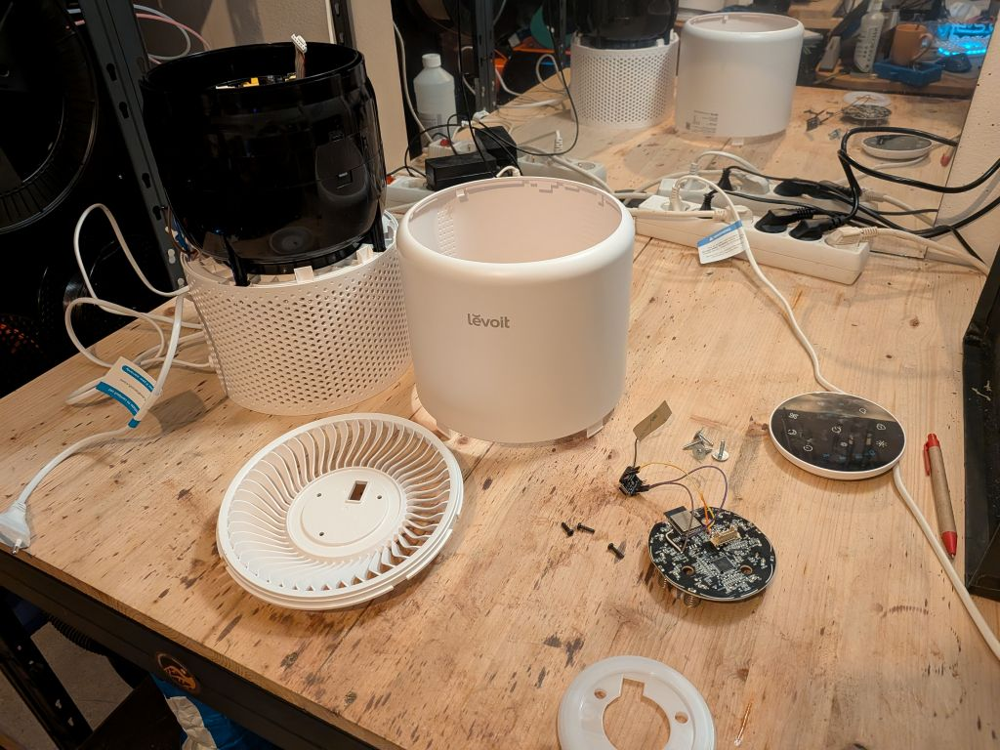

### PCB

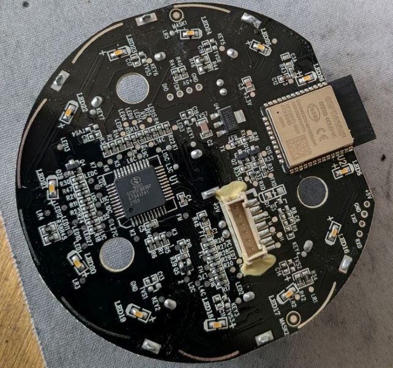

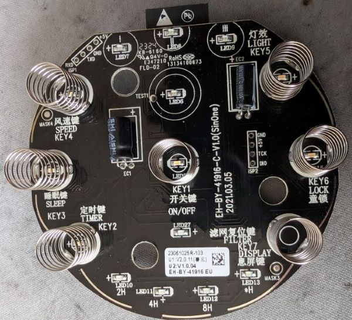

## 3. Flash the original ESP32

### Prerequisites

Solder wires to **TXD0, RXD0, IO0, GND** and connect them to a USB-UART converter (3.3V TTL).
On this board TXD0 and RXD0 are broken out on the **ISP1** header next to the
module, labelled `+5V`, `GND`, `TXD`, `RXD` (`ISP1` is printed on the other
side). Wire converter RX to `TXD` and converter TX to `RXD`. Use **ISP1**, not
the `RX` / `TX` test pads in the middle of the board; see
[Routes onto the device](#routes-onto-the-device).

On a Core 200S-P the header is labelled, left to right, `GND` `EN` `TXD` `RXD`
`IO0` `+5V` (photos by [@fuccimain](https://github.com/tuct/levoit/discussions/54)):

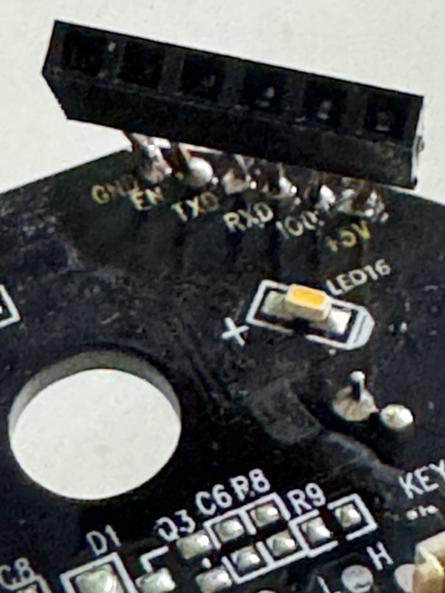 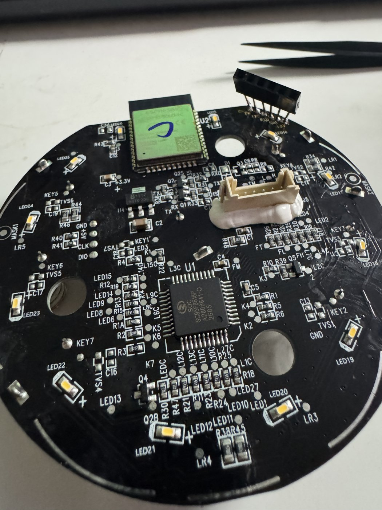

(`EN` and `IO0` are broken out here too, handy for the bootloader step below.)

**Power the board from its own +5V pad, not from the 3V3 of the USB-UART
converter.** The 3V3 output of a CP2102/CH340 adapter is too weak for the
module: the boot log then shows `Brownout detector was triggered` in a loop and
esptool reports flash ID `ff`/`ff` and "Failed to communicate with the flash
chip", which looks like a dead flash but is not. A 5 V / 1 A supply on the
**+5V** pad of the board (the on-board regulator makes the 3.3 V), with its GND
tied to the converter's GND, reads and writes the full 4 MB without a single
brownout. Leave the converter's 3V3 and 5V pins unconnected.

Connect **IO0 to GND before powering on** to enter bootloader mode. On the
ESP32-SOLO-1C, antenna up, IO0 is the bottom pin of the right-hand row (pin 25).

Seen on a Core 200S-P (ESP32-S0WD rev 1.0, 4 MB flash, manufacturer `0x20`
device `0x4016`): the stock image is a two-slot OTA layout (`ota_0` at
`0x10000`, `ota_1` at `0x190000`, plus `nvs`, `usercfg`, `storage` and `log`
partitions), so erase the whole flash before writing the ESPHome factory image.

### Board revisions: the MCU UART pins differ

The Core 200S and the Core 200S-P use the same ESP32-SOLO-1C and the same
protocol, but the two UART lines between the module and the MCU are wired the
other way round. The YAML files in this folder default to the Core 200S; on a
200S-P swap the two pins in `substitutions:` (that is the Core 300S/400S
mapping, see [#60](https://github.com/tuct/levoit/issues/60)).

| Board | Stock boot banner | `rx_pin` | `tx_pin` |
|-------|-------------------|----------|----------|
| Core 200S, MCU 2.0.11 | — | `GPIO17` | `GPIO16` |
| Core 200S-P, "Core200s_MCU", Hardware version 2.0, Wi-Fi FW 1.1.15 | `Device model: Core200s_MCU` / `Hardware version: 2.0` | `GPIO16` | `GPIO17` |

How to tell before flashing: with the stock firmware still on the module, the
boot banner on the debug pads (TXD0/RXD0, 115200 8N1) prints `Device model`,
`Hardware version` and `Firmware version`.

How to tell after flashing: the ESPHome log shows `>>> TX:` frames every few
seconds but never a received frame, `MCU Version` stays unknown and the fan
entity does not follow the buttons on the unit. Wi-Fi and the Home Assistant
connection work fine, so it looks like an ESPHome problem; it is only the two
pins.

### Backup Existing Firmware

```bash
esptool --baud 115200 read_flash 0 ALL levoit-core200s-backup.bin
```

Read it twice and compare the two files (`cmp`): a backup that differs between
two reads is not a backup. The image holds your Wi-Fi credentials and the
VeSync pairing, so keep it private.

> Note: backup may fail on some boards — proceed at your own risk.

Then [flash and, if needed, restore](../../docs/installing.md#3-flash-the-original-esp32):

```bash
esphome run levoit-core200s.yaml
```

Check the [component README](../../components/levoit/README.md) for UART pin
mapping per board.

## 4. Add your own ESP32 (recommended)

Replacing the original ESP32 lets you keep the original firmware intact and switch back easily.
This route uses the `RX` / `TX` test pads (the ESP32-to-MCU link), not the
`TXD` / `RXD` flashing pads on ISP1.

**Wiring (Seeed XIAO ESP32-S3):**

| PCB | XIAO ESP32-S3 |
|-----|----------|
| EN | GND |
| 3.3V | 3.3V |
| GND | GND |
| RX | GPIO05 (pad D4) |
| TX | GPIO04 (pad D3) |

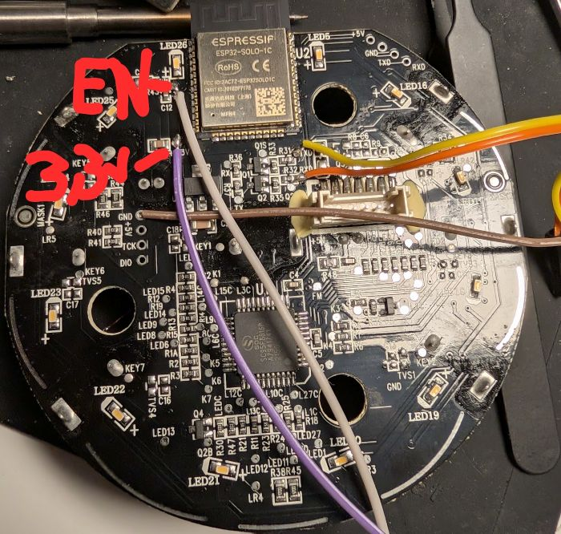

> Pull the `EN` pin of the original ESP32 to GND to disable it.

**Recommended modules:**
- [Seeed XIAO ESP32-S3](https://www.seeedstudio.com/XIAO-ESP32S3-p-5627.html?sensecap_affiliate=3gGMlPv&referring_service=link)
- [Seeed XIAO ESP32-C3](https://www.seeedstudio.com/Seeed-XIAO-ESP32C3-p-5431.html?sensecap_affiliate=3gGMlPv&referring_service=link)

[Wiring, parking the original, strapping pins](../../docs/installing.md#4-add-your-own-esp32)
in the install guide.

## 5. Assembly

**Placement of new ESP**

No room to fit the esp32! i placed mine outside in the airstream. I had to break out a small part to get the wires through.

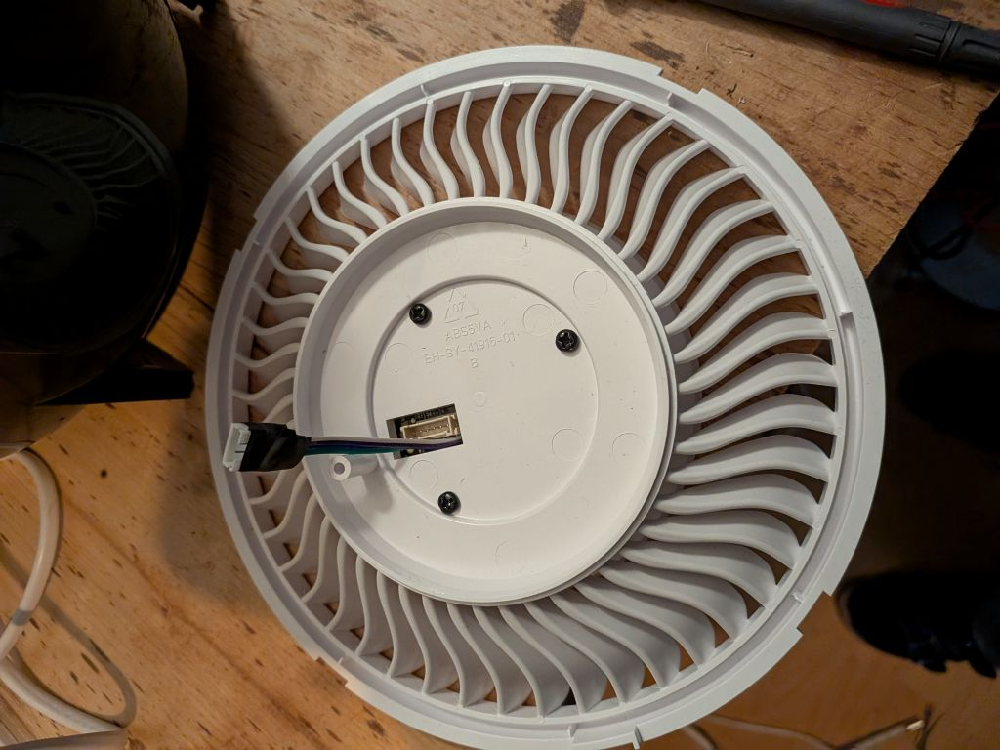

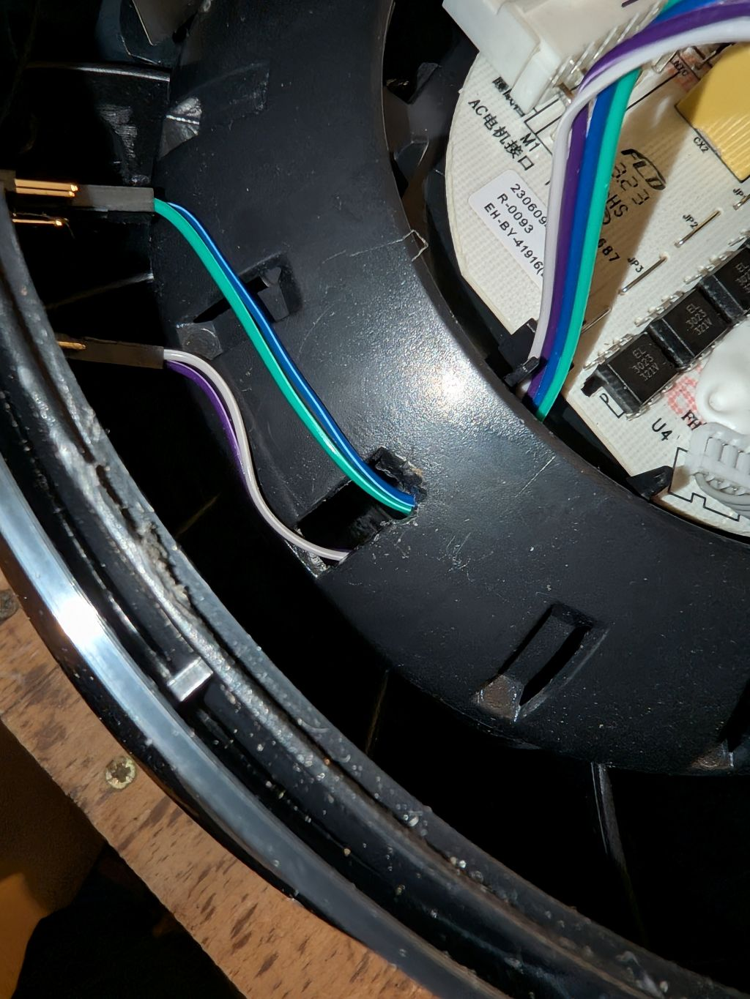

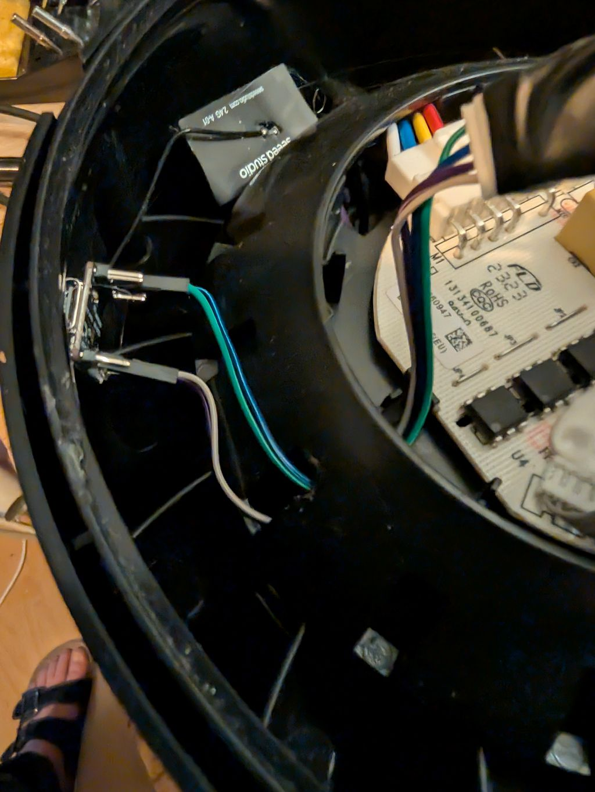

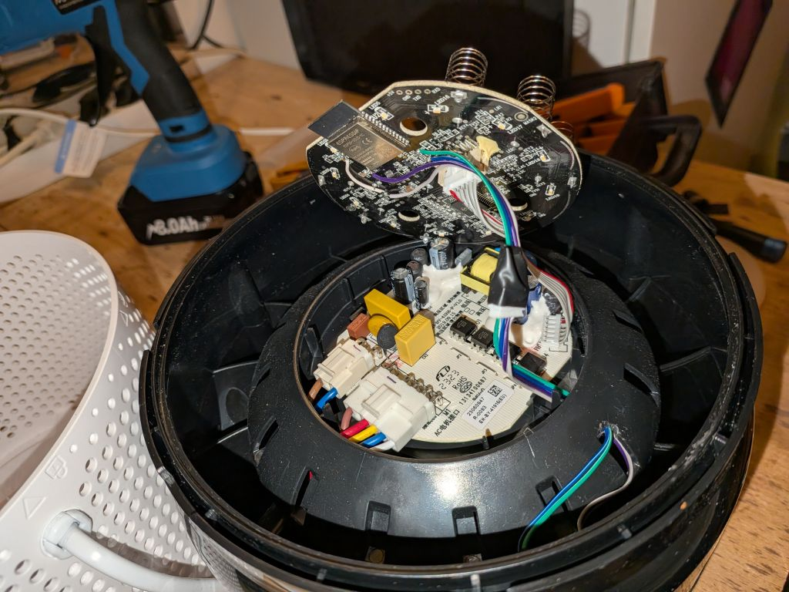

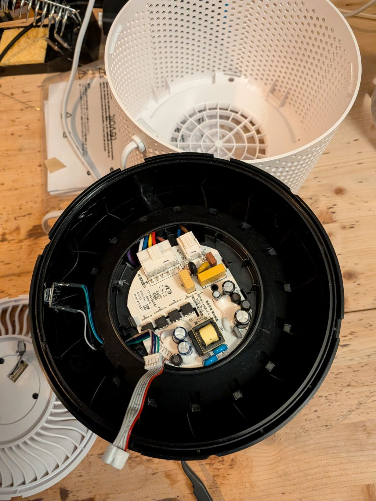

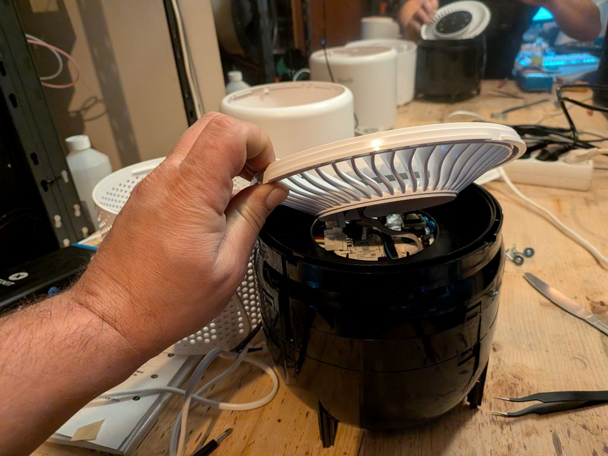

* Plug the logic board back in
* Screw the logic board / top module back in
* Fit the top sleeve back onto the base
* Refit the screws — they are soft metal, do not overtighten
* Filter and base cover back in

Reassemble and enjoy! [What to check](../../docs/installing.md#5-assembly)
once it is powered.

## Hardware & protocol notes

The UART protocol as captured from the stock firmware (status byte map, the
display byte pair, why filter life is not on the wire, commands, the symptoms
from [#60](https://github.com/tuct/levoit/issues/60)) is in
[PROTOCOL.md](./PROTOCOL.md).
