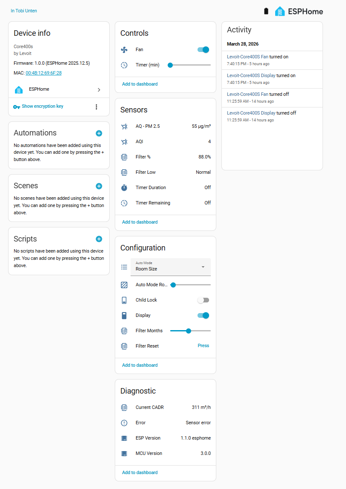
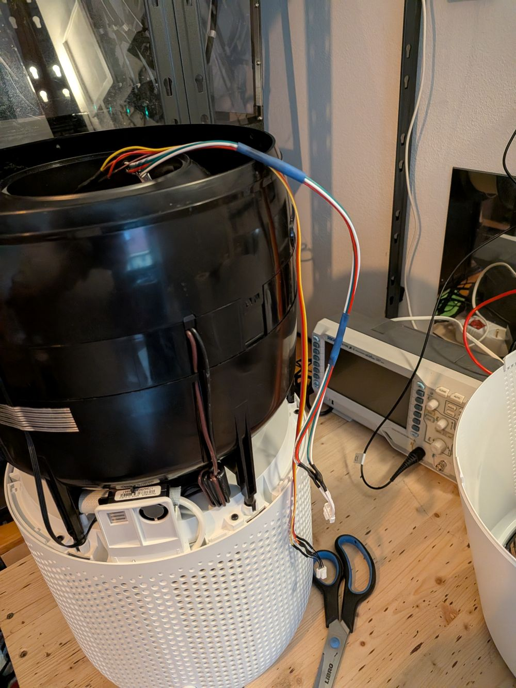
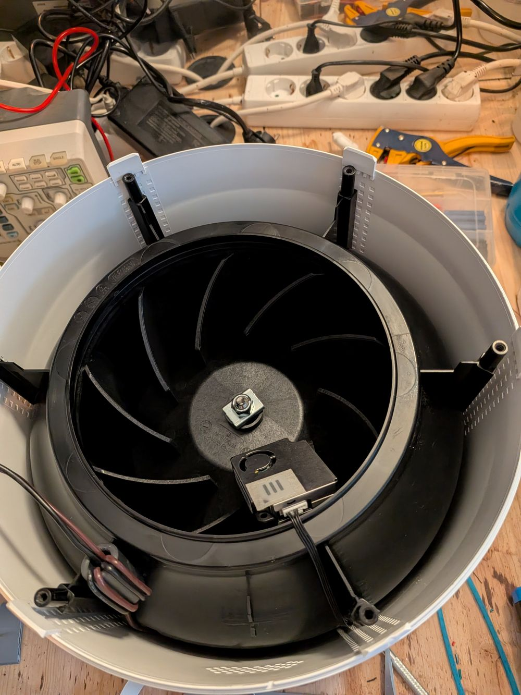
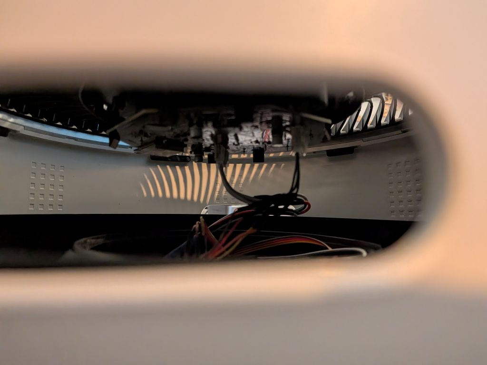
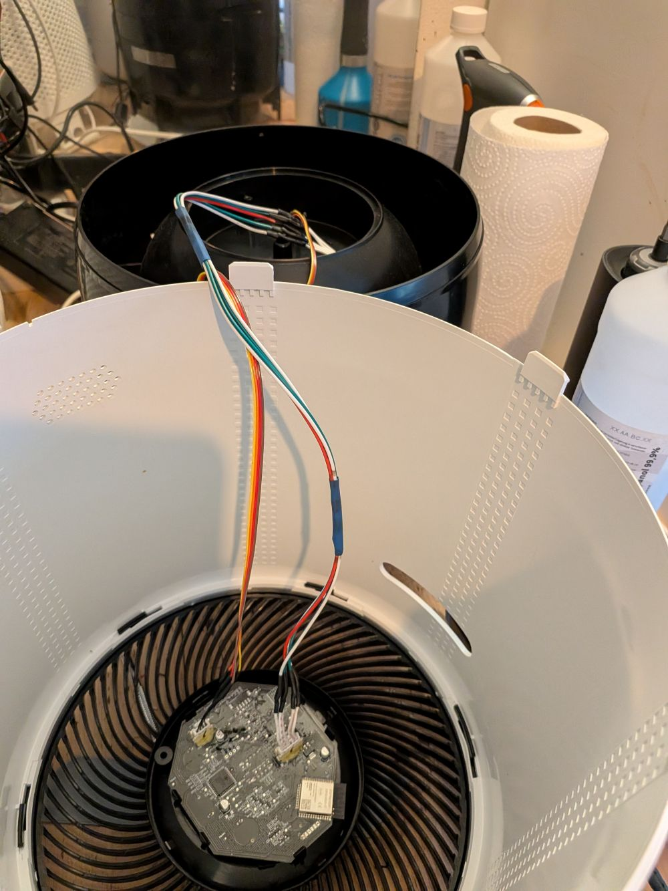
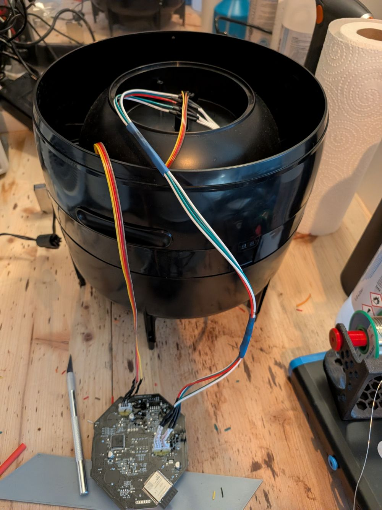
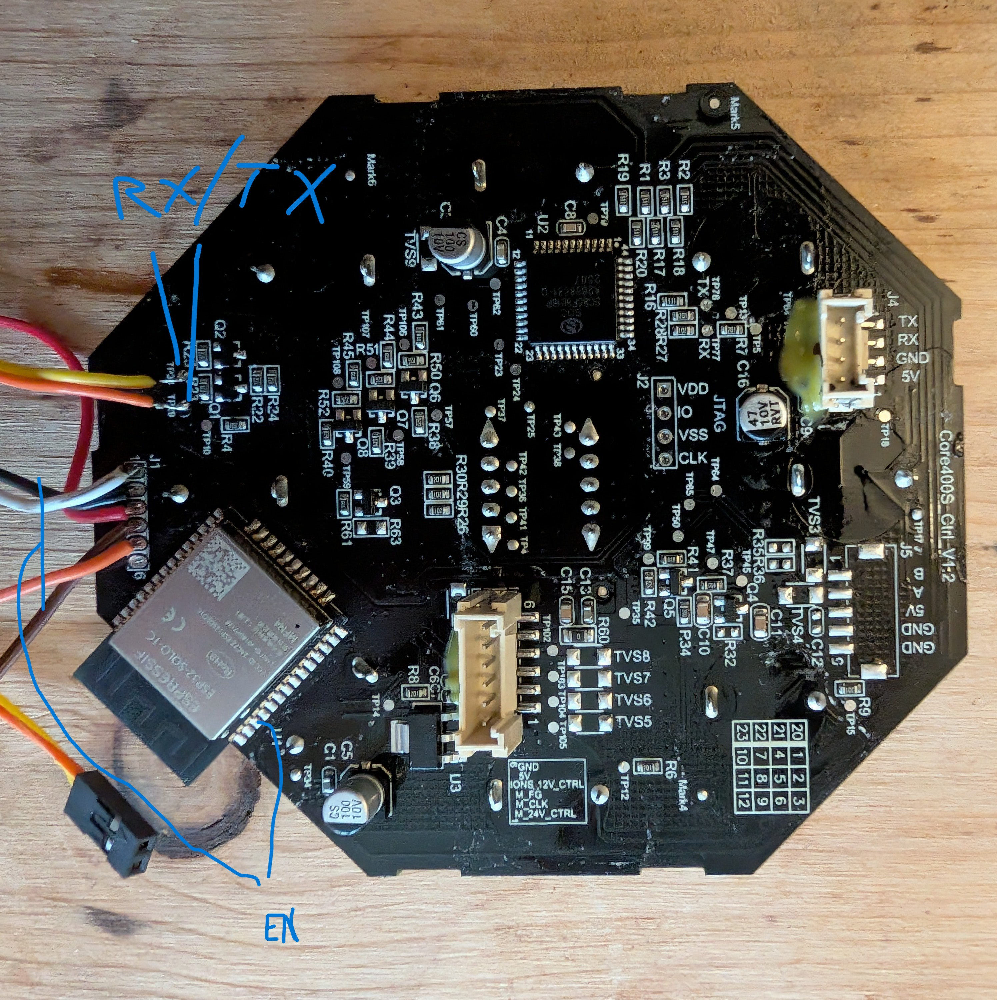

[← Back](../../README.md)

# Levoit Core 400S - Custom Firmware (ESPHome)

Started from community projects ([acvigue](https://github.com/acvigue/esphome-levoit-air-purifier), [mulcmu](https://github.com/mulcmu/esphome-levoit-core300s)) and evolved into a generic Levoit ESPHome component for Core/Vital models.

## Quick Facts

| Item | Value |
|------|-------|
| Model | Core 400S |
| Tested MCU FW | 3.0.0, 2.0.18 |
| ESP Module | ESP32-SOLO-1C (ESP32-S0WD rev v1.0, single core, 4 MB flash) |
| Board | CORE400S Ctrl V1.2, `Core400S_C_V2.2P2.2SP3` |
| Fan Speeds | 4 |
| CADR (spec) | 442 m³/h |
| Noise | 24–52 dB |
| Room Size | 9–38 m² (97–409 ft²) |
| ESPHome | 2026.5.3+ |
| PM Sensor | PM2008MS |

## Features

| Feature | Type | Notes |
|---------|------|-------|
| Fan | fan | 4 speeds, presets: Manual / Auto / Sleep |
| Fan Operating Mode | select | Manual / Sleep / Auto |
| Auto Mode | select | Default / Quiet / Room Size |
| Auto Mode Room Size | number | 9–38 m² |
| Display | switch | Toggle LED display |
| Child Lock | switch | |
| PM2.5 | sensor | µg/m³ |
| AQI | sensor | As reported by MCU |
| Current CADR | sensor | m³/h, updated every 5s |
| Filter Life Left | sensor | % remaining |
| Filter Low | binary_sensor | On when < 5% |
| Filter Lifetime | number | Configurable in months |
| Reset Filter Stats | button | Resets CADR/runtime counters |
| Timer | number | Run timer in minutes |
| MCU Version | text_sensor | |
| Error | text_sensor | "Ok" or "Sensor Error" |



## Confirmed board revisions

The same config works across revisions — no changes have been needed so far.

| Board silkscreen | MCU FW | Notes |
|------------------|--------|-------|
| `CORE400S Ctrl V1.2` | 3.0.0 | The original revision this guide was written against |
| `Core400S_C_V2.2P2.2SP3` | 2.0.18 | Reported in [#79](https://github.com/tuct/levoit/issues/79). `devices/levoit-core400s/levoit-core400s.yaml` unchanged in substance (esp32dev, esp-idf, `CONFIG_FREERTOS_UNICORE: y`, UART RX `GPIO16` / TX `GPIO17` at 115200), component at `ac0cffa`, ESPHome 2026.9.1. MCU frames decode immediately (ptype `B040`, model 3); PM2.5, AQI, filter life and the Error sensor all populate |

If you have a revision not listed, a short report is welcome — board silkscreen,
module marking, MCU FW from the **MCU Version** text sensor, and whether
anything needed changing.

### Known quirk: Auto Mode Room Size below its minimum

**Auto Mode Room Size** can read a value under the configured `min_value` of 9 —
`6` was reported on FW 2.0.18 ([#79](https://github.com/tuct/levoit/issues/79)).
The number reflects whatever the MCU currently holds, and the MCU appears to
park it at a placeholder when auto mode is not set to Room Size. That is the
reason the separate **Auto Mode Room Size Preset** number exists: it remembers
your intended target so selecting Room Size restores it, rather than inheriting
whatever Default or Quiet left behind.

Not yet investigated, so treat the placeholder explanation as unconfirmed. Set
Room Size once and the value should track what you asked for.

## Teardown / Disassembly

Very similar to Core 300S but the PCB needs to be unclipped from the carry holes after removing the filter and filter housing.

* Place upside down, remove base cover and filter to expose 8 screws (4 have washers)
* Remove all 8 screws — they are soft metal, do not overtighten when reassembling
* Slide a pry tool between the tabs to separate base and top sleeve
* Unplug the logic board (use a screwdriver or kitchen knife from the side)
* Remove the fan unit to access the logic board

I had to use extended wires for re-assembly, did not find another way!












### J1 Debug Header Pinout

| Pin | Signal |
|-----|--------|
| 1 | TX |
| 2 | RX |
| 3 | GND |
| 4 | 3.3V |
| 5 | IO0 |
| 6 | EN |

## Install New ESP32 (Recommended)

Replacing the original ESP32 lets you keep the original firmware intact and switch back easily.

**Recommended modules:**
- Seeed XIAO ESP32-C3
- Seeed XIAO ESP32-S3

**Wiring:** 4 wires — `+3.3V`, `GND`, `RX`, `TX`

> The RX/TX pads are **not** on the pin header — use the test pads near the original ESP32 on the board.
> Pull the `EN` pin of the original ESP32 to GND to disable it.
> One of the pins on the pinheader is EN and GND, you need a multimeter to check!
> Not sure which oin is RX/TX but simply change if you got it wrong




## Flash Original ESP32

### Prerequisites

Connect to the J1 debug header (or solder to TXD0/RXD0/IO0/+3V3/GND) with a USB-UART converter (3.3V TTL).

Connect **IO0 to GND before powering on** to enter bootloader mode.

### Backup Existing Firmware

```bash
esptool read_flash 0 ALL levoit-core400s-backup.bin
```

> Note: may fail if watchdog-protected. Try while the PCB is externally powered.
>
> **Keep the baud rate low.** A full-flash read at `-b 460800` has been reported
> failing partway through over jumper wires; plain 115200 completed, and two
> identical reads confirmed it. Verify any backup by reading twice and comparing
> before you rely on it.

The board can be flashed with the logic board **out of the unit**, powered from
the 3.3 V on J1 — the fan MCU runs from it on the bench, so the sensors come up
and you can confirm the UART link before reassembling.

### Configure

1. Copy `secrets-example.yaml` → `secrets.yaml` and fill in your Wi-Fi and encryption key
2. Adjust the device name in the config if running multiple units
3. Check the [component README](../../components/levoit/README.md) for UART pin mapping per board

### Flash

```bash
esphome run levoit-core400s.yaml
```

Reassemble and enjoy!

### ESPHome Web Builder / Dashboard

Use the pre-generated builder yaml to flash without a local clone — all config is inlined, no `!include` or packages needed:

| File | Board |
|------|-------|
| `levoit-core400s-builder.yaml` | original ESP32-SOLO-1C |
| `levoit-core400s-builder-c3.yaml` | ESP32-C3 replacement |
| `levoit-core400s-builder-s3.yaml` | ESP32-S3 replacement |

Upload to the [ESPHome web builder](https://builder.esphome.io) or paste into the ESPHome dashboard. Regenerate with `.\make-builder-yaml.ps1` from the `devices/` folder.

### Restore Original Firmware

```bash
esptool erase_flash
esptool write_flash 0x00 levoit-core400s-backup.bin
```
