[← Back](../../README.md)

# Levoit Core 400S - Custom Firmware (ESPHome)

Started from community projects ([acvigue](https://github.com/acvigue/esphome-levoit-air-purifier), [mulcmu](https://github.com/mulcmu/esphome-levoit-core300s)) and evolved into a generic Levoit ESPHome component for Core/Vital models.

## Quick Facts

| Item | Value |
|------|-------|
| Model | Core 400S |
| Tested MCU FW | 3.0.0, 2.0.18 |
| ESP Module | ESP32-SOLO-1C (ESP32-S0WD rev v1.0, single core, 4 MB flash) |
| MCU | SinOne SC95F8616P, LQFP-48: a 1T 8051 core with 64 KB flash (U2 on the CORE400S Ctrl V1.2, marking in `images/pcp_front.jpg`; the `Core400S_C_V2.2P2.2SP3` board is not photographed) |
| Board | CORE400S Ctrl V1.2, `Core400S_C_V2.2P2.2SP3` |
| Fan Speeds | 4 |
| CADR (spec) | 442 m³/h |
| Noise | 24–52 dB |
| Room Size | 9–38 m² (97–409 ft²) |
| ESPHome | 2026.6.0+ |
| PM Sensor | PM2008MS |

## Features

| Feature | Type | Notes |
|---------|------|-------|
| Fan | fan | 4 speeds, presets: Manual / Auto / Sleep |
| Fan Operating Mode | select | Manual / Sleep / Auto |
| Auto Mode | select | Default / Quiet / Room Size |
| Auto Mode Room Size | number | 9–38 m² |
| Display | switch | Toggle LED display |
| Child Lock | switch | |
| PM2.5 | sensor | µg/m³ |
| AQI | sensor | As reported by MCU |
| Current CADR | sensor | m³/h, updated every 5s |
| Filter Life Left | sensor | % remaining |
| Filter Low | binary_sensor | On when < 5% |
| Filter Lifetime | number | Configurable in months |
| Reset Filter Stats | button | Resets CADR/runtime counters |
| Timer | number | Run timer in minutes |
| MCU Version | text_sensor | |
| Error | text_sensor | "Ok" or "Sensor Error" |

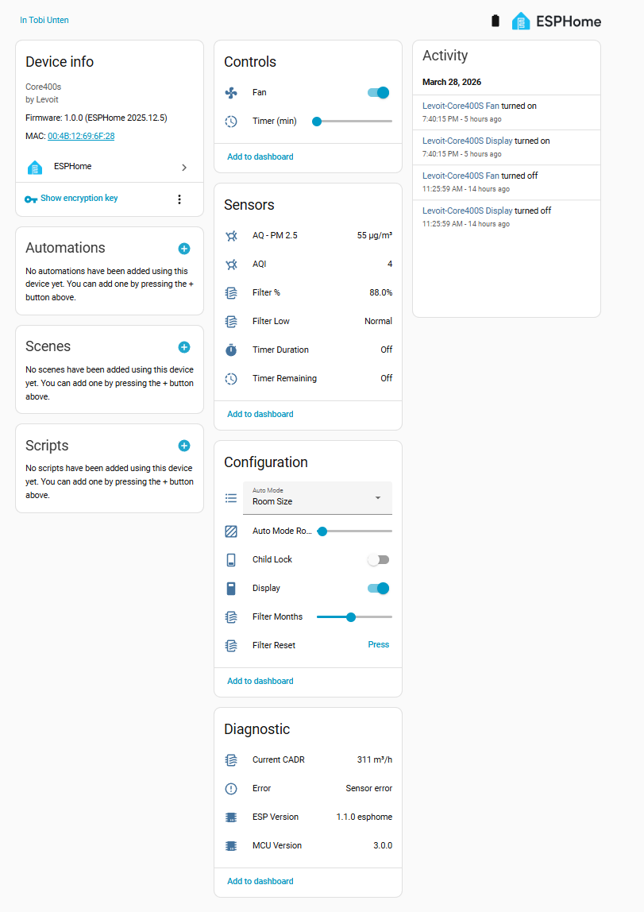

## Confirmed board revisions

The same config works across revisions — no changes have been needed so far.

| Board silkscreen | MCU FW | Notes |
|------------------|--------|-------|
| `CORE400S Ctrl V1.2` | 3.0.0 | The original revision this guide was written against |
| `Core400S_C_V2.2P2.2SP3` | 2.0.18 | Reported in [#79](https://github.com/tuct/levoit/issues/79). `devices/levoit-core400s/levoit-core400s.yaml` unchanged in substance (esp32dev, esp-idf, `CONFIG_FREERTOS_UNICORE: y`, UART RX `GPIO16` / TX `GPIO17` at 115200), component at `ac0cffa`, ESPHome 2026.9.1. MCU frames decode immediately (ptype `B040`, model 3); PM2.5, AQI, filter life and the Error sensor all populate |

If you have a revision not listed, a short report is welcome — board silkscreen,
module marking, MCU FW from the **MCU Version** text sensor, and whether
anything needed changing.

### Known quirk: Auto Mode Room Size below its minimum

**Auto Mode Room Size** can read a value under the configured `min_value` of 9 —
`6` was reported on FW 2.0.18 ([#79](https://github.com/tuct/levoit/issues/79)).
The number reflects whatever the MCU currently holds, and the MCU appears to
park it at a placeholder when auto mode is not set to Room Size. That is the
reason the separate **Auto Mode Room Size Preset** number exists: it remembers
your intended target so selecting Room Size restores it, rather than inheriting
whatever Default or Quiet left behind.

Not yet investigated, so treat the placeholder explanation as unconfirmed. Set
Room Size once and the value should track what you asked for.

## Teardown / Disassembly

Very similar to Core 300S but the PCB needs to be unclipped from the carry holes after removing the filter and filter housing.

* Place upside down, remove base cover and filter to expose 8 screws (4 have washers)
* Remove all 8 screws — they are soft metal, do not overtighten when reassembling
* Slide a pry tool between the tabs to separate base and top sleeve
* Unplug the logic board (use a screwdriver or kitchen knife from the side)
* Remove the fan unit to access the logic board

I had to use extended wires for re-assembly, did not find another way!

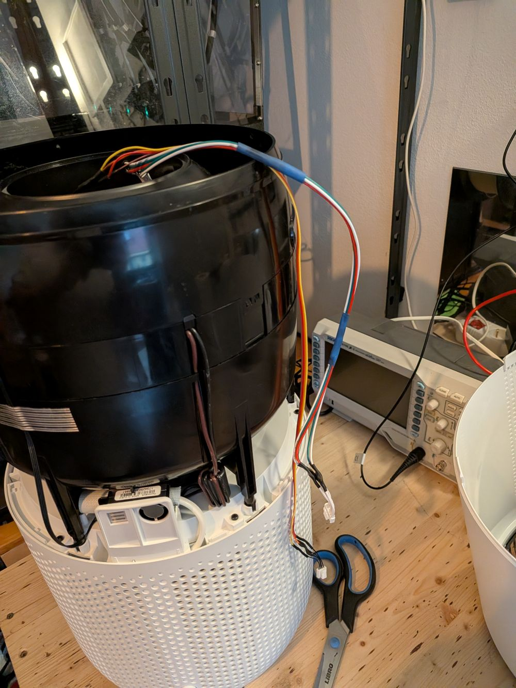

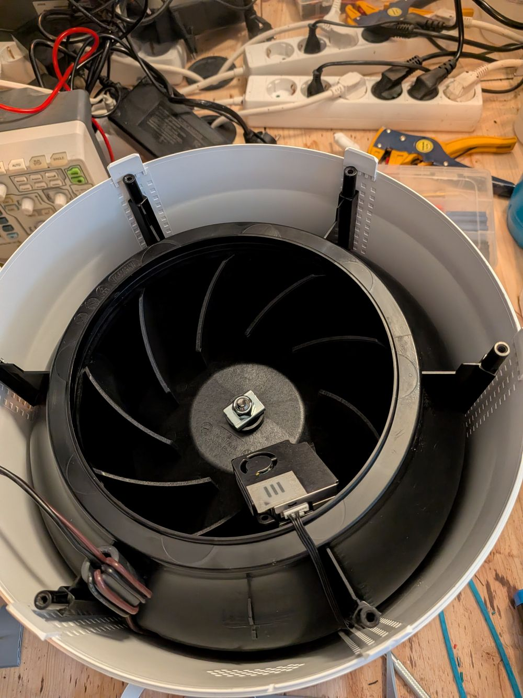

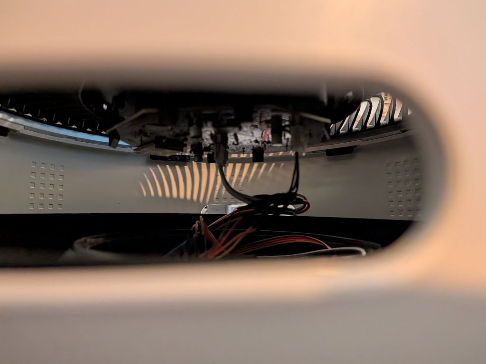

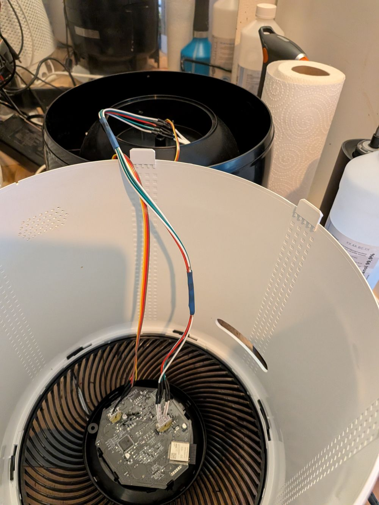

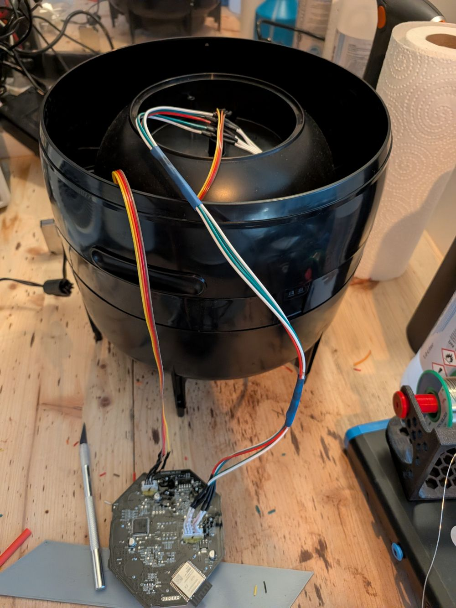

### Opening it without extension wires

Two community methods that avoid extending the stock cables, both from
[discussion #33](https://github.com/tuct/levoit/discussions/33):

**Twist off the top** (kocy33, on a `CORE400S Ctrl V1.2`):

1. Remove the 6 screws in the filter compartment, as above. Without them the top
   does not come off.
2. Work about 11 plastic picks (e.g. iFixit picks) in around the top to release
   the clips, then twist the black top part **counterclockwise** and lift it.
3. Unplug the cables with the top off, work on the board in comfort, and
   reassemble without extending anything.

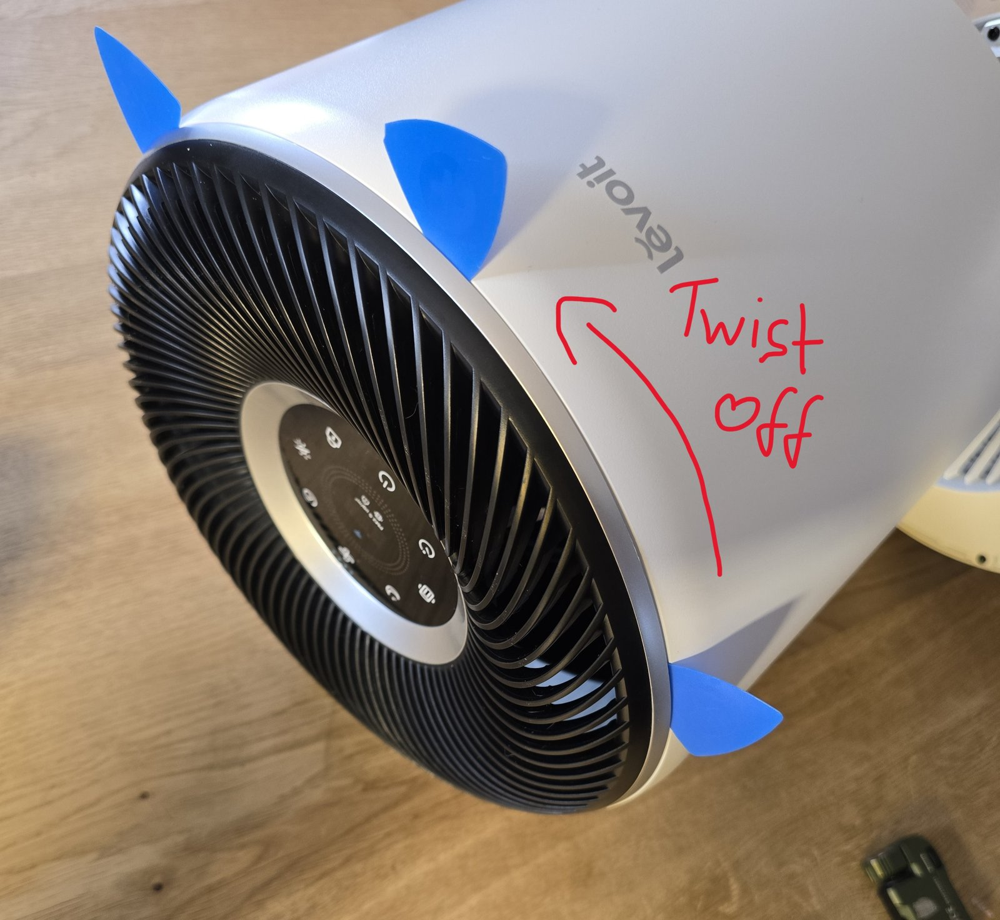 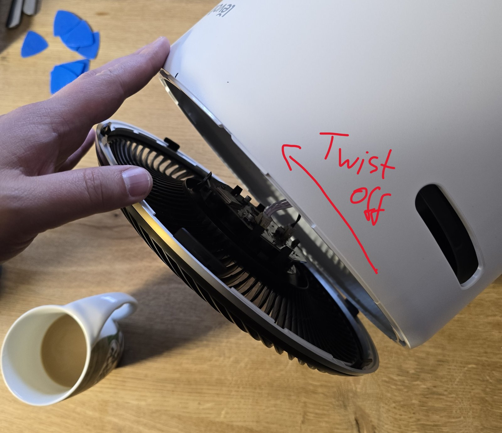 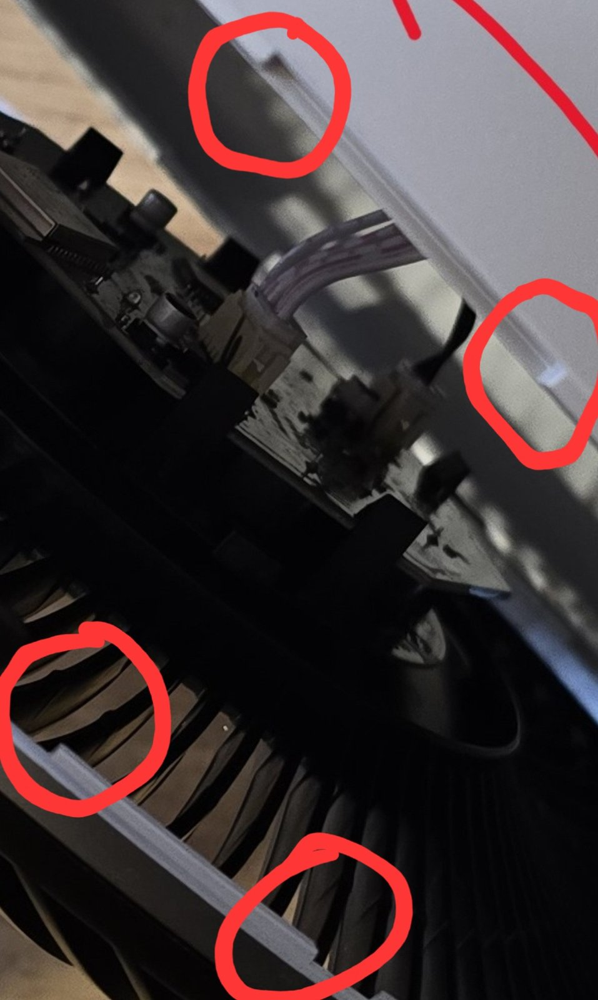

**Reach in through the handle** (EdenNelson): split the unit in the middle as
described above, then plug and unplug the connectors through the handle opening
with long (12-inch) cooking tweezers or hemostats. Soldering a JST-PH 2.0 mm
6-pin connector onto the board for the flash cable then lets you reconnect it
later, to flash the stock firmware or ESPHome again, without taking everything
apart.

### J1 Debug Header Pinout

| Pin | Signal |
|-----|--------|
| 1 | TX |
| 2 | RX |
| 3 | GND |
| 4 | 3.3V |
| 5 | IO0 |
| 6 | EN |

## Routes onto the device

Three ways to put ESPHome on this unit. The two soldering routes use
**different serial pads**, so pick one before you solder anything.

| Route | Teardown | Serial pads | Original firmware |
|-------|----------|-------------|-------------------|
| [Over the air](#flash-over-the-air--no-disassembly-third-party) | **none** | — | Overwritten (third-party proof of concept, hijacks the stock OTA over the LAN) |
| [Install a new ESP32](#install-new-esp32-recommended) | full | `RX` / `TX` test pads near the original ESP32: the link between the ESP32 and the MCU | Kept, the stock module is only disabled (`EN` to GND) |
| [Flash the original ESP32](#flash-original-esp32) | full + soldering | [J1 debug header](#j1-debug-header-pinout) pins 1 (`TX`) and 2 (`RX`): the ESP32's own UART0 | Overwritten, so back it up first |

The two soldering routes are below; the over-the-air route is at the
[end of this guide](#flash-over-the-air--no-disassembly-third-party).

> **Don't flash through the `RX` / `TX` test pads.** They are the ESP32-to-MCU
> link, so esptool can't reach the bootloader through them (`No serial data
> received`, `Invalid head of packet (0xFF)`). A lifted `RX` pad also breaks the
> MCU's replies to ESPHome later: commands still work, but no frame ever arrives
> and `MCU Version` stays unknown. Remove flashing wires with heat, never by
> pulling. This is what happened on a Core 200S-P; see that guide.

## Install New ESP32 (Recommended)

Replacing the original ESP32 lets you keep the original firmware intact and switch back easily.
This route uses the `RX` / `TX` test pads near the original ESP32 (the
ESP32-to-MCU link), not J1.

**Recommended modules:**
- Seeed XIAO ESP32-C3
- Seeed XIAO ESP32-S3

**Wiring:** 4 wires — `+3.3V`, `GND`, `RX`, `TX`

> The RX/TX pads are **not** on the pin header — use the test pads near the original ESP32 on the board.
> Pull the `EN` pin of the original ESP32 to GND to disable it.
> One of the pins on the pinheader is EN and GND, you need a multimeter to check!
> Not sure which oin is RX/TX but simply change if you got it wrong

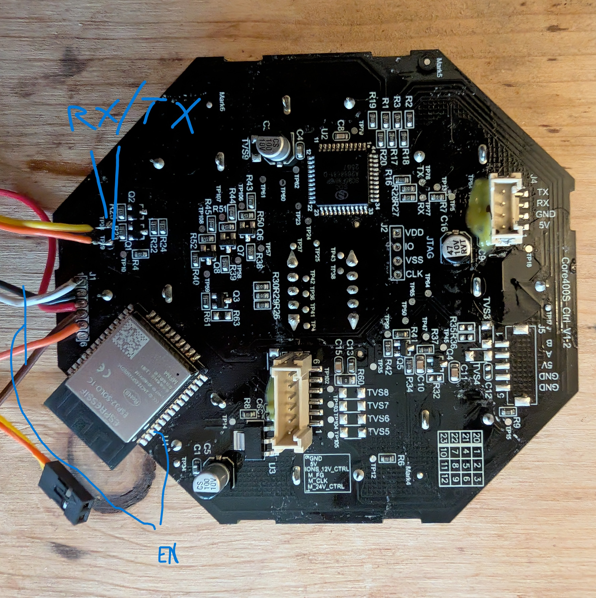

#### On the `CORE400S Ctrl V1.2`

kocy33 found the pads and wired a Seeed XIAO ESP32-C3 on this revision
([discussion #33](https://github.com/tuct/levoit/discussions/33)):

| What | Where |
|------|-------|
| MCU link | test pads **TP33** (marked RX) and **TP29** (marked TX), next to Q1 / Q2 / R23 / R25. If the MCU does not answer, swap `rx_pin` / `tx_pin` |
| 5 V for the new ESP | the **5V** pin of header **J4** (its pins are labelled TX, RX, GND, 5V); kocy33 powered the C3 from it |

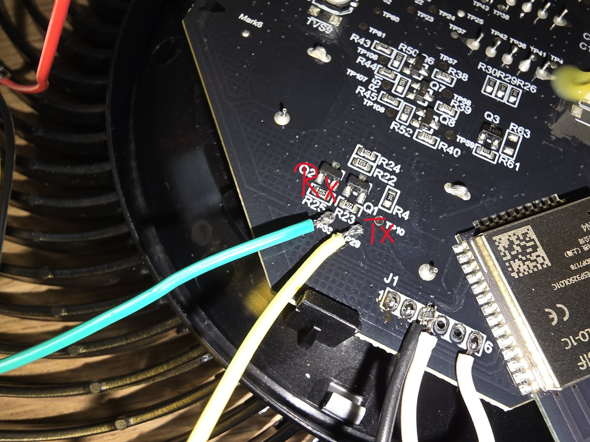 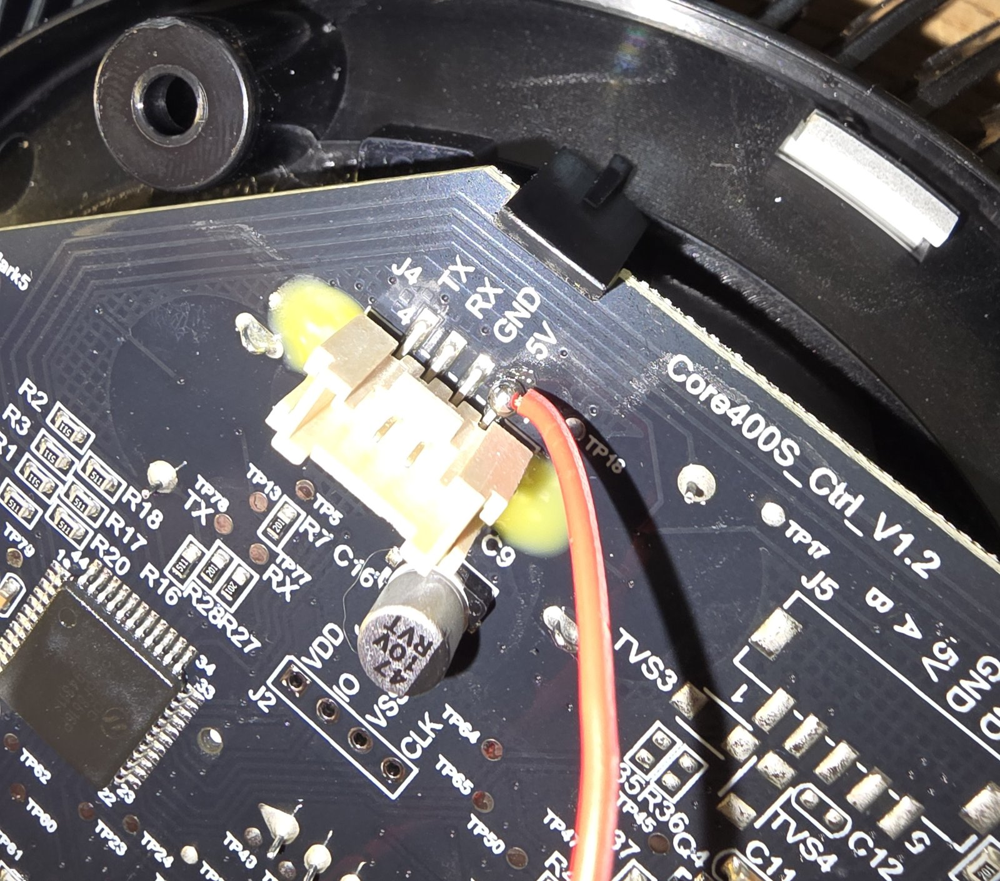

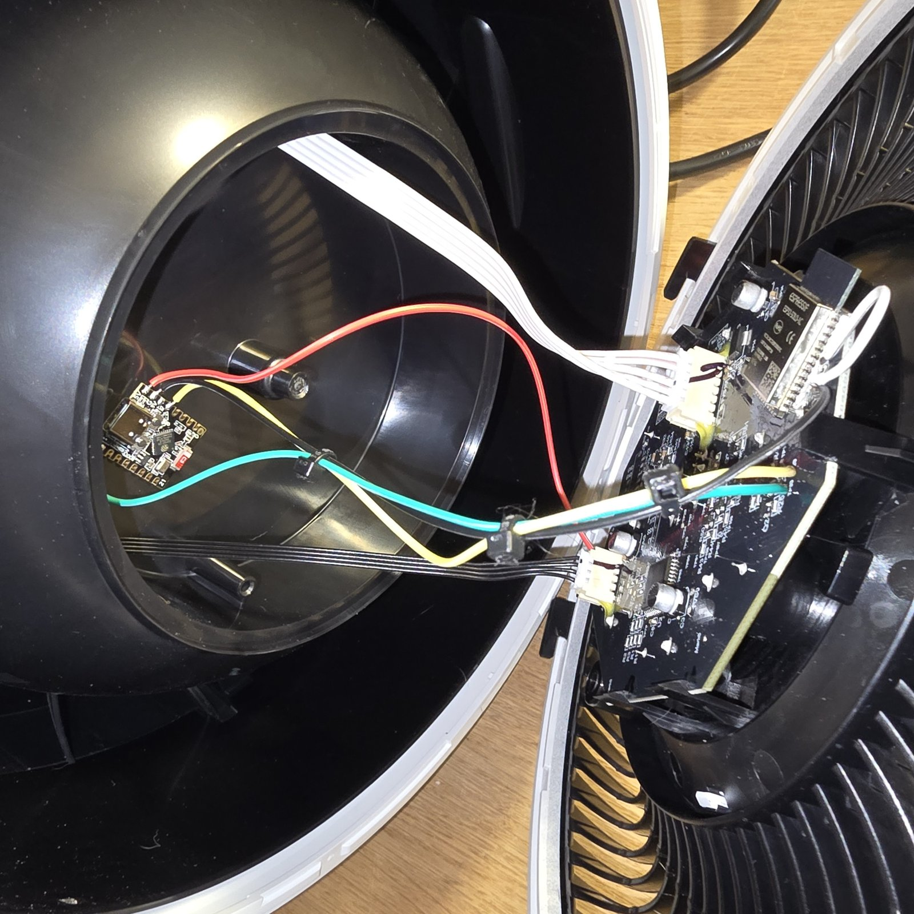 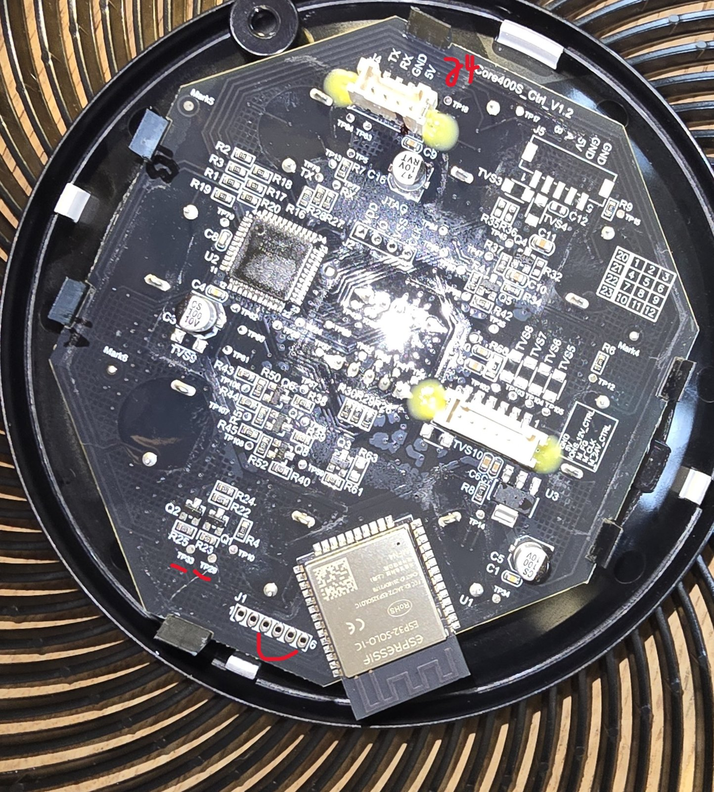


## Flash Original ESP32

### Prerequisites

Connect a USB-UART converter (3.3V TTL) to the **J1 debug header**: converter
RX to J1 pin 1 (`TX`), converter TX to pin 2 (`RX`), GND to pin 3 and 3.3 V to
pin 4. J1's `TX` / `RX` are the ESP32's own UART0. The `RX` / `TX` test pads
near the module are the MCU link and won't work for flashing; see
[Two routes, two sets of pads](#two-routes-two-sets-of-pads). If you can't use
J1, the same signals are the module's own TXD0 / RXD0 / IO0 / +3V3 / GND pins.

Connect **IO0 (J1 pin 5) to GND before powering on** to enter bootloader mode.
Leave `EN` (pin 6) unconnected: pulling it to GND holds the ESP32 off.

### Backup Existing Firmware

```bash
esptool read_flash 0 ALL levoit-core400s-backup.bin
```

> Note: may fail if watchdog-protected. Try while the PCB is externally powered.
>
> **Keep the baud rate low.** A full-flash read at `-b 460800` has been reported
> failing partway through over jumper wires; plain 115200 completed, and two
> identical reads confirmed it. Verify any backup by reading twice and comparing
> before you rely on it.

The board can be flashed with the logic board **out of the unit**, powered from
the 3.3 V on J1 — the fan MCU runs from it on the bench, so the sensors come up
and you can confirm the UART link before reassembling.

### Configure

1. Copy `secrets-example.yaml` → `secrets.yaml` and fill in your Wi-Fi and encryption key
2. Adjust the device name in the config if running multiple units
3. Check the [component README](../../components/levoit/README.md) for UART pin mapping per board

### Flash

```bash
esphome run levoit-core400s.yaml
```

Reassemble and enjoy!

### ESPHome Web Builder / Dashboard

Use the pre-generated builder yaml to flash without a local clone — all config is inlined, no `!include` or packages needed:

| File | Board |
|------|-------|
| `levoit-core400s-builder.yaml` | original ESP32-SOLO-1C |
| `levoit-core400s-builder-c3.yaml` | ESP32-C3 replacement |
| `levoit-core400s-builder-s3.yaml` | Seeed XIAO ESP32-S3 replacement |

Upload to the [ESPHome web builder](https://builder.esphome.io) or paste into the ESPHome dashboard. Regenerate with `.\make-builder-yaml.ps1` from the `devices/` folder.

### Restore Original Firmware

```bash
esptool erase_flash
esptool write_flash 0x00 levoit-core400s-backup.bin
```

## Flash Over the Air — No Disassembly (third-party)

The same no-soldering trick documented for the Core 300S works on the Core
400S. [**nico202/levoit-core300s-ota-wifi-flash**](https://github.com/nico202/levoit-core300s-ota-wifi-flash)
gets ESPHome onto the **stock ESP32 without opening the unit**, by redirecting
the device's own firmware download over the LAN. See the
[Core 300S guide](../levoit-core300s/README.md#flash-over-the-air--no-disassembly-third-party)
for the full walkthrough and the [protocol notes](https://github.com/nico202/levoit-core300s-ota-wifi-flash/blob/main/docs/protocol.md);
the stock ESP32 has **no Secure Boot**, so any ESPHome image wrapped in VeSync's
128-byte OTA header is accepted.

Confirmed on a **Core 400S** by [@iNDi](https://github.com/tuct/levoit/issues/76)
with one change: on that unit's firmware the **region field is at header offset
76, not 77** (adjust `make_ota.py`). The announced version must still match
exactly.

> **A third-party proof of concept, not tested by this project, and not part of
> it.** Redirecting network traffic you do not own may be illegal where you
> live, and a failed flash can leave the unit needing the soldered route to
> recover. At your own risk, on your own hardware.

Once ESPHome is running, the device is ordinary: `esphome run` / `upload` work
over Wi-Fi, and the [Levoit ESPHome Home Assistant integration](https://github.com/tuct/levoit-esphome-ha)
keeps it updated over the air — no cloud trick ever again.
