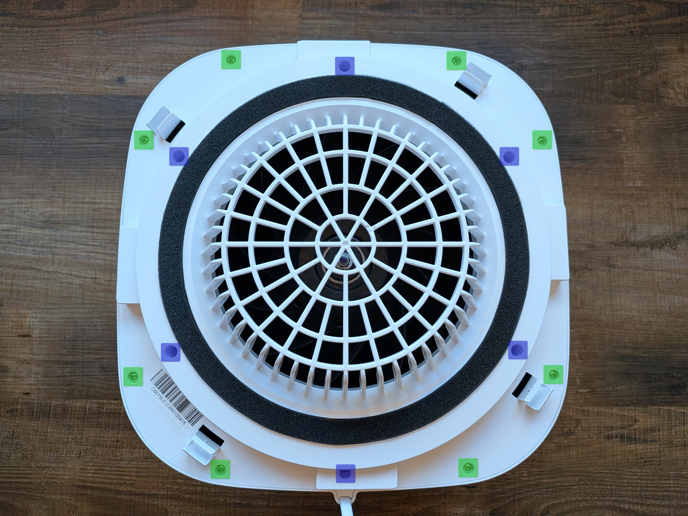
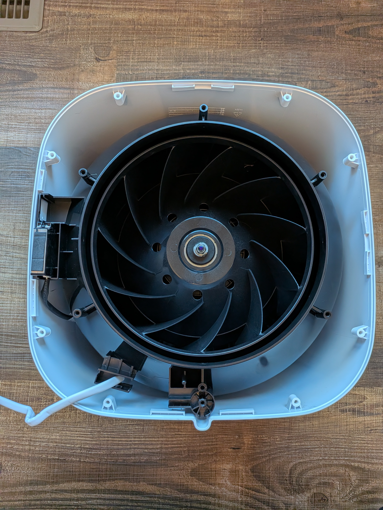
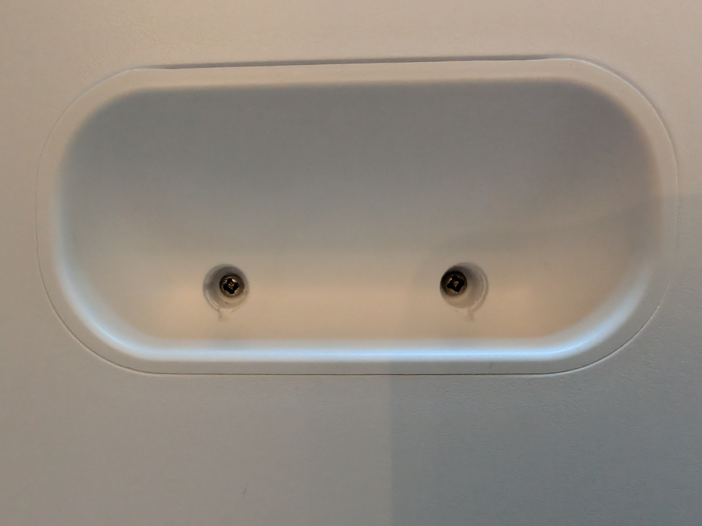
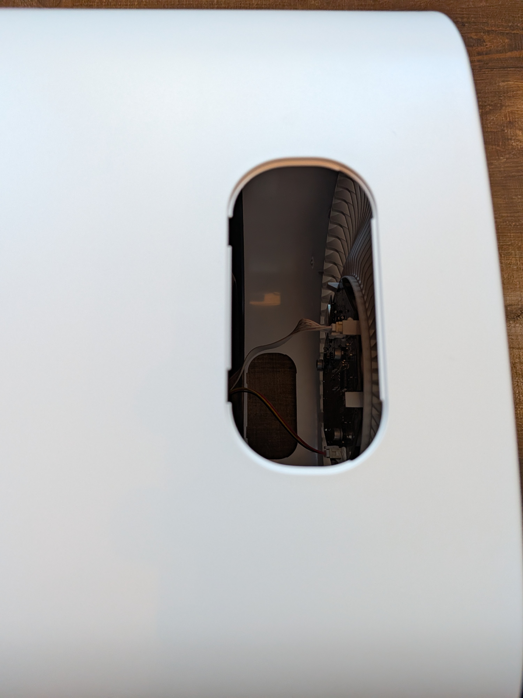
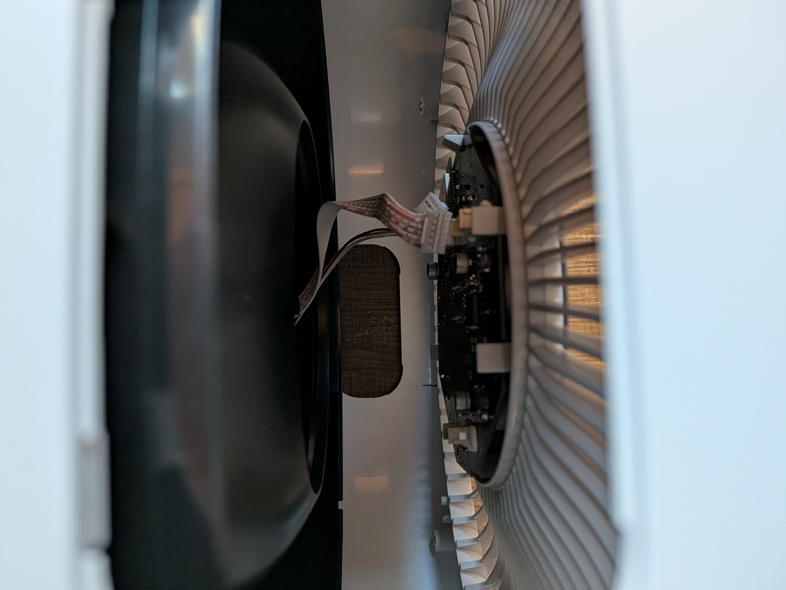
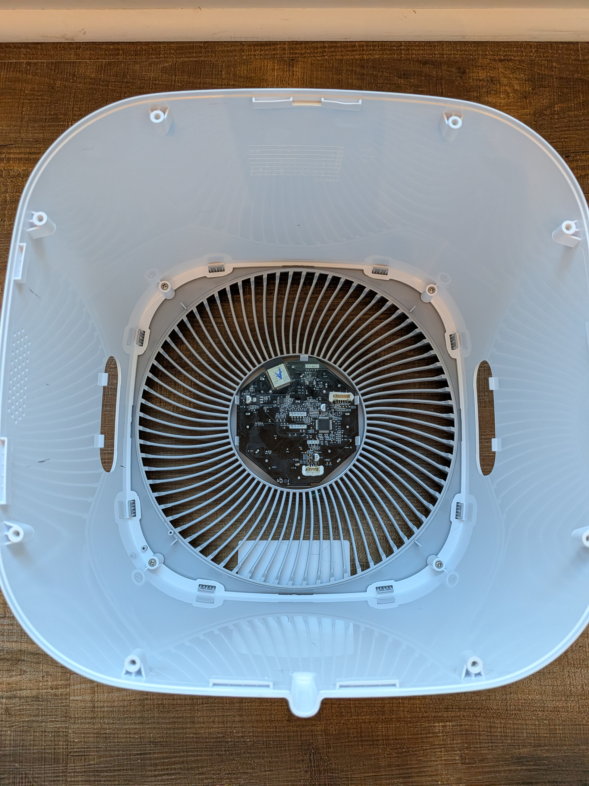
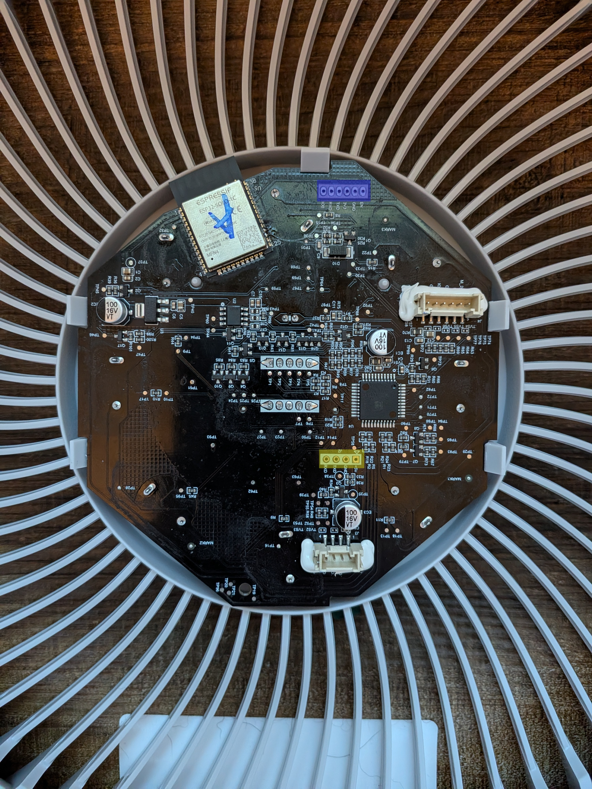

[← Back](../../README.md)

# Levoit Core 600S - Custom Firmware (ESPHome)

ESPHome on the Core 600S, through the `levoit` component, in Home Assistant
without the cloud. Supported. Adding your own ESP32 is the recommended route;
check which module your unit has before flashing the original. The steps
shared by all devices are in the [install guide](../../docs/installing.md);
this page has what is particular to the Core 600S.

## Quick Facts

| Item | Value |
|------|-------|
| Model | Core 600S |
| Tested MCU FW | 2.0.1 |
| ESP Module | ESP32-C3-SOLO-1 |
| Fan Speeds | 4 |
| CADR (spec) | 641 m³/h |
| Noise | 26–54 dB |
| Room Size | 9–147 m² (97–1,582 ft²) |
| ESPHome | 2026.6.0+ |
| PM Sensor | Luftme LD15 |

## Features

| Feature | Type | Notes |
|---------|------|-------|
| Fan | fan | 4 speeds, presets: Manual / Auto / Sleep |
| Auto Mode | select | Default / Quiet / Room Size / ECO |
| Auto Mode Room Size | number | 9–147 m² |
| Display | switch | Toggle LED display |
| Child Lock | switch | |
| Light Detect | switch | Auto-dims display when ambient light is low |
| PM2.5 | sensor | µg/m³ |
| AQI | sensor | As reported by MCU |
| Current CADR | sensor | m³/h, updated every 5s |
| Filter Life Left | sensor | % remaining |
| Filter Low | binary_sensor | On when < 5% |
| Filter Lifetime | number | Configurable in months |
| Reset Filter Stats | button | Resets CADR/runtime counters |
| Timer | number | Run timer in minutes |
| MCU Version | text_sensor | |
| Error | text_sensor | "Ok" or "Sensor Error" |

## 1. Build the firmware

**With Home Assistant (recommended):** [Levoit ESPHome](https://github.com/tuct/levoit-esphome-ha)
→ *Add device* → **Core 600S** → the original ESP, Seeed XIAO ESP32-C3 or
ESP32-S3. [Step by step](../../docs/installing.md#with-home-assistant-recommended).

**Manually:** the files in this folder, built with the ESPHome CLI or pasted
into the Device Builder; choose the config matching your module.
[Step by step](../../docs/installing.md#manually).

| Board | ESPHome CLI | Device Builder / web builder |
|-------|-------------|------------------------------|
| original ESP32-SOLO-1C | `levoit-core600s.yaml` | `levoit-core600s-builder.yaml` |
| Seeed XIAO ESP32-C3 | `levoit-core600s-c3.yaml` | `levoit-core600s-builder-c3.yaml` |
| Seeed XIAO ESP32-S3 | `levoit-core600s-s3.yaml` | `levoit-core600s-builder-s3.yaml` |

```bash
esphome run levoit-core600s-c3.yaml
```

```bash
esphome run levoit-core600s-s3.yaml
```

## 2. Disassembly

Remove the base and filter from the upper assembly. Turn upside down.



Remove the screws highlighted in green. You can also remove the screws highlighted in blue to remove the fan grille and gasket piece to make removing the fan less unwieldy. In that case, the PM2.5 sensor will be lose so be careful.



To release the fan, remove the screws hidden behind plastic plugs in each of the handle.



Then pop the handles out and carefully slide the fan assembly out slightly. There are a couple of cables connecting to the control board which is clipped into the top fan grille. Luckily the holes left by the handles make it relatively easy to unplug these from the connectors on the control board.



Carefully unplug these cables before pulling the fan assembly out.



That will get you access to flash the ESP32.



## 3. Flash the original ESP32

They were nice enough to silkscreen the ESP32 programming header on both sides so you don't even need to remove the board from the case if you don't want to. Make note of which ESP32 you have if you're not going to replace it. **ESP32-C3-SOLO-1** and **ESP32-SOLO-1C** have been found so far.

The header for the ESP32 is highlighted in blue. Connect your UART adapter here, making sure you get TX and RX the right way around. TX and RX on this board are TX and RX of the ESP32. Sometimes they're labeled to match your adapter. Note that it's **3V3** *not 5V*.

The header for the microvontroller is highlighted in yellow. This is not what you're looking for if you're looking to flash esphome.



The Core 600S uses an **ESP32-C3-SOLO-1** on the original board. It is recommended to replace it with a new ESP module.

**Recommended modules:** see [Add your own ESP32](#4-add-your-own-esp32-recommended).

`levoit-core600s.yaml` is for an original **ESP32-SOLO-1C** (`esp32dev`); this
folder has no config for an original ESP32-C3-SOLO-1.

Back up first, then [flash and, if needed, restore](../../docs/installing.md#3-flash-the-original-esp32):

```bash
esptool read_flash 0 ALL levoit-core600s-backup.bin
esphome run levoit-core600s.yaml
```

## 4. Add your own ESP32 (recommended)

**Recommended modules:**
- [Seeed XIAO ESP32-S3](https://www.seeedstudio.com/XIAO-ESP32S3-p-5627.html?sensecap_affiliate=3gGMlPv&referring_service=link)
- [Seeed XIAO ESP32-C3](https://www.seeedstudio.com/Seeed-XIAO-ESP32C3-p-5431.html?sensecap_affiliate=3gGMlPv&referring_service=link)

> TODO: add wiring photos and pin mapping

[Wiring, parking the original, strapping pins](../../docs/installing.md#4-add-your-own-esp32)
in the install guide.

## 5. Assembly

Reverse the disassembly:

* Slide the fan assembly back in and plug the cables back into the control
  board, through the holes left by the handles
* Pop the handles back in and refit the screws behind their plastic plugs
* If you removed the screws highlighted in blue, refit the fan grille and
  gasket piece; mind the loose PM2.5 sensor
* Refit the screws highlighted in green
* Base and filter back on

[What to check](../../docs/installing.md#5-assembly) once it is powered.

## Hardware & protocol notes

How the Core 600S's UART protocol differs from the Core 300S/400S (status
push, ACK, Light Detect, status byte layout, room size encoding) is in
[PROTOCOL.md](./PROTOCOL.md).
