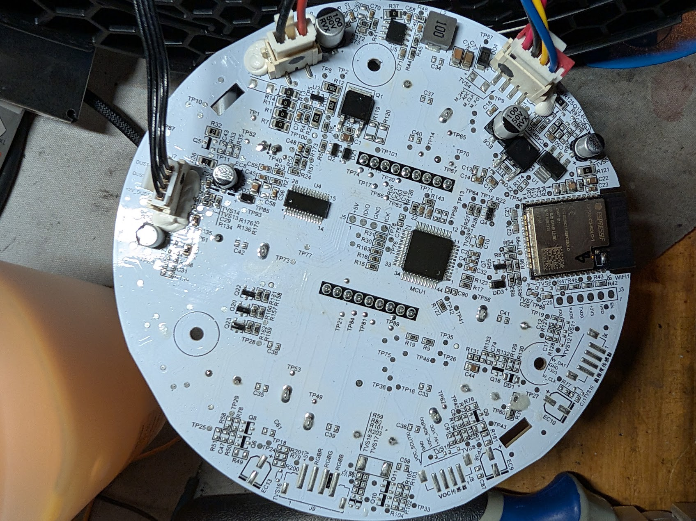
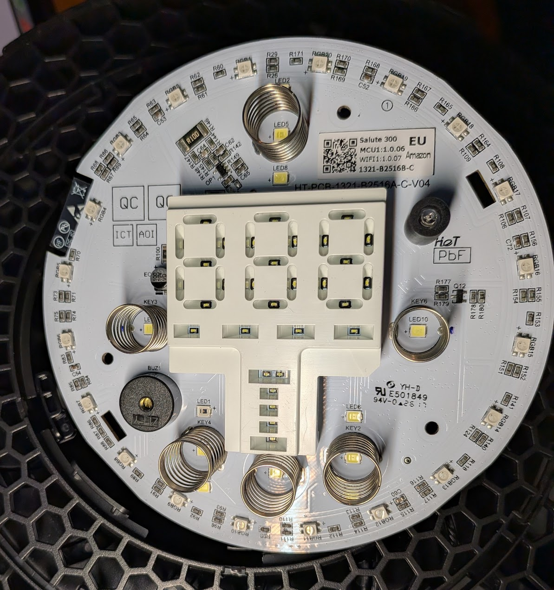

[← Back](./README.md)

# Levoit Eleva 300X — hardware and protocol notes

How the Eleva 300X works inside, moved here from the [README](./README.md),
which keeps what is needed to install it.

## Hardware

### PCB A — main board

The pins for a replacement ESP are in the README: [PCB A — main board](./README.md#pcb-a--main-board).

| Ref | Part / Pins (from silkscreen) | Notes |
|-----|------------------------------|-------|
| WIFI1 | Espressif ESP32-C3-SOLO-1 module (FCC ID 2AC7Z-ESPC3SOLO) | Same module as the Vital 100S / 200S; MCU UART on module pins 27 / 28 = **IO18 (RX) / IO19 (TX)** |
| J3 | EN, GND, +3V3, TXD0, RXD0, IO0 | ESP programming / UART header |
| MCU1 | 44-pin QFP, Arm Cortex-M0+, vendor TBD | Main MCU, talks to the ESP over UART. Core from the [MCU update image](#mcu-firmware-image) |
| J5 | +5V, DIO, GND, CLK | MCU debug header (SWD-style) |
| U4 | 28-pin SSOP, part TBD | |
| Dust connector | +5V_DUST, DUST_… | PM2008MZ sensor cable |
| J8 | GND, VOC_SCL(TX), VOC_SDA(RX), +5V_VOC | VOC sensor connector (VOC传感器), appears unpopulated |
| J6 | W_DAT, GND, +3V3, W_CLK | Temp / humidity sensor connector (温湿度传感器), appears unpopulated |
| J9 | +5V, RGBR, RGBG, RGBB | RGB output |
| Fan connector | M_24V … M_FG | 24 V fan motor with speed feedback (FG) |

### ESP32-C3 stock flash layout

Read with `esptool read-flash 0 ALL`. Secure Boot and flash encryption are **disabled**, so the stock firmware can be backed up and restored.

| Name | Type | Offset | Size |
|------|------|--------|------|
| nvs | data/nvs | 0x009000 | 16 KiB |
| otadata | data/ota | 0x00d000 | 8 KiB |
| phy_init | data/phy | 0x00f000 | 4 KiB |
| ota_0 | app | 0x010000 | 1536 KiB |
| ota_1 | app | 0x190000 | 1536 KiB |
| usercfg | data/nvs | 0x310000 | 128 KiB |
| fac_data | data/nvs | 0x330000 | 64 KiB (factory device keys) |
| storage | data/0x0f | 0x340000 | 128 KiB |
| historydata | data/nvs | 0x360000 | 128 KiB |
| log | data/nvs | 0x380000 | 64 KiB |

### MCU firmware image

The stock firmware updates the MCU in pass-through mode: the image is streamed from the cloud over UART to the MCU and is not stored on the ESP flash first.

The MCU update 1.0.13 (`LAP-C341S-WEU_MCU_C1_ota_v1.0.13.bin`, 64 284 bytes, URL in [firmware-updates.md](../../docs/firmware-updates.md)) is a 16-byte VeSync header followed by a raw Arm binary:

| Bytes | Value | Meaning |
|-------|-------|---------|
| 0 | `01` | type (unconfirmed) |
| 1–3 | `0C FB 00` | payload length, little-endian: 64 268 = file minus header |
| 4–7 | `00 01 00 0D` | version 1.0.13 |
| 8–15 | `01 80 87 00 02 25 8E 00` | unknown, probably checksums |

- The vector table points into `0x0800_2xxx`, so the application is linked at `0x0800_2000`. The first 8 KB of flash hold a bootloader, which is not in the file.
- The code is 16-bit Thumb only (no IT blocks, no hardware divide, no MOVW/MOVT) and writes `SCB->VTOR`: a **Cortex-M0+**, not an M0, M3 or M4.
- Built with Keil (Arm C library heap messages); no chip name in the image. The clock and flash controllers sit at `0x4002_1000` / `0x4002_2000` as on STM32-style parts, but the code loads no GPIO base at `0x4800_0000` or `0x5000_0000`, so it is not an STM32F0/G0/L0, PY32 or AT32F421 map.

The ESP side is chip-agnostic: the strings in the Wi-Fi 1.0.08 image (`MCU not requesting bin`, `MCU not in BIN_REQ state`, `ota mcu packet len`) show the ESP only relays chunks that the MCU's bootloader asks for.

The VeSync update downloads from `fw.vesync.com` by hostname. If the device's DNS lookups fail (`getaddrinfo() error=202` in the UART log), the update aborts at about 4% in the app. Adding 8.8.8.8 as a DNS server fixed it here.

### PCB B — display board (HT-PCB-1321-B2516A-C-V04)

- 3-digit 7-segment display plus 4 + 5 indicator LEDs under the light guide
- 20 RGB LEDs (RGB1–RGB20) forming the air-quality ring
- 5 spring touch keys (KEY2–KEY6 visible), each with a backlight LED
- Buzzer (BUZ1)
- OP1: small sensor near the top, possibly an ambient light sensor (TBD)
- Label: *Salute 300, EU, Amazon, MCU1: 1.0.06, WIFI1: 1.0.07, 1321-B2516B-C*

## UART Protocol (WIP)

ESP ↔ MCU link, captured with a Saleae Logic 8 (on the capture: channel 0 = MCU TX, channel 1 = ESP TX). **115200 8N1.**

Same framing as the other Levoit devices: `A5 | type | seq | len (u16 LE) | checksum | 02 <cmd lo> 55 00 | flat TLV…`. Type `22` is a command, `12` an acknowledgement and `02` a report that needs no reply. Checksum = `0xFF - (sum of all bytes except [5])`, like `levoit_checksum()`.

Periodic traffic (about once per second):

| Dir | Type / Cmd | Content |
|-----|-----------|---------|
| MCU → ESP | RPT `5523` | `01` PM1, `02` PM2.5, `03` PM10 (µg/m³, display caps at 999), `0b` AQI, `0c` air-quality level (1–4) |
| MCU → ESP | RPT `5500` | full status (see below) |
| ESP → MCU | CMD `5523` | echoes PM/AQI back, `04`–`0a` = 0xFFFF (no temp/humidity/VOC sensors) |
| ESP → MCU | CMD `5521` `0c=0` | MCU ACK carries `01`=1, `07`=79200, `08`=21600, `0b`=1800 (meaning TBD) |

**The Eleva 300X uses the Vital protocol.** The status `5500` keys and the ESP → MCU commands match [vital_status.cpp](../../components/levoit/vital_status.cpp) / [vital_commands.cpp](../../components/levoit/vital_commands.cpp). Panel buttons are handled by the MCU locally and only show up in the status report; app actions send the commands below.

Status `5500` (MCU → ESP, about once per second):

| Key | Meaning (Vital name) | Values seen on the Eleva |
|-----|---------|--------|
| `01` | MCU version (patch, minor, major) | `0d 00 01` = 1.0.13 (after the 2026-11-20 update) |
| `02` | power | 1 |
| `03` | fan mode | 0 manual, 1 sleep, 2 auto |
| `04` | fan level | 1–3, 4 = turbo, 0 in sleep |
| `05` | fan speed setting | 1–4 (kept while in auto/sleep) |
| `06` | display illuminated | 1 on, 0 off (sleep turns it off after ~3 s) |
| `09` | air-quality level | 1–4 |
| `0a` | air-quality detail | counts up slowly on the Eleva, meaning TBD |
| `0b` / `0c` / `0d` | PM2.5 / PM1 / PM10 | µg/m³ |
| `0e` | child lock | 0/1 |
| `13` | light detection | 0/1 |
| `2c` | AQI | Eleva-specific |
| `17` | dark detected | 0/1 |
| `34` | ambient light sensor, raw | ~4400 in a lit room, ~700 covered |
| `2a` `2b` `2e`–`31` | missing sensors | 0xFFFF |

Commands (ESP → MCU, from the VeSync app, each ACKed by the MCU within ~40 ms):

| Action | Command + payload | Status key | Existing `CommandType` |
|--------|-------------------|------------|------------------------|
| Power on / off | `02 00 50` + `01 01 01` / `00` | `02` (off: `04` = 255, `06` = 0) | `setDeviceON` / `OFF` |
| Fan level 1–3 / turbo | `02 03 55` + `01 01 0N` (N = 1–4) | `04`, `05` | `setDeviceFanLvl1`–`4` (turbo is level 4, not mode 4 as on the EverestAir) |
| Manual / sleep / auto | `02 02 55` + `01 01 00` / `01` / `02` | `03` | `setFanModeManual` / `Sleep` / `Auto` |
| Display on / off | `02 04 55` + `01 01 64` / `01 01 00` | `06`, `12` | `setDisplayOn` / `Off` (not possible from the app in sleep mode) |
| AQI ring bright / dim | `02 04 55` + `02 01 00` / `02 01 01` | `32` (0 bright, 1 dim) | **new** |
| Child lock on / off | `02 40 51` + `01 01 01` / `00` | `0e` | `setDisplayLockOn` / `Off` |
| Light detection on / off | `02 11 55` + `01 01 01` / `00` | `13` (`17` = dark detected) | `setLightDetectOn` / `Off` |
| Mute on / off | `02 17 55` + `01 04 01 00 00 00` / `01 04 00 00 00 00` (4-byte value) | `2d` (1 muted) | **new** |

Not captured yet: filter reset.

### Auto-mode configuration `5521`

The quiet period and adaptive start are stored and run **on the MCU**. Auto mode itself also runs on the MCU, which adjusts `04` from its own PM reading. The ESP reads the block about once per second with CMD `5521` `0c 01 00`; the MCU answers in its ACK with the full block. To change settings the ESP sends a CMD `5521` with only the changed keys; the MCU ACKs and also pushes the new block as a REPORT.

| Key | Meaning | Values seen |
|-----|---------|-------------|
| `01` | TBD | 1, 2, 3 |
| `02` | adaptive start, all modes (powers on/off by air quality; VeSync describes it as cloud-only, so the MCU may only store it) | 0/1 |
| `03` | dynamic manual (manual speed jumps to turbo on pollution), Manual mode only | 0/1 |
| `04` | dynamic sleep, Sleep mode only | 0/1 |
| `05` | quiet period on/off, all modes (lowers the fan by one level while active) | 0/1 |
| `06` | quiet period trigger: **0 = light sensor (darkness)**, 1 = time window `07`/`08` | 0/1 |
| `07` | quiet window start, seconds after midnight (u32) | 79200 = 22:00, 81000 = 22:30 |
| `08` | quiet window end, seconds after midnight (u32) | 21600 = 06:00, 25200 = 07:00 |
| `0b` | TBD (u16) | 1800 |
| `09` | event, sent alone by the MCU: **7 = quiet period started, 8 = ended** | 7, 8 |

The ESP always writes keys `01`–`04` as one group and `05`–`08` as one group. Set examples: `02 21 55` + `05 01 01 06 01 01 07 04 60 35 01 00 08 04 60 54 00 00` (quiet on, timer, 22:00–06:00), `02 21 55` + `01 01 02 02 01 01 03 01 00 04 01 01` (adaptive start and dynamic sleep on, key 01 echoed).

Verified with the sensor covered (capture `quiet_light3`): quiet on with trigger light, sensor covered → status `34` falls from ~4400 to ~700, `17` dark = 1, `5521 09=7`, fan level 4 → 3, display off; uncovered → `09=8`, fan back to 4. With trigger = timer, the MCU needs the local time from the ESP.

### Local time `5522`

At boot the MCU sends CMD `02 22 55` with no payload (twice, ~1 s apart). The ESP ACKs it and, once it has network time, sends CMD `02 22 55` + `01 04 <epoch LE32>`, where the epoch is **local** time (UTC + zone offset): `1795260449` was sent at 11:27:29 CET.

Other boot traffic from the stock ESP: Wi-Fi LED `02 18 50` (blinking, then on), `02 24 55` (same payload as the Wi-Fi LED off, TBD), filter `02 05 55` (below), status request `02 01 55` (empty; full status comes back in the ACK).

### Filter `5505`

Filter life is kept by the ESP / cloud, not the MCU: the status report has no filter percentage, and "done replace" for the main or the carbon filter in the app sends nothing to the MCU. The app has a genuine-filter check; a genuine filter cannot be reset manually, only after unlinking it.

| Action | Frame | Direction |
|--------|-------|-----------|
| Filter reset on the panel | `02 05 55` + `03 01 00` | **MCU → ESP** (SEND, ESP ACKs) |
| Unlink + reset in the app | `02 05 55` + `03 00` (key 03, empty value), then `04 01 00` | ESP → MCU |
| Link a genuine filter in the app | `01 01 00`, `04 01 01`, `01 01 00` | ESP → MCU |
| Every boot | `04 01 <genuine 0/1>`, then `01 01 00` | ESP → MCU |

Key `04` = genuine filter linked (no visible effect on the unit either way), `03` = reset, `01` always 0 (TBD). Captures: `filter_reset`, `filter_reset2`, `filter_nongenuine_boot`, `filter_genuine_boot`.

### Timer

Standard Vital timer: set `02 19 50` + `01 04 <seconds> 02 01 00` (0 = cancel); query `02 1A 50` (ACK carries `01` total, `02` remaining); while running, the MCU pushes `02 1B 50` every second **as a REPORT** with `02` remaining, `01` total. Seen: 1800, 3600, 28800 s.

The Saleae Logic 2 captures behind this section are in [uart/saleae/](uart/saleae/), with an index of what each one shows.
