[← Back](../../README.md)

# Levoit Eleva 300X - Custom Firmware (ESPHome)

ESPHome on the Eleva 300X, through the `levoit` component with
`model: ELEVA300X`. Work in progress. Adding your own ESP32 is the recommended
route and the one that runs on hardware; flashing the original ESP32-C3 is
untested. The steps shared by all devices are in the
[install guide](../../docs/installing.md); this page has what is particular to
the Eleva 300X.

> **Runs on hardware with a replacement Seeed XIAO ESP32-C3** (2026-11-23): fan
> speed and PM / AQI confirmed; the other features are not checked yet. The
> config for the stock ESP32-C3-SOLO-1 module is still untested.

## Quick Facts

| Item | Value |
|------|-------|
| Model | Eleva 300X (EU: LAP-C341S-WEU, US: LAP-C341S-WUSZ) |
| Released | August 2026 |
| Tested MCU FW | 1.0.06 as shipped (WiFi FW 1.0.07, VeSync SDK v1.3.1, ESP-IDF dc489539); updated via VeSync to WiFi FW 1.0.08 + new MCU FW on 2026-11-20 |
| Internal name | Salute 300 (EU, Amazon), label 1321-B2516B-C |
| ESP Module | ESP32-C3 (QFN32, rev v0.4), 4 MB embedded flash (XMC), single core |
| MCU | Arm Cortex-M0+, 44-pin QFP; the marking is not legible in the photos, the core is read from the [MCU update image](./PROTOCOL.md#mcu-firmware-image) |
| Board | PCB A: main board (MCU + ESP) / PCB B: HT-PCB-1321-B2516A-C-V04 (display) |
| PM Sensor | Cubic PM2008MZ (laser, PM1.0 / PM2.5 / PM10) |
| Fan Speeds | 4 (1–3 + Turbo) |
| Modes | Manual, Auto |
| CADR (spec) | 161 CFM smoke / dust / PM2.5, 172 CFM pollen (~273 m³/h) |
| Noise (spec) | 20–50 dB |
| Room Size | up to 250 ft² (~23 m²) at 4.8 ACH |
| Power | up to 25.5 W, 100–240 V 50/60 Hz |
| Dimensions | 23.8 × 23.8 × 38.3 cm (9.4 × 9.4 × 15.1 in), 4.5 kg (9.9 lb) |
| ESPHome | ✅ Seeed XIAO ESP32-C3 replacement working (RX GPIO5 = D3 / TX GPIO4 = D2); stock module untested |

## Features

Implemented: everything in the tables of the
[UART protocol notes](./PROTOCOL.md#uart-protocol-wip). Filter reset: the `reset_filter_stats` button sends `03 00` + `04 01 00` like the stock app; a panel reset resets the ESP-side filter estimate. At boot ESPHome sends `04 01 00` (not genuine), like a stock boot with an unlinked filter; it cannot verify a filter, and the flag has no visible effect. The quiet period with trigger = timer needs `time_id` on the `levoit:` block (the configs use Home Assistant time) so the MCU gets the local time.

### Stock Features (from manufacturer / reviews)

Firmware support for these is still to be decided once the UART protocol is known.

| Feature | Notes |
|---------|-------|
| Fan | 4 speeds: 1–3 + Turbo (reviews also mention a Sleep mode) |
| Auto Mode | Driven by the PM sensor, configurable in the app |
| Dynamic Manual | Manual speed that jumps to Turbo when pollution is detected, then returns |
| Air quality display | Onboard screen with PM1, PM2.5, PM10 and an AQI score; LED ring color by air quality |
| Display off | Works at any fan speed, including Turbo |
| Screen lock | Touch panel lock (likely the child lock) |
| Filters | HEPA main filter (~24 months) + separate replaceable carbon filter (6–12 months depending on type) |
| Filter tracking | Separate life tracking / reminders for main and carbon filter (stock: VeSync app) |

Carbon filter options: Essential (90 g, ~6 months), Pet (200 g), Smoke & Cooking (240 g), Premium (260 g, ~12 months).

## Measured Values (HouseFresh)

| Speed | Noise @ 3 ft | Power |
|-------|-------------|-------|
| Standby | – | 0.65 W |
| Sleep | 35.8 dBA | 1.85 W |
| 1 | 36.8 dBA | 5.33 W |
| 2 | 39.8 dBA | 6.91 W |
| 3 | 44.9 dBA | 10.03 W |
| Turbo | 55.4 dBA | 23.91 W |

Measured CADR: 165 CFM (PM1) at Turbo, 115 CFM (PM1) below 45 dBA.

## 1. Build the firmware

**With Home Assistant (recommended):** [Levoit ESPHome](https://github.com/tuct/levoit-esphome-ha)
→ *Add device* → **Eleva 300X** → the original ESP, Seeed XIAO ESP32-C3 or
ESP32-S3. [Step by step](../../docs/installing.md#with-home-assistant-recommended).

**Manually:** the files in this folder, built with the ESPHome CLI or pasted
into the Device Builder. [Step by step](../../docs/installing.md#manually).

| Board | ESPHome CLI | Local component | Device Builder / web builder | Status |
|-------|-------------|-----------------|------------------------------|--------|
| original ESP32-C3-SOLO-1 | [`levoit-eleva-300x.yaml`](levoit-eleva-300x.yaml) | [`levoit-eleva-300x_dev.yaml`](levoit-eleva-300x_dev.yaml) | [`levoit-eleva-300x-builder.yaml`](levoit-eleva-300x-builder.yaml) | untested |
| Seeed XIAO ESP32-C3 | [`levoit-eleva-300x-c3.yaml`](levoit-eleva-300x-c3.yaml) | [`levoit-eleva-300x-c3_dev.yaml`](levoit-eleva-300x-c3_dev.yaml) | [`levoit-eleva-300x-builder-c3.yaml`](levoit-eleva-300x-builder-c3.yaml) | **works on hardware** (fan speed, PM / AQI) |
| Seeed XIAO ESP32-S3 | [`levoit-eleva-300x-s3.yaml`](levoit-eleva-300x-s3.yaml) | [`levoit-eleva-300x-s3_dev.yaml`](levoit-eleva-300x-s3_dev.yaml) | [`levoit-eleva-300x-builder-s3.yaml`](levoit-eleva-300x-builder-s3.yaml) | untested |

The ESPHome CLI files pull the component from GitHub; the `_dev` files build
against this repo's local component. On the stock ESP32-C3 module the logger
stays on J3 (UART0).

## 2. Disassembly

Start with the hexagon grille side up: the outer grille, a middle ring and the
round centre cover.

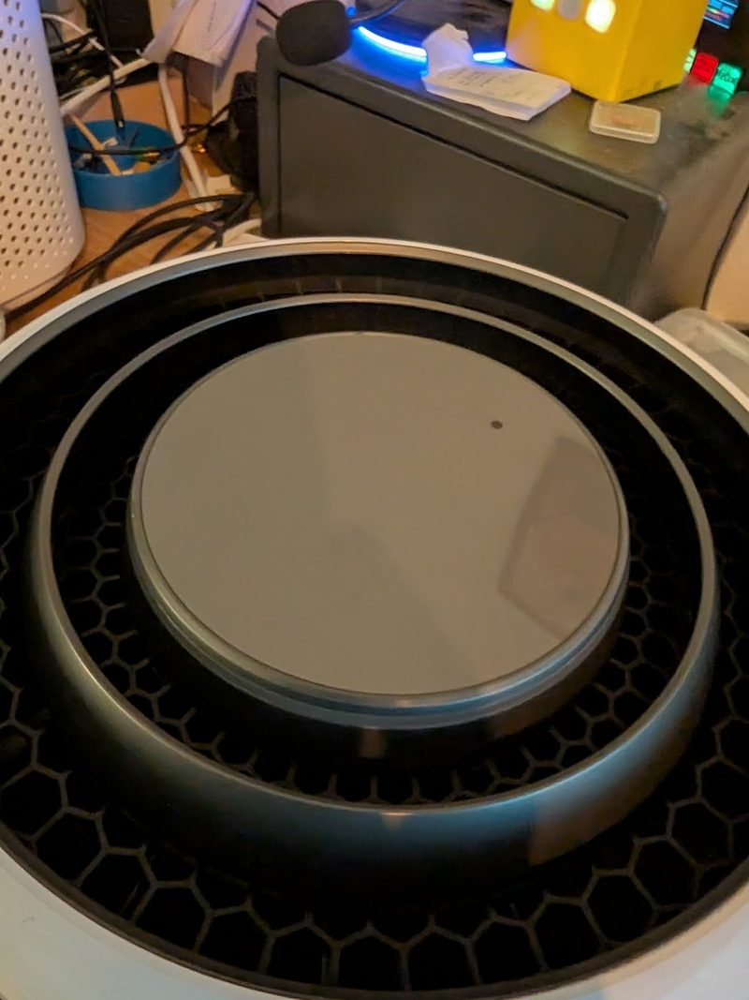

1. **Remove the middle ring:** turn it **counter-clockwise**, with a bit of
   force, and lift it off. It sits on four bayonet hooks; when refitting, line
   them up and turn it clockwise.

   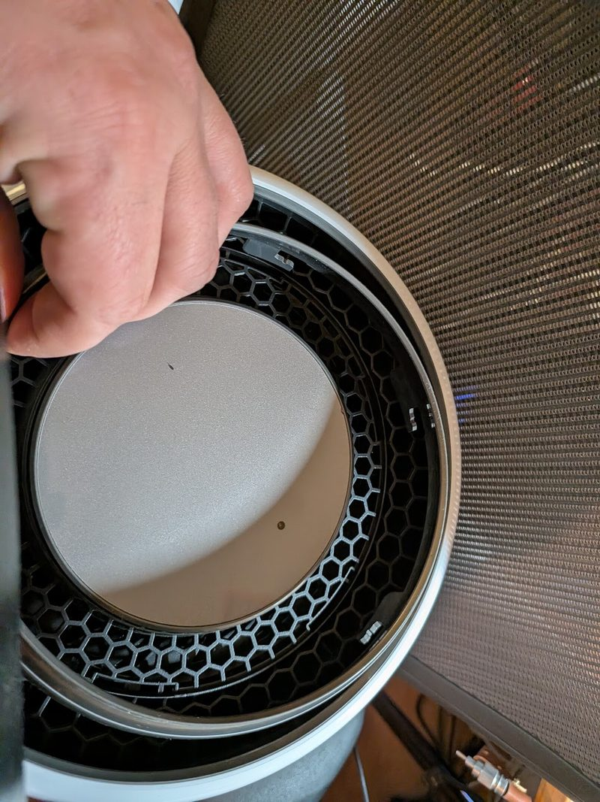

   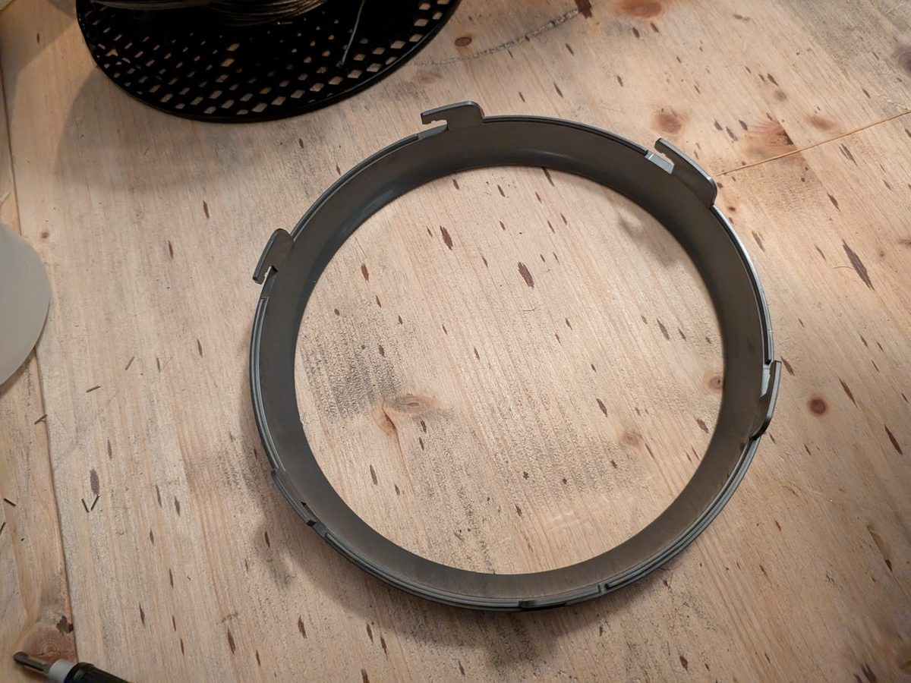

2. **Unclip the centre cover:** it is held by clips that sit in notches in the
   grille, next to the cover's edge (circled below). At each notch, push a flat
   screwdriver in and lever **up**, carefully but with some force, until the
   clip **clicks** free. Keep it open (an opening pick wedged under the cover
   works) and move on to the next.

   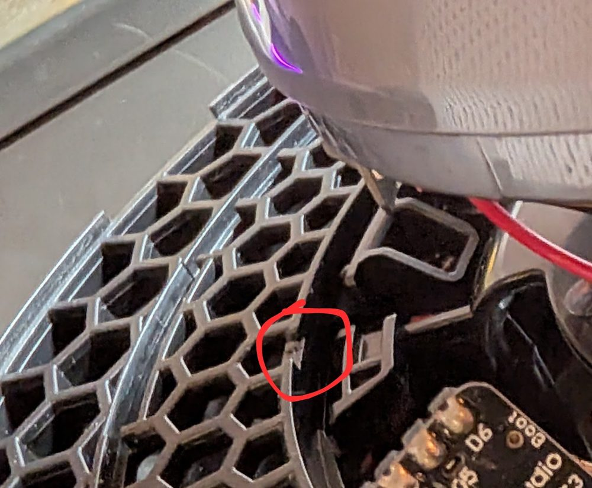

   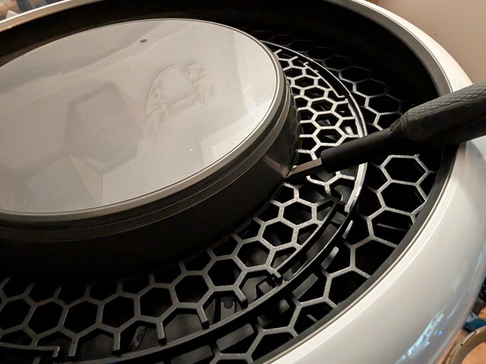

   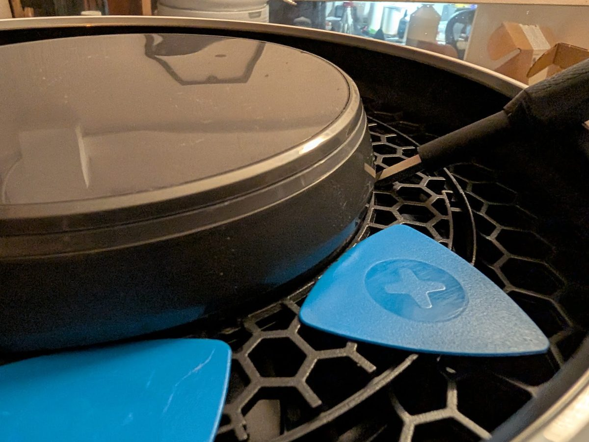

   A released clip, with the cover lifted:

   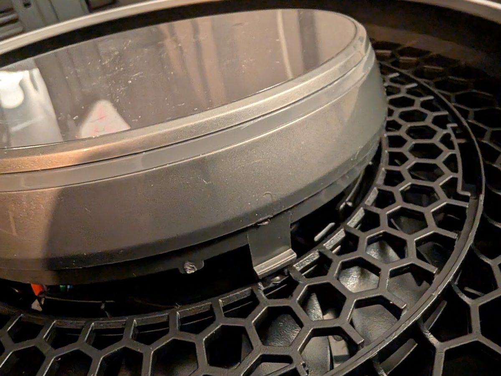

3. **Lift the cover off:** with all clips free, the centre cover comes up with
   the main board mounted underneath it. The board stays connected to the base
   by its cables, so lift it gently and set it aside. The pins for the ESP are
   [below](#pcb-a--main-board).

   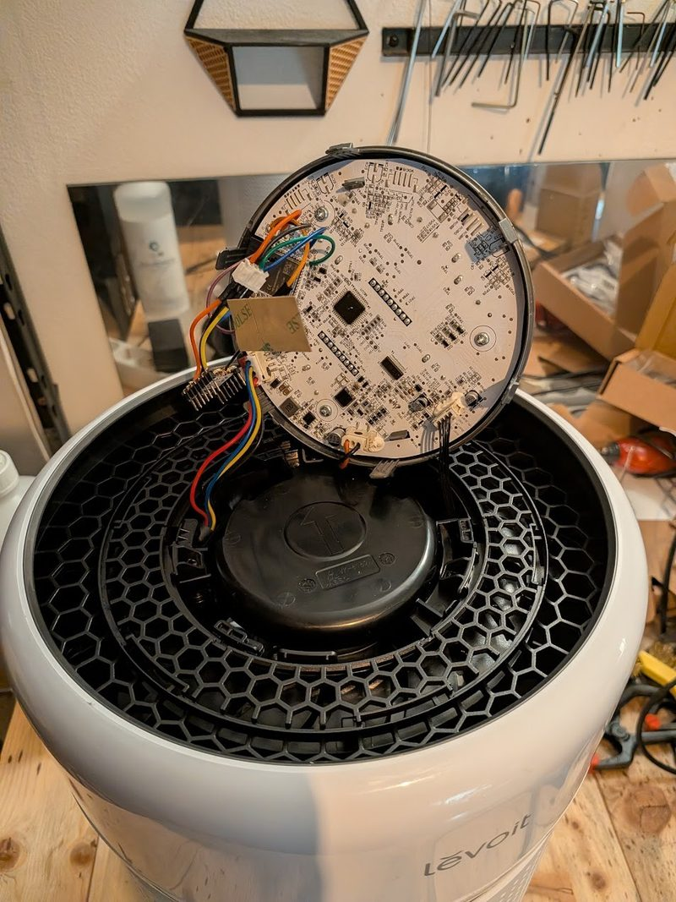

### PCB A — main board

The pins for a replacement ESP (here a Seeed XIAO ESP32-C3): the MCU link on two pads at the stock module, power and EN on the J3 header (pin 1 is EN):

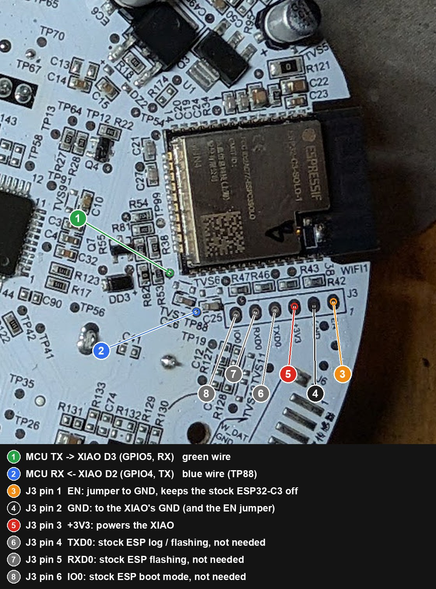

The full board photo and the part list are in the
[hardware notes](./PROTOCOL.md#pcb-a--main-board).

### ESP ↔ MCU UART pins

115200 8N1 on module pins 27 / 28 of the **ESP32-C3-SOLO-1** (FCC ID 2AC7Z-ESPC3SOLO), measured with a logic analyzer on the pads.
Where they are on the board: see the [labelled pins](#pcb-a--main-board) under PCB A.

| Signal | Module pin | ESP32-C3-SOLO-1 pin name | ESPHome pin | Saleae |
|--------|-----------|---------------------------|-------------|--------|
| MCU TX → ESP RX | 27 | IO18 | `rx_pin: GPIO18` | ch 0 |
| ESP TX → MCU RX | 28 | IO19 | `tx_pin: GPIO19` | ch 1 |

Same module and pins as the [Vital 100S](../levoit-vital100s) and [Vital 200S](../levoit-vital200s), both tested on the stock module. Flash: DIO at 80 MHz, 4 MB, as the stock firmware's image header (bootloader and app, both dumps) sets it.

Don't go by the classic **ESP32-SOLO-1** datasheet: it has the same footprint, but there pins 27 / 28 are IO16 / IO17. On the C3, GPIO16 / GPIO17 are internal flash pins, which ESPHome refuses. GPIO18 / GPIO19 are the C3's USB pins, so ESPHome warns that USB-Serial-JTAG uses them; that is expected, the log runs on UART0.

The stock app agrees: `vesync_uart_init` passes `tx = 19, rx = 18` (and 115200) to `uart_set_pin()` in both dumped builds (May 2026 in `ota_0`, Wi-Fi 1.0.08 from Jul 2026 in `ota_1`).

## 3. Flash the original ESP32

Untested on this model. Secure Boot and flash encryption are **disabled**, so the stock firmware can be backed up and restored.

Before flashing:

1. Back up the stock flash (`esptool --chip esp32c3 read-flash 0 ALL backup.bin`, IO0 held low during reset).
2. Flash over J3 (TXD0 / RXD0 / IO0). The configs already use the MCU pins `rx_pin: GPIO18` / `tx_pin: GPIO19` (see [ESP ↔ MCU UART pins](#esp--mcu-uart-pins)).

The generic procedure (bootloader, flashing, restore) is in the
[install guide](../../docs/installing.md#3-flash-the-original-esp32).

## 4. Add your own ESP32 (recommended)

**Recommended modules:**
- [Seeed XIAO ESP32-S3](https://www.seeedstudio.com/XIAO-ESP32S3-p-5627.html?sensecap_affiliate=3gGMlPv&referring_service=link)
- [Seeed XIAO ESP32-C3](https://www.seeedstudio.com/Seeed-XIAO-ESP32C3-p-5431.html?sensecap_affiliate=3gGMlPv&referring_service=link)

| Board | ESP RX ← MCU TX (module pin 27) | ESP TX → MCU RX (module pin 28) | Status |
|-------|---------------------------------|---------------------------------|--------|
| Seeed XIAO ESP32-C3 | GPIO5 = pad D3 | GPIO4 = pad D2 | **works on hardware** (fan speed, PM / AQI); see the photo below |
| Seeed XIAO ESP32-S3 | GPIO5 = pad D4 | GPIO4 = pad D3 | untested |

For either board the stock module's EN is held low.

The working XIAO ESP32-C3 install: the two MCU link wires soldered to the stock module's pins (the USB-UART on J3 and the logic analyzer on the right were for reverse engineering and flashing, not needed for the XIAO):

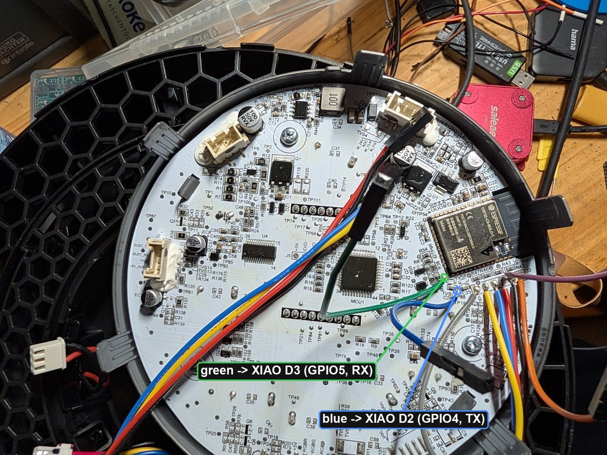

The XIAO end, fitted in the base: the cable from the board's connector lands on **D2 (blue, GPIO4, TX)** and **D3 (yellow, GPIO5, RX)**, with red / black for power. The wire colours change at the connector, so go by the pads, not the colours. The stock module's EN is held to GND (a dupont jumper on this unit), so the stock ESP32-C3 stays off the link:

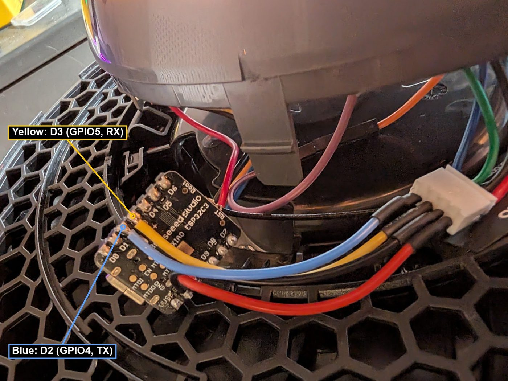

Where everything goes on the main board: see the [labelled pins](#pcb-a--main-board) under PCB A (MCU link on two pads at the stock module, power and EN on J3).

And the board end, back on the unit: the four-wire cable from the XIAO (top left) plugs into a small connector whose wires are soldered to the board, and a dupont jumper holds the stock module's EN to GND:

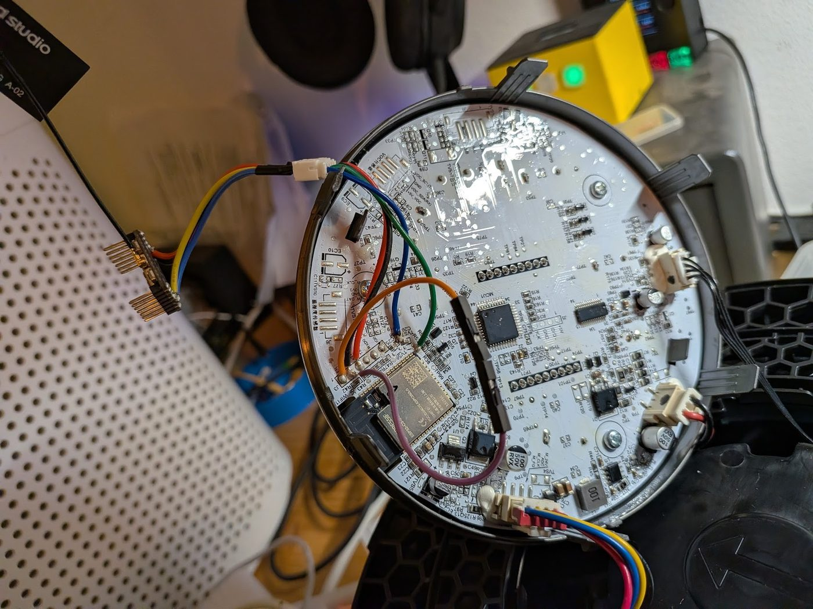

[Wiring, parking the original, strapping pins](../../docs/installing.md#4-add-your-own-esp32)
in the install guide.

## 5. Assembly

**Where the XIAO goes:** wrap it in insulating tape so nothing can short, and slide it into the gap at the side of the base, under the centre cover, as here (the cable runs from the board's connector down into the side):

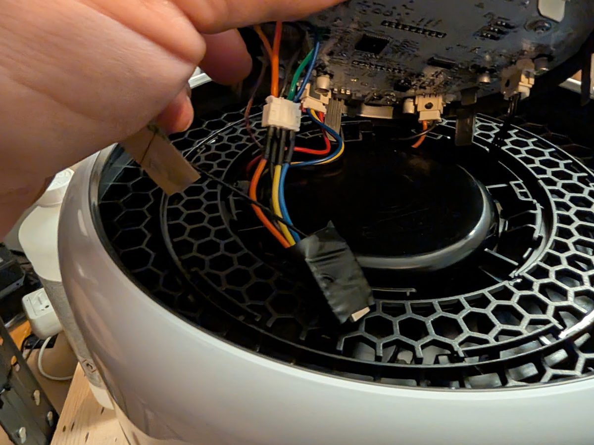

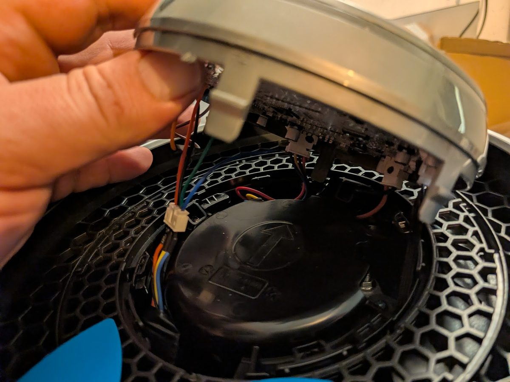

* Set the centre cover, with the main board underneath it, back into the
  grille and refit its clips in the notches
* Refit the middle ring: line up its four bayonet hooks and turn it clockwise

[What to check](../../docs/installing.md#5-assembly) once it is powered.

## Hardware & protocol notes

The board descriptions (PCB A part list, PCB B display board), the stock flash
layout, the MCU firmware image and the UART protocol (status, commands,
auto-mode configuration `5521`, local time `5522`, filter `5505`, timer) are in
[PROTOCOL.md](./PROTOCOL.md).

## Notes

- UART captures go in [uart/](uart/)
- Teardown / PCB photos go in [images/](images/)

## Sources

- [Levoit press release (TNGlobal reprint), Aug 2026](https://technode.global/?p=991105)
- [HouseFresh review](https://housefresh.com/levoit-eleva-300x-review/)
- [RTINGS review](https://www.rtings.com/air-purifier/reviews/levoit/eleva-300x)
