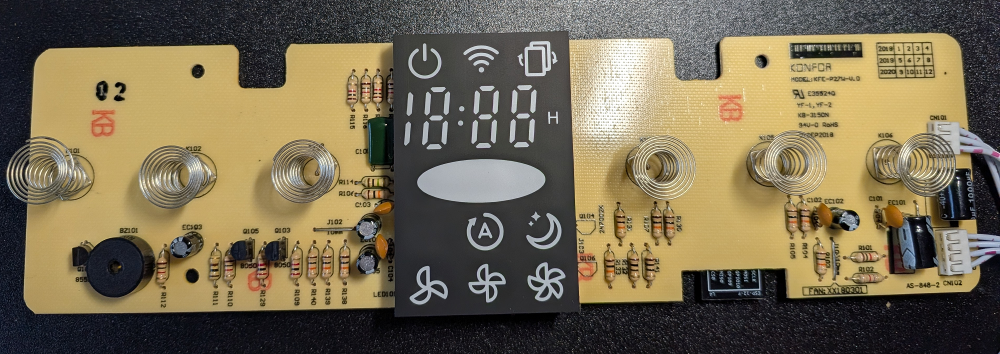
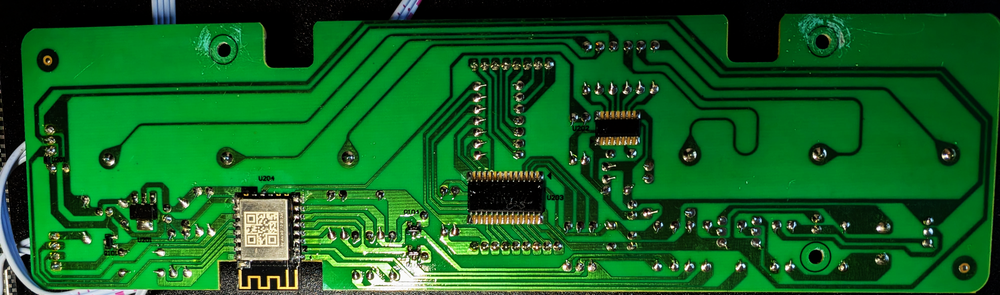
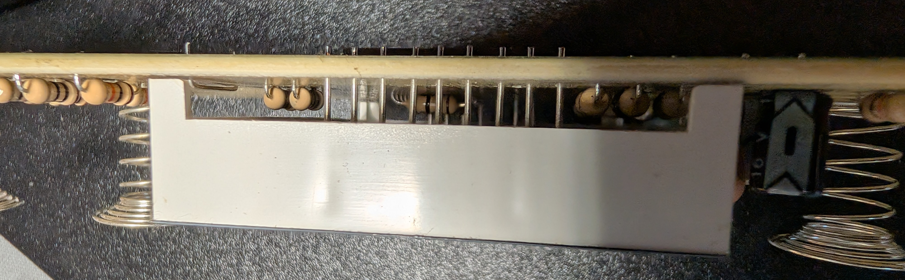
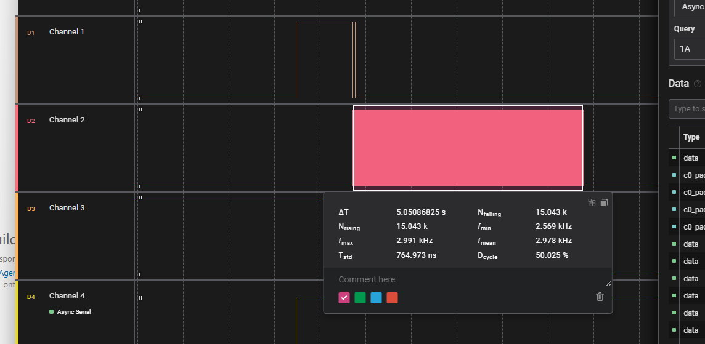
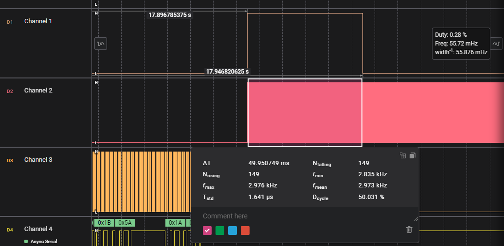
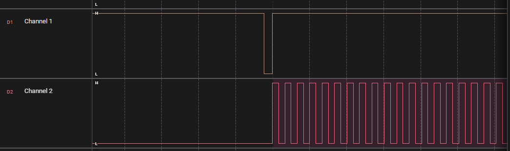

[← Back](./README.md)

# LV-PUR131S — hardware and protocol notes

How the original board works, as read out while reverse engineering it for
this project. The wiring for the hack is in the README,
[step 3](./README.md#3-modify-the-pcb).

## Hardware

Not like the other Levoits i have, only uses one ESP12F and no 2nd MCU

MCU: ESP12F 

Fan / Main Power: 24V DC
PCB: 5V


### PCB








TODO add fried version!


#### ESP12F Pinout

#### Display driver - TM1628 

SPI 500khz/ 1mhz?, 8 Bits, LSB Mode 0, enable active low

DIO -> GPIO13
SCK -> GPIO14
STP -> GPIO15 


Command 1# 0x03 // 7 grids, 11 segs

Command 2# 0x40 // mode normal + increment + write

Command 3# 0xC0 //set adr

14 bytes data
Command 4# 0x8C


#### Buttons to Serial - ????
RX -> GPIO10
990 Baud
7 Bit
1 Stop bit, no parity, LSB

Start cmd: 0x1A 
2 bytes Btn idx
2nd byte differs on release! sometime -> ignore!
15 ms between sends while presses

| Button | B1    |  B2    | What |
|--------:|:------:|:-------:|:-----|
| BTN1   | 0x1B  | 0x5A   | power|
| BTN2   | 0x1B  | 0x53   | display|
| BTN3   | 0x1B  | 0x5B   | sleep|
| BTN4   | 0x5B  | 0x5A   | auto |
| BTN5   | 0x5B  | 0x53   | Fan  |
| BTN6   | 0x5B  | 0x52   | timer|
    
#### PM1003
PWM/AQI -> GPIO03
Reset -> GPIO02 (pulled high? oin press connect to gnd)

#### Fan - PWM out 
GPIO04
3Khz, 2.976Khz

| Speed  | Duty cylce    | 
|--------:|:------|
| LOW   | 40%  |
| MID   | 60%  |
| HIGH   | 80%  |


#### Beep

uses 2 pins, one sends short on sig, 2nd provides freq => nice after hall effect ;)









GPIO16 -> high 1.25s,low 220us, high 50ms
GPIO12 -> PWM 2.975MHZ, 50%, starts after 220us low to high, contiunes for 5sec after start


## Display Bytes Map 

b[byte 0-13].[bit map]

b1.0x20 => 0x00 0x20 ....


### Power:
```
b3.0x01 (top)
b3.0x02 (bottom)

=> 0x00 00 00 03 00 00 00 00 00 00 00 00 00 00
```

### Wifi
```
b4.0x80 (top)
b5.0x01 (top)

```

### Filter
```
b5.0x02
b13.0x02

```

### Digits
```
  ---A---
 |       |
 F       B
 |       |
  ---G---
 |       |
 E       C
 |       |
  ---D---   • DP

```
| Digit | Segments On   | Binary   | Hex  |
| ----- | ------------- | -------- | ---- |
| 0     | A B C D E F   | 00111111 | 0x3F |
| 1     | B C           | 00000110 | 0x06 |
| 2     | A B D E G     | 01011011 | 0x5B |
| 3     | A B C D G     | 01001111 | 0x4F |
| 4     | B C F G       | 01100110 | 0x66 |
| 5     | A C D F G     | 01101101 | 0x6D |
| 6     | A C D E F G   | 01111101 | 0x7D |
| 7     | A B C         | 00000111 | 0x07 |
| 8     | A B C D E F G | 01111111 | 0x7F |
| 9     | A B C D F G   | 01101111 | 0x6F |

1(only 2 segs), 2, 3, 4 (7 segs)

#### Digit 1

only F and E!
```
F: b0.0x80
E: b1.0x01

```
#### Digit 2

```
byte 0
A: b0.0x01
B: b0.0x02
C: b0.0x04
D: b0.0x08
E: b0.0x10
F: b0.0x20
G: b0.0x40


```

#### Digit 3

```
A: b2.0x01
B: b2.0x02
C: b2.0x04
D: b2.0x08
E: b2.0x10
F: b2.0x20
G: b2.0x40
```

#### Digit 4

```
A: b4.0x01
B: b4.0x02
C: b4.0x04
D: b4.0x08
E: b4.0x10
F: b4.0x20
G: b4.0x40
```

##### Digits Dots
```
b1.0x04
```
#### Digits H
```
b10.0x20
```


### Color:

3 colors, 8 leds in 2 rows per color

```
b6.01 r  [x   ]
b6.08 r  [ x  ]
b6.40 r  [  x ]
b7.02 r  [   x]
b8.04 r  [x   ]
b8.20 r  [ x  ]
b9.01 r  [  x ]
b10.02 r [   x]


b6.02 g  [x   ]
b6.10 g  [ x  ]
b6.80 g  [  x ]
b8.01 g  [   x]
b8.08 g  [x   ]
b8.40 g  [ x  ]
b9.02 g  [  x ]
b10.04 g [   x]


b6.04 b  [x   ]
b6.20 b  [ x  ]
b7.01 b  [  x ]
b8.02 b  [   x]
b8.10 b  [x   ]
b8.80 b  [ x  ]
b10.01 b [  x ]
b10.08 b [   x]


RED -> all red bits
b6.49
b7.02
b8.24
b9.01
b10.02

blue
b6.24
b7.01
b8.92
b10.09

yellow:
DB 02 6D 03 06 00 00 00 => Yellow

b6.db
b7.02
b8.6D
b9.03
b10.06

```


### Auto
```
b11.0x02 
b12.0x01
```

### Sleep
```
b12.0x02
b12.0x04
```

### Fan Low
```
b12.0x08
b12.0x10
```


### Fan Mid
```
b12.0x20
b12.0x40
```
### Fan High
```
b12.0x80
b13.0x01
```

### Colors used by original Firmware
```
AQI
00 00 00 00 00 00 49 02 24 01 02 00 00 00 => RED
00 00 00 00 00 00 DB 02 6D 03 06 00 00 00 => Yellow
00 00 00 00 00 00 24 01 92 00 09 00 00 00 => blue


AQI RED
00000000 00000000 00000000 00000000 00000000 00000000 01001001 00000010 00100100 00000001 00000010 00000000 00000000 00000000

AQI YELLOW
00000000 00000000 00000000 00000000 00000000 00000000 11011011 00000010 01101101 00000011 00000110 00000000 00000000 00000000

AQI BLUE
00000000 00000000 00000000 00000000 00000000 00000000 00100100 00000001 10010010 00000000 00001001 00000000 00000000 00000000
```
