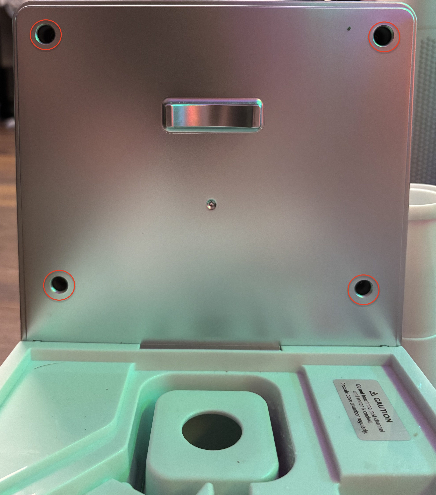
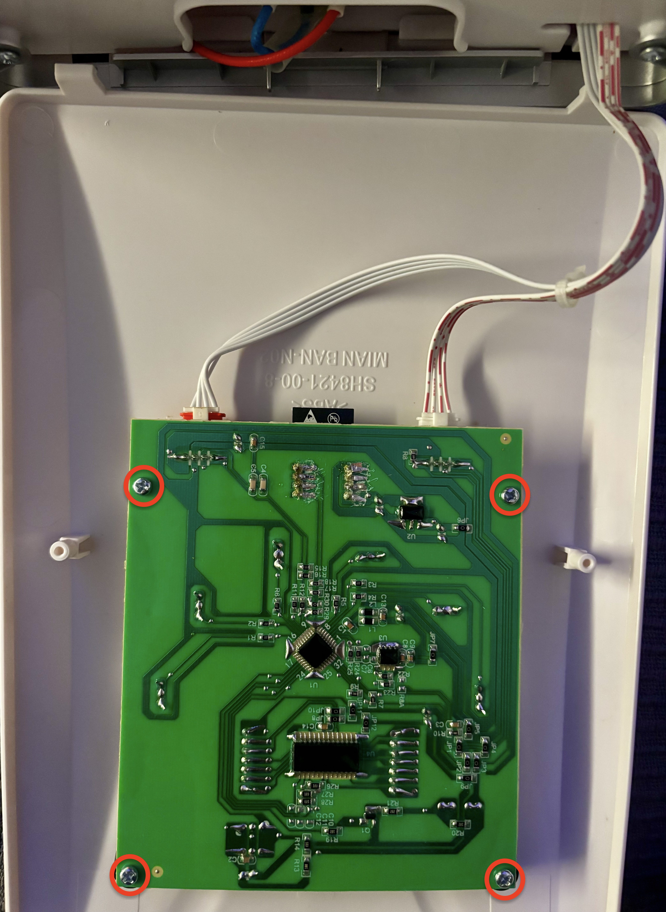
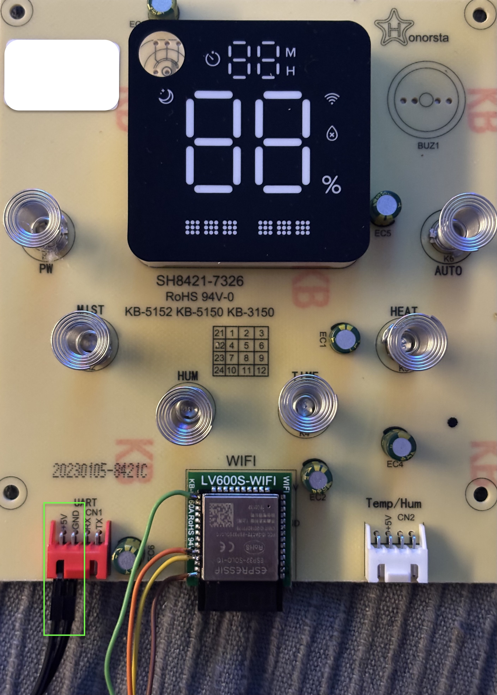

# LV600S EU teardown and serial access

This guide covers the observed `LUH-A602S-WEUR` with an original ESP32-SOLO-1C,
ESP32-S0WD revision 1.0 and 4 MB of flash. Check the model and module marking on
your unit before applying the guide. Board layouts and firmware can vary.

> [!WARNING]
> **Unplug the mains cord before starting. Reconnect it only after the unit is
> fully reassembled.** Empty and dry the appliance before opening it. Work only
> on the isolated low-voltage display board and disconnect any external supply
> and USB adapter before soldering. This modification is at your own risk.
> Incorrect wiring, power or firmware can permanently damage the appliance.

## Disassembly

The housing is easy to open. Serial programming requires soldering to the module pads.

1. Remove the water tank and set it aside. Remove the lid, nozzle and any other
   loose parts that could drop out while you handle the base. Drain the base
   and let it dry.
2. Remove the screws on the rear side of the front display housing as shown
   in Figure 1. Keep them separate from the circuit-board screws.
3. Carefully fold the display housing forward as shown in Figure 2. Support it
   so its weight does not pull on the harness. Remove the circuit-board screws
   shown in that figure. Release any connector by its housing or latch.
4. Lift the board out and turn it over to expose the display and Wi-Fi module.
   Figure 3 shows the wires soldered to the ESP32 module. Before soldering,
   identify each point by continuity to the corresponding module pin with all
   power disconnected. Check for bridges and strain on the wires afterwards.

### Figure 1 — Screws on the rear of the display housing

### Figure 2 — Display folded forward and board retaining screws

### Figure 3 — ESP32 programming wires and 5 V input

The green outline marks the `+5V` and `GND` contacts on CN1 for the external
supply on this board. Use the table to verify the ESP32 programming connections
before soldering.

| ESP32-SOLO-1C signal | Serial setup |
|---|---|
| GND | Common ground for the low-voltage supply and the USB–UART adapter |
| GPIO1 / U0TXD | Module transmit to adapter receive |
| GPIO3 / U0RXD | Module receive from adapter transmit |
| GPIO0 | Boot strap. Hold low for reset into the ROM bootloader and release before normal boot |
| EN | Reset or enable if the verified wiring uses it |

The appliance MCU uses a separate 9600-baud 8N1 link on GPIO17 TX and GPIO16 RX.
The connector marked UART on the display board must be traced before you use any
of its pins. The ROM bootloader uses UART0. [Espressif pin definitions and
operating conditions](https://documentation.espressif.com/esp32-solo-1_datasheet_en.html) ·
[ESP32 boot mode selection](https://docs.espressif.com/projects/esptool/en/latest/esp32/advanced-topics/boot-mode-selection.html)

## Power and first read

- Power the display board from an **external isolated, regulated 5 V supply**
  connected to the board's verified 5 V input and GND. Check that the supply
  holds under load and that the board's regulator provides a stable 3.3 V at
  the module during startup. Apply 5 V at the verified board input only.
- Set the USB–UART adapter's **TX/RX logic to 3.3 V**. Connect TX, RX and GND
  as shown above. For the power connections, the adapter shares GND with the
  board and external supply. Leave the adapter's VCC/3.3 V lead disconnected.
- With external power off, bridge the verified **GPIO0 pad to GND**. Apply
  external 5 V or reset with GPIO0 held low to enter the ROM download mode.
  Switch off the external supply and remove the GPIO0–GND bridge before the
  next normal boot. This is the boot strap for the LV600S's original ESP32.
- Identify the correct USB–UART port, confirm the ROM download mode and read
  the chip, detected flash size and available protection status. Stop and find
  the cause if there are brownouts, inconsistent reads or unknown protection
  settings. Leave the module's protection settings intact. A normal UART0 boot
  log confirms the port and transmit path. The separate ROM download check is
  required before reading flash.
- Read all 4 MB twice on the documented unit, compare sizes and SHA-256 hashes,
  and keep a private copy in a second location. The dumps and generated firmware
  may contain credentials or device identifiers. Keep both private. Use the
  verified original partition table for the owner profile. A validated initial
  image set and its offsets are specific to that table and device. See the
  [owner's verified flash record](https://github.com/mvs90/levoit-lv600s-local/blob/codex/tuct-alignment/HANDOFF.md).

## What the first conversion established

- Original `1.1.03` appeared in a normal UART0 boot log after an isolated 5 V
  restart with the adapter's 3.3 V supply pin disconnected. Reset and brownout
  messages during early bench work made stable power a prerequisite for further
  work. The two original dumps matched. The observed unit reported Secure Boot
  and flash encryption disabled. These findings apply to the tested module.
- After the first serial install, the bootloader, partition table, OTA start
  data and app matched their build files in a separate flash verification.
  Normal startup followed after the GPIO0 strap was released. The MCU replied
  over its local serial link. Sensor and actuator checks required the reassembled
  appliance, with the tank and sensors fitted. The original vendor OTA path
  remains unverified.
- For reassembly disconnect the external supply and USB–UART adapter, remove
  the temporary wires and boot strap, reconnect the harnesses and reinstall the
  board and housing. Check for pinched wiring or loose hardware. Refit the tank
  and loose parts and reconnect mains only with the housing closed. Subsequent
  owner-profile updates used encrypted ESPHome OTA. [Live verification](https://github.com/mvs90/levoit/blob/codex/owner-test/docs/esphome-devices/owner-test.md)
