[← Back](../../README.md)

# Levoit Vital 100S - Custom Firmware (ESPHome)

## Quick Facts

| Item | Value |
|------|-------|
| Model | Vital 100S |
| Tested MCU FW | 1.0.5 |
| ESP Module | ESP32-C3-SOLO-1 |
| Board | Vital 100S-C_V1.3P1.4 20221027 |
| Fan Speeds | 4 |
| CADR (spec) | 221 m³/h |
| Noise | 23–52 dB |
| Room Size | 9–52 m² (97–560 ft²) |
| ESPHome | 2026.5.3+ |
| PM Sensor | PM1003 |

## Features

| Feature | Type | Notes |
|---------|------|-------|
| Fan | fan | 4 speeds, presets: Manual / Auto / Sleep / Pet |
| Auto Mode | select | Default / Quiet / Efficient |
| Auto Mode Room Size | number | 9–52 m² |
| Auto Mode High Fan Time | text_sensor | Remaining high-speed runtime in efficient mode |
| Efficiency Counter | sensor | Seconds remaining at high fan speed |
| Display | switch | Toggle LED display |
| Child Lock | switch | |
| Light Detect | switch | Auto-dims display when ambient light is low |
| PM2.5 | sensor | µg/m³ |
| AQI | sensor | As reported by MCU |
| Current CADR | sensor | m³/h, updated every 5s |
| Filter Life Left | sensor | % remaining |
| Filter Low | binary_sensor | On when < 5% |
| Filter Lifetime | number | Configurable in months |
| Reset Filter Stats | button | Resets CADR/runtime counters |
| Timer | number | Run timer in minutes |
| MCU Version | text_sensor | |
| Error | text_sensor | "Ok" or "Sensor Error" |

## Known issue: Auto mode reports 25% at the lowest fan rate

In **Auto** mode with good air quality (blue indicator), the unit drops the fan
below its first manual level — roughly 10% by ear — but Home Assistant keeps
reporting **25%**, the same as level 1. Reported in
[#72](https://github.com/tuct/levoit/issues/72). Not yet fixed.

The likely cause: the MCU sends **two** separate datapoints, and the component
only uses one.

| DP | Name | Used for |
|----|------|----------|
| `0x04` | `FanLevel` | The fan entity's speed — 1–4, so 25 / 50 / 75 / 100% |
| `0x05` | `FanSpeed` | Parsed and **discarded** ([`vital_status.cpp:159`](../../components/levoit/vital_status.cpp#L159)) |

In auto-low the MCU most likely holds `FanLevel` at 1 while `FanSpeed` carries
the real rate. The fan entity has four discrete speeds and cannot express
anything below 25%, so the number HA shows is correct for `FanLevel` and simply
does not describe what the fan is doing.

**To confirm it**, set the logger to `VERBOSE` and watch for `FanSpeed=` while
the unit is in auto with a blue indicator:

```yaml
logger:
  level: VERBOSE
  logs:
    levoit.vital: VERBOSE
```

If `FanSpeed` moves while `FanLevel` stays at 1, that is the value worth
exposing — as its own sensor rather than by changing the fan entity, since
redefining the existing percentages would break anyone's automations.

## Teardown / Disassembly

Remove the top cover to access the PCB. Start by carefully opening the left side with a plastic pry tool or kitchen knife:

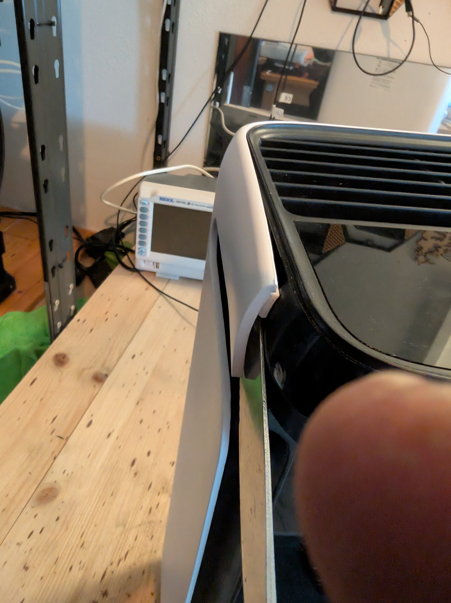

There are hooks on each side — you need some force, but be gentle:

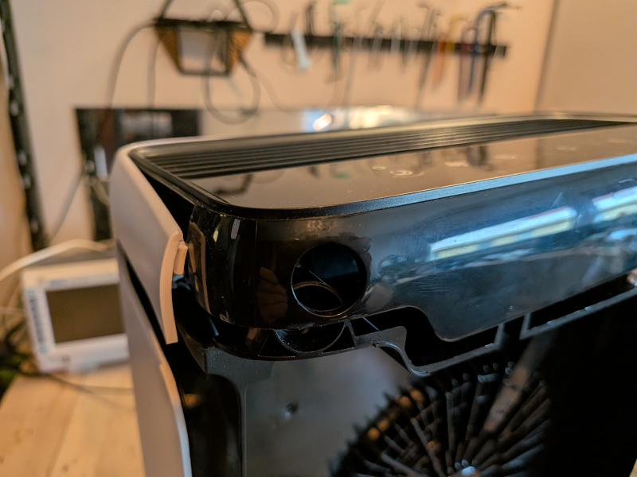

Open both sides, then pull firmly upward:

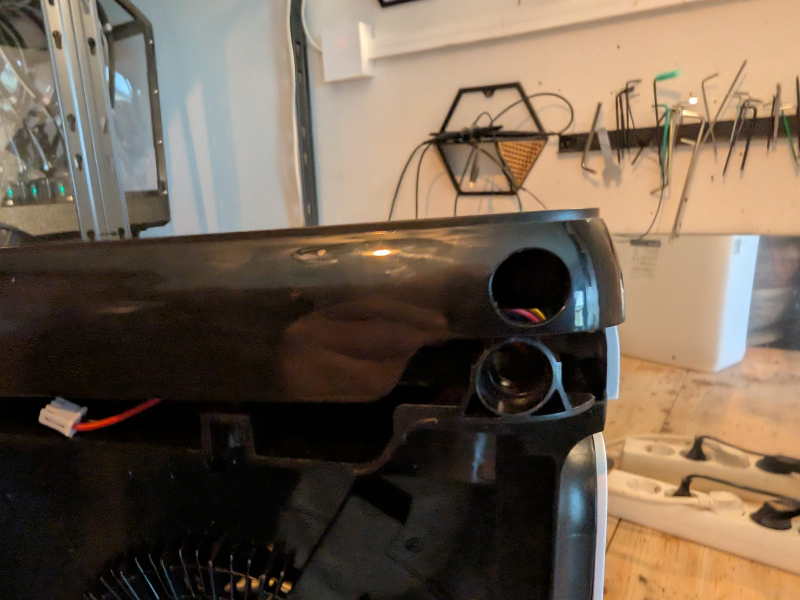

Be careful with the cables — slide them out of the holder on the right side:

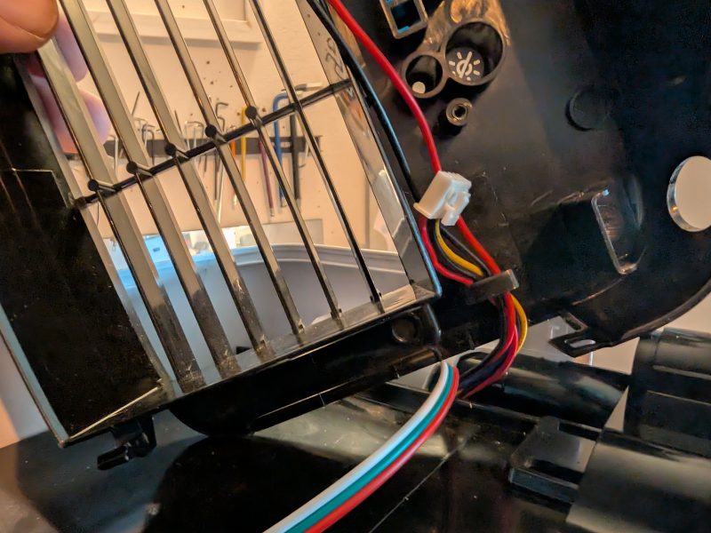

PCB fully accessible:

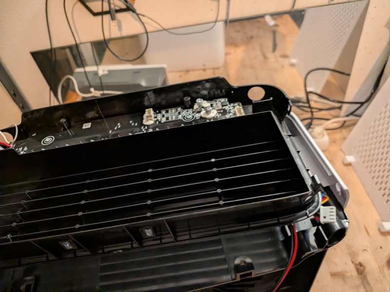

## Debug Header Pinout

| Pin | Signal |
|-----|--------|
| 1 | EN (reset) |
| 2 | GND |
| 3 | 3.3V |
| 4 | TX |
| 5 | RX |
| 6 | IO0 |

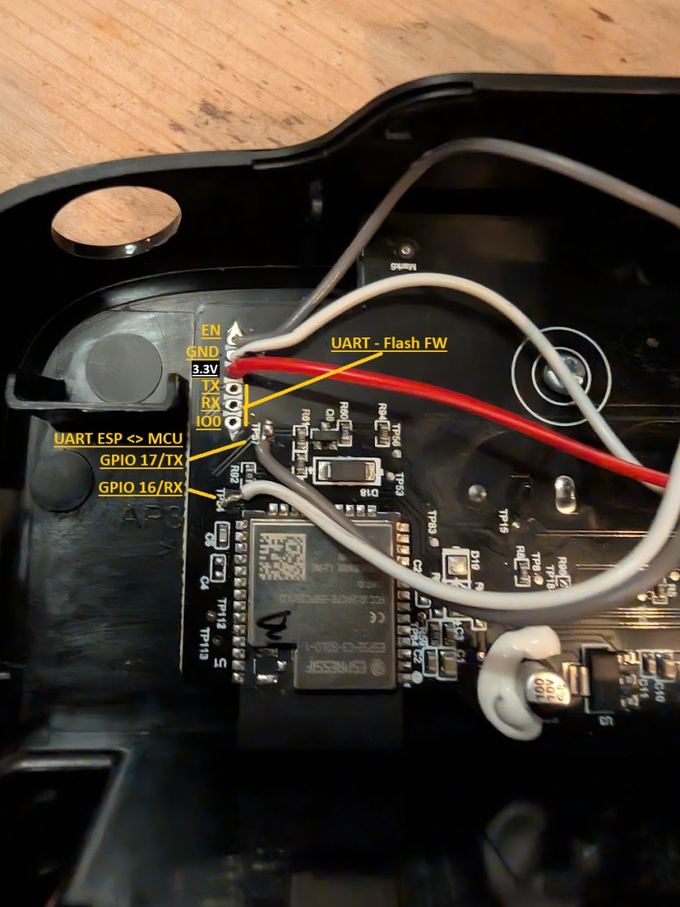
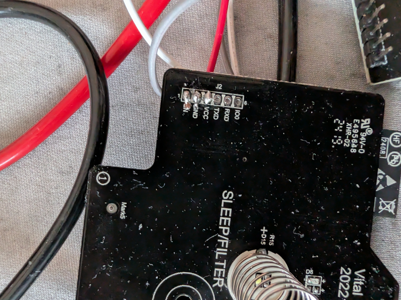

## Install New ESP32 (Recommended)

Adding your own ESP alongside the stock module leaves the original firmware
untouched and the change fully reversible — nothing is desoldered.

Photo by [@gorischek](https://github.com/tuct/levoit/issues/72), used with
permission:

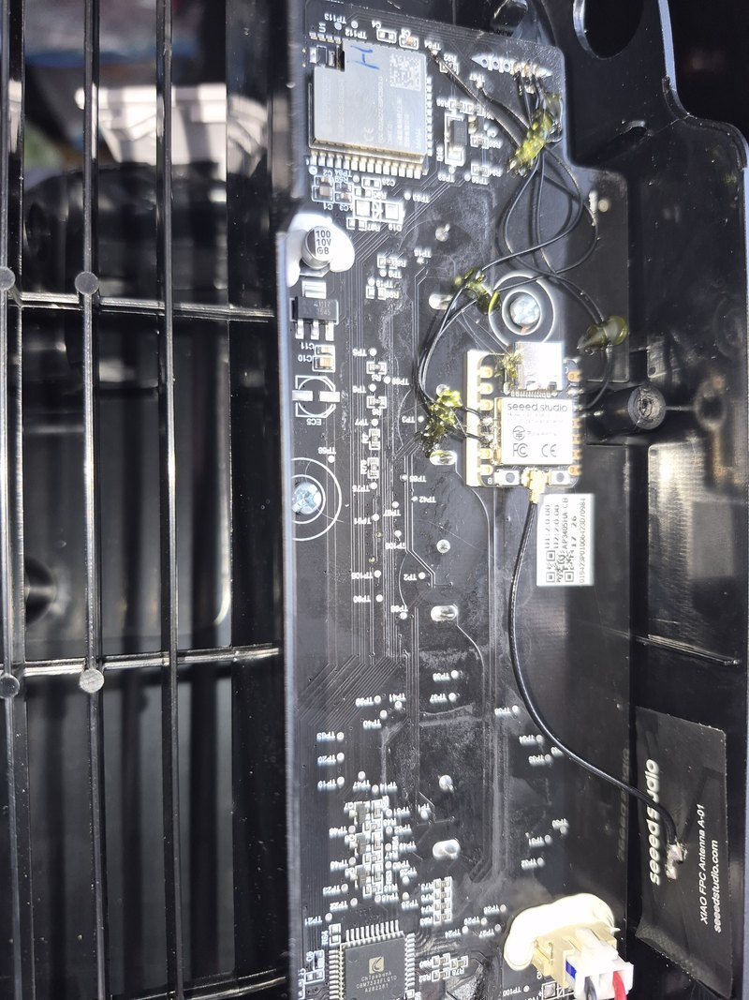

What the photo shows, top to bottom:

* The **stock ESP32** in its shield can at the top, still fitted, with wires
  tapped onto its pads
* A **Seeed Studio XIAO** laid flat on the board in free space to the right of
  the MCU, wired with fine enamelled wire
* A **XIAO FPC Antenna A-01** — the flexible external antenna — stuck to the
  inside of the housing and run to the XIAO's u.FL connector
* **Hot glue at every wire anchor**, which is what makes this survive the fan's
  vibration

### Wiring

Four wires, plus one to silence the stock module:

| Connection | Where |
|-----------|-------|
| `3.3V`, `GND` | Debug header pins 3 and 2 |
| ESP `RX` ← MCU `TX` | Debug header pin 4 |
| ESP `TX` → MCU `RX` | Debug header pin 5 |
| Stock ESP32 `EN` → `GND` | Debug header **pin 1**, tied to pin 2 |

The debug header carries `EN` on pin 1, so the stock module can be held in reset
straight from the header — no probing needed. See
[Debug Header Pinout](#debug-header-pinout) above. Until it is held low, keep
your ESP's TX disconnected: both modules would otherwise drive the same line.

> **Use an external antenna.** The board sits low in a plastic housing beside a
> metal fan assembly. The XIAO's onboard antenna works, but the FPC antenna in
> the photo is a worthwhile upgrade if your Wi-Fi is marginal — and the XIAO
> variants with a u.FL connector need their antenna switch set in firmware.

## Flash Original ESP32

### Prerequisites

Connect to the debug header with a USB-UART adapter (3.3V TTL), crossing TX/RX:
- Adapter TX → MCU RX
- Adapter RX → MCU TX

Connect **IO0 to GND before powering on** to enter bootloader mode.

### Backup Existing Firmware

```bash
esptool read_flash 0 ALL levoit-vital100s-backup.bin
```

> Note: may fail if watchdog-protected. Try while powered externally.

### Configure

1. Copy `secrets-example.yaml` → `secrets.yaml` and fill in your Wi-Fi and encryption key
2. Adjust the device name in the config if running multiple units
3. Check the [component README](../../components/levoit/README.md) for UART pin mapping per board

### Flash

```bash
esphome run levoit-vital100s.yaml
```

Reassemble and enjoy!

### ESPHome Web Builder / Dashboard

Use the pre-generated builder yaml to flash without a local clone — all config is inlined, no `!include` or packages needed:

| File | Board |
|------|-------|
| `levoit-vital100s-builder.yaml` | original ESP32-C3-SOLO-1 |
| `levoit-vital100s-builder-c3.yaml` | ESP32-C3 replacement |
| `levoit-vital100s-builder-s3.yaml` | ESP32-S3 replacement |

Upload to the [ESPHome web builder](https://builder.esphome.io) or paste into the ESPHome dashboard. Regenerate with `.\make-builder-yaml.ps1` from the `devices/` folder.

### Restore Original Firmware

```bash
esptool erase_flash
esptool write_flash 0x00 levoit-vital100s-backup.bin
```

## Custom Hardware (if PCB/MCU is fried)

Parts used for a full custom replacement build:

* 7× [Touch buttons](https://amzn.to/4sZdCNO)
* 1× [4-Digit TM1637 Display](https://www.az-delivery.de/products/4-digit-display)
* 16× LEDs, 3mm white, 2.7V
* Diode 1N4000
* [ESP32 dev kit V4](https://amzn.to/4qLOvwh)
* Level Shifter
* DC-DC Converter MP1584

**Fan PWM info:** 24V, 5V signal, 1.6kHz, duty cycle 10–90% (`min: 0.1`, `max: 0.9`)
**Fan speed signal:** 5V, frequency = speed (0=off, 60Hz=slowest, 185Hz=max)

### Custom Schematics

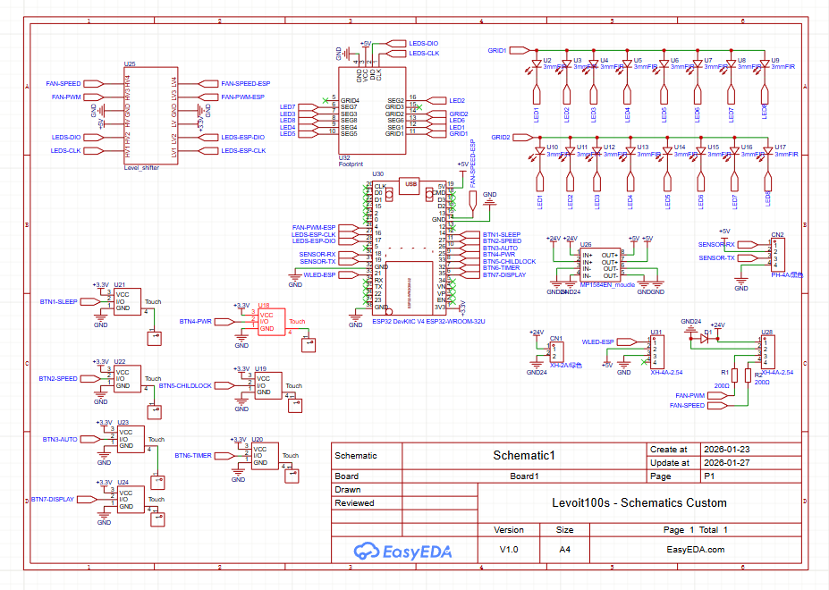

Using AZ-Delivery TM1637 display to drive 16 LEDs: SEG1=LED1, SEG2=LED2, ...

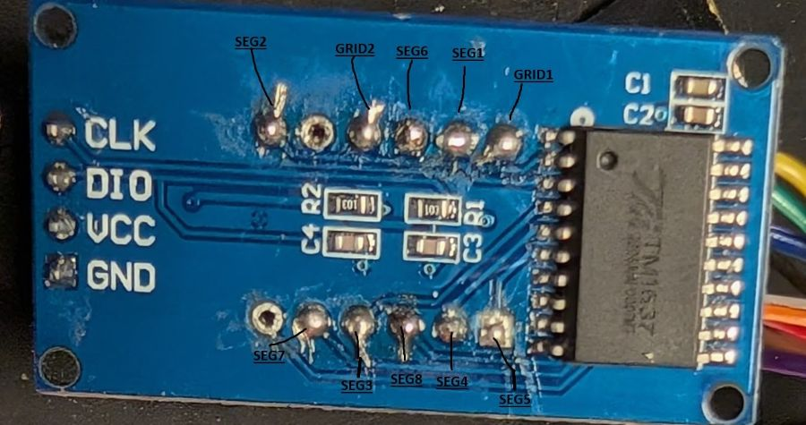
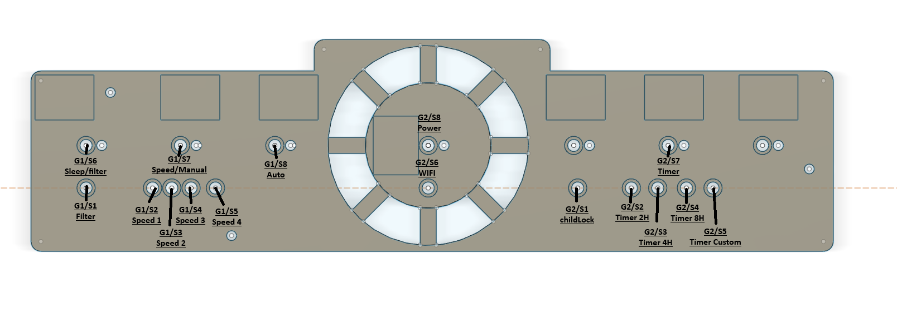
