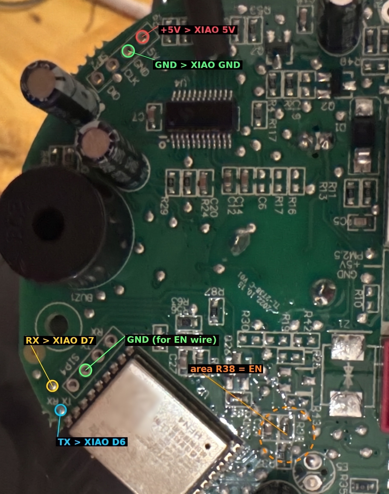
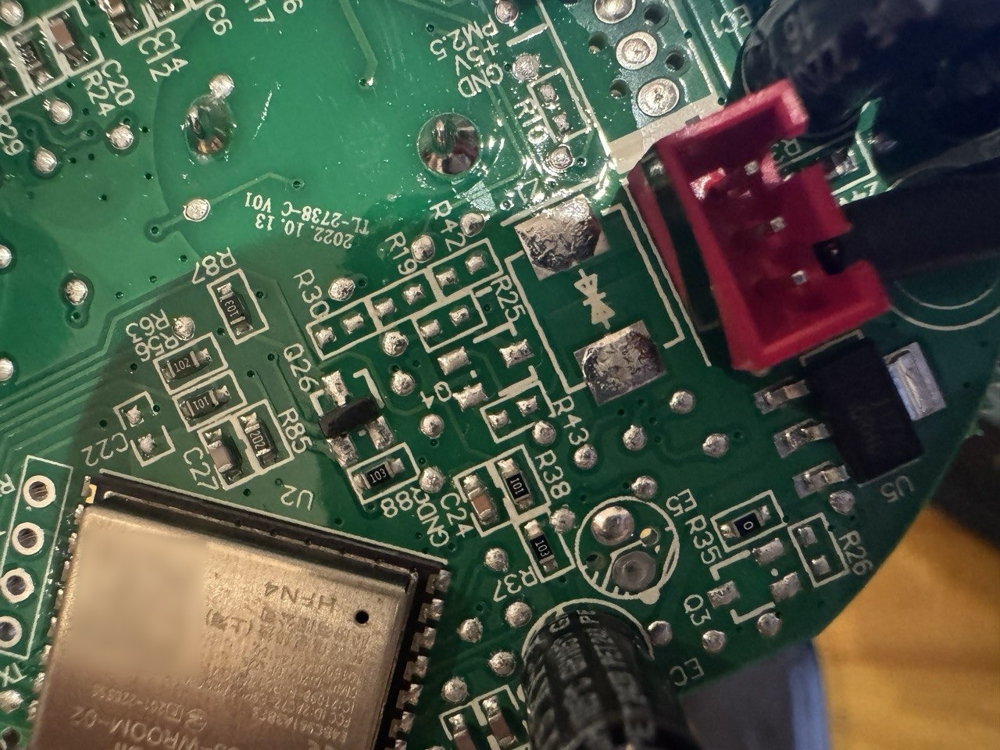
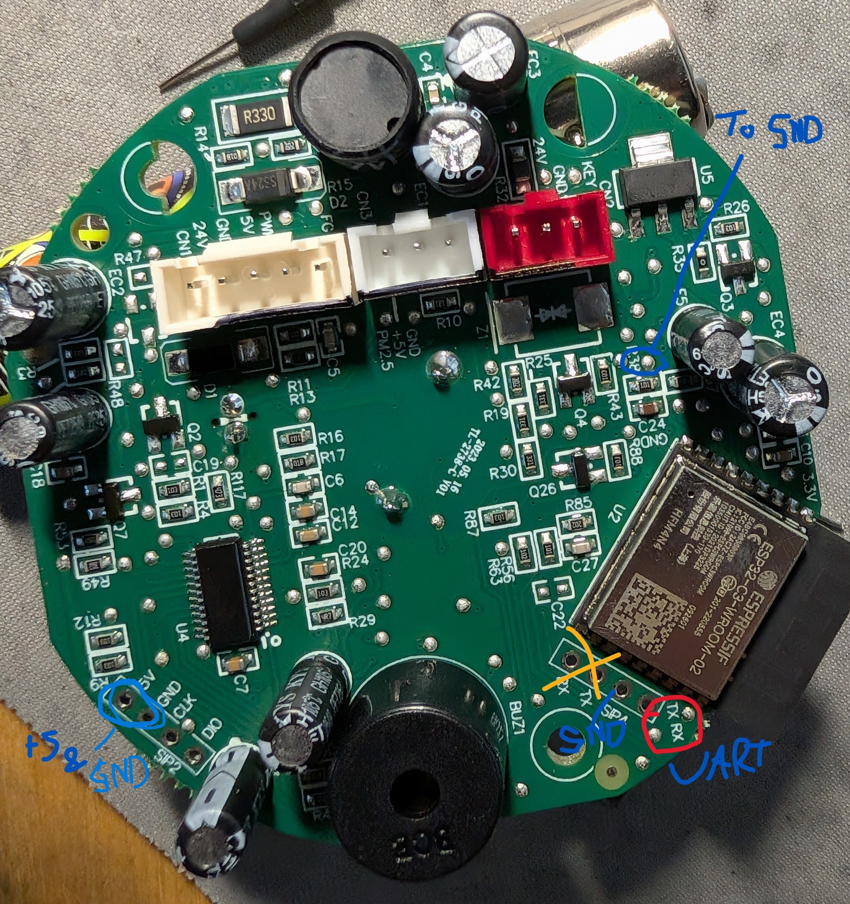
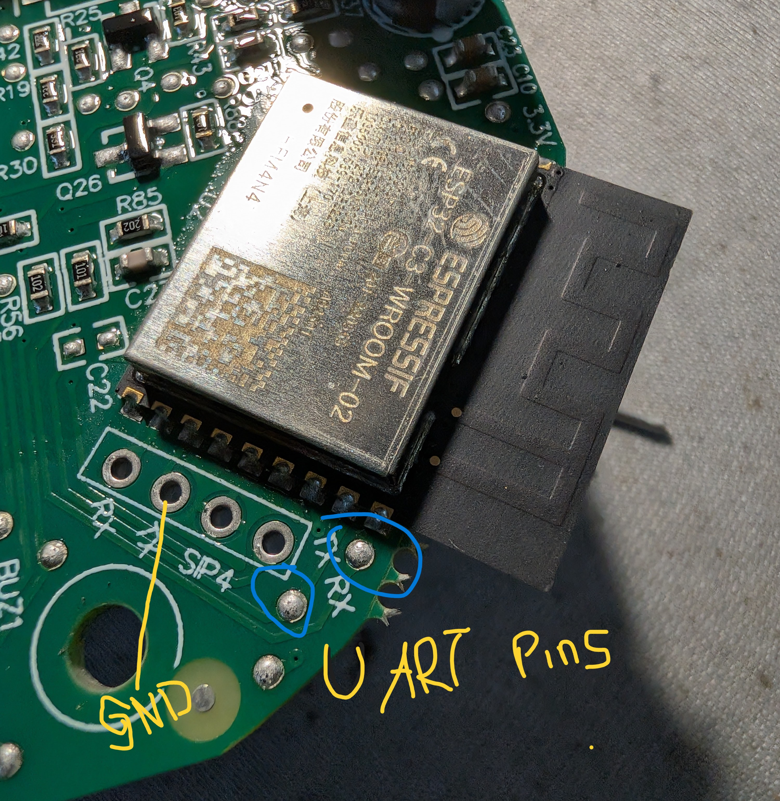
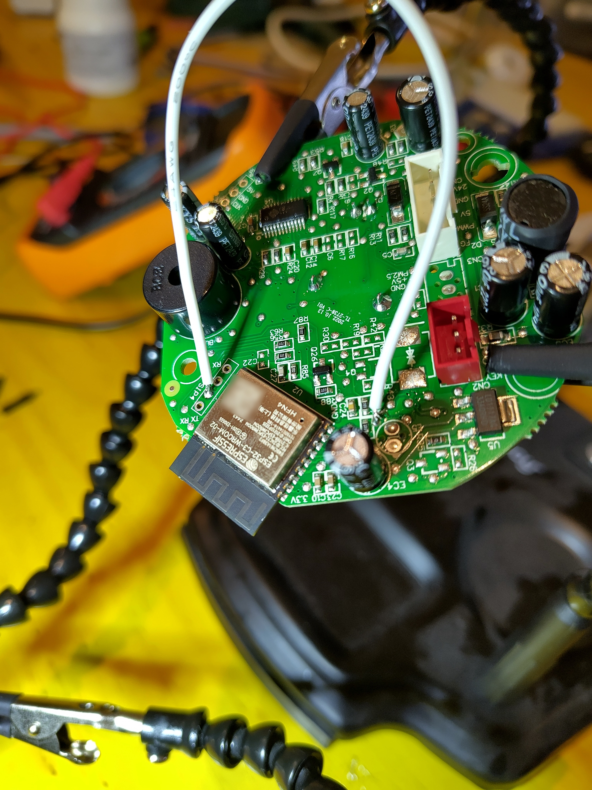
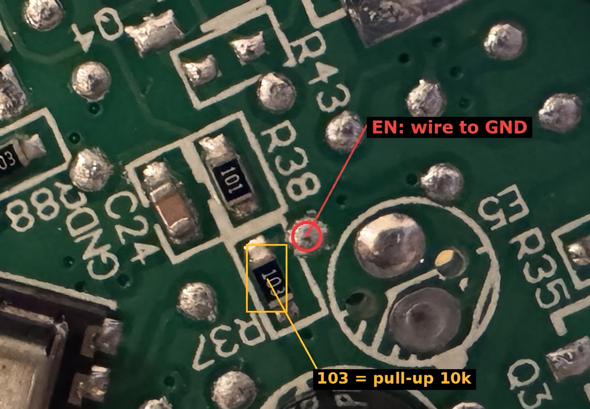
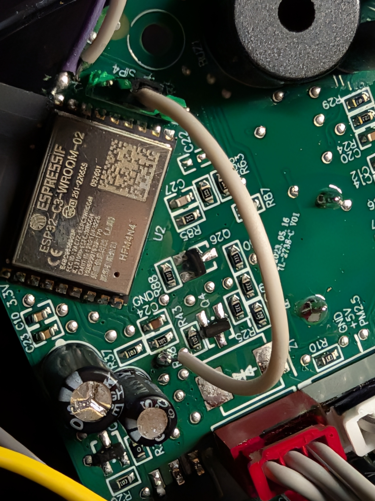
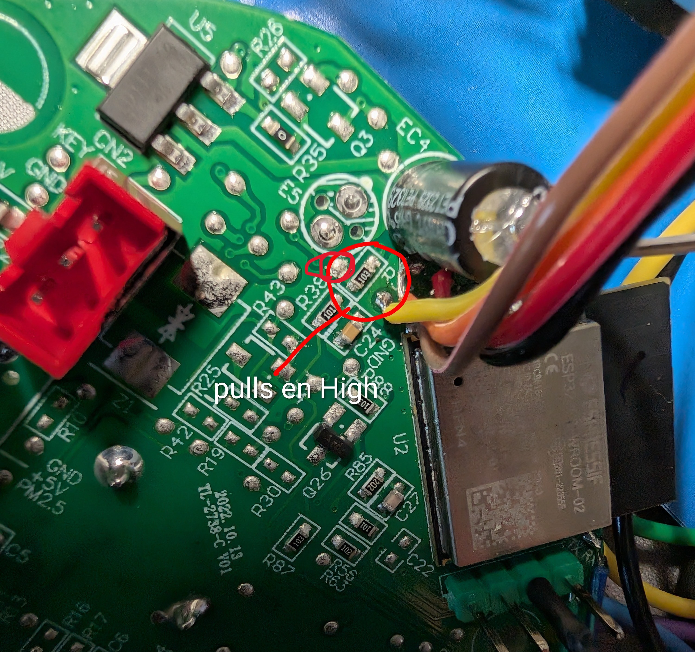
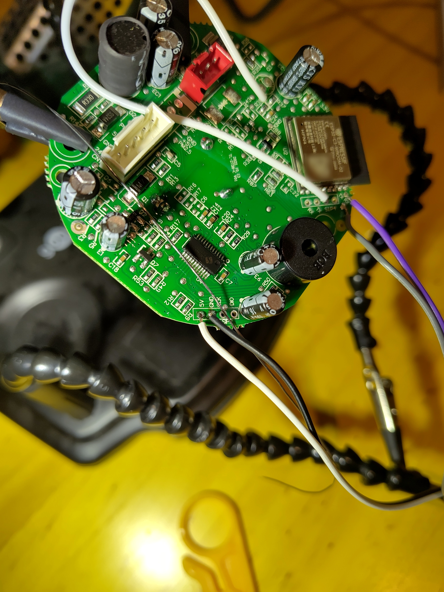

[← Back](../../README.md)
# Philips / MUJI 600-series Air Purifier — AC0650 / AC0651

A MUJI-branded, **Philips/Versuni-manufactured** air purifier driven by an ESPHome
[`philips`](../../components/philips) external component over the MCU↔module UART.
Two variants are supported via the `model:` option — both speak the identical
`FE FF` protocol:

- **AC0650/10** — base: fan + filters, no air-quality sensor.
- **AC0651/10** — adds a **PM1003 PM2.5 sensor**, allergen/AQI index, an **Auto**
  fan preset, and "standby sensor monitoring".


Supported. The stock module is locked, so the route is adding your own ESP32
([step 4](#4-add-your-own-esp32-recommended)). The steps shared by all devices
are in the [install guide](../../docs/installing.md); this page has what is
particular to the 600 series.

## Quick Facts

| Item | Value |
|------|-------|
| Models | AC0650/10, AC0651/10 |
| Brand | MUJI (Philips/Versuni OEM) |
| Tested MCU FW | 0.1.9 / 0.2.1|
| Stock ESP module | ESP32-C3-WROOM-02U (secure boot — locked) |
| Replacement module | [Seeed XIAO ESP32-C3](https://www.seeedstudio.com/Seeed-XIAO-ESP32C3-p-5431.html?sensecap_affiliate=3gGMlPv&referring_service=link) or [Seeed XIAO ESP32-S3](https://www.seeedstudio.com/XIAO-ESP32S3-p-5627.html?sensecap_affiliate=3gGMlPv&referring_service=link) (or any ESP32-C3 or ESP32-S3) |
| MCU link | UART, 115200 8N1, `FE FF` protocol |
| Fan speeds | 3 (Sleep / Medium / Turbo) + Auto on 651 |
| PM sensor | PM1003 (AC0651 only) |
| ESPHome | 2026.6.0+ |

## Features

Entities exposed by the [`philips`](../../components/philips) component
(see [`common.yaml`](./common.yaml) + the per-model yamls):

| Feature | Type | Models | Notes |
|---------|------|--------|-------|
| Fan | `fan` | both | on/off = power; speeds 1=Sleep, 2=Medium, 3=Turbo; **Auto** preset on 651 |
| Pre-filter | `sensor` | both | `filter_clean` — % remaining |
| HEPA Filter | `sensor` | both | `filter_lifetime` — % remaining |
| Reset Pre-filter | `button` | both | resets the pre-filter counter |
| Reset HEPA Filter | `button` | both | resets the HEPA counter |
| MCU Version | `text_sensor` | both | MCU firmware version string |
| PM2.5 | `sensor` | 651 | µg/m³ (PM1003 sensor) |
| Allergen Index | `sensor` | 651 | 1–12 (tracks PM2.5) |
| Standby Sensor Monitoring | `switch` | 651 | keep the PM sensor running in standby |

## 1. Build the firmware

**With Home Assistant (recommended):** [Levoit ESPHome](https://github.com/tuct/levoit-esphome-ha)
→ *Add device* → **Philips 600 series** (AC0650) → ESP32-C3 or Seeed XIAO
ESP32-S3. No Home Assistant template for the AC0651 yet: build it manually.
[Step by step](../../docs/installing.md#with-home-assistant-recommended).

**Manually:** the files in this folder, built with the ESPHome CLI or pasted
into the Device Builder. [Step by step](../../docs/installing.md#manually).

| Model | Board | ESPHome CLI | Device Builder / web builder |
|-------|-------|-------------|------------------------------|
| AC0650 | ESP32-C3 | [`philips-ac0650.yaml`](./philips-ac0650.yaml) (`model: AC0650`, choose your ESP32 model) | [`philips-ac0650-builder.yaml`](./philips-ac0650-builder.yaml) |
| AC0650 | Seeed XIAO ESP32-S3 | [`philips-ac0650-s3.yaml`](./philips-ac0650-s3.yaml) | [`philips-ac0650-builder-s3.yaml`](./philips-ac0650-builder-s3.yaml) |
| AC0650 | Seeed XIAO ESP32-C3, local component + verbose logging | [`philips-ac0650-c3_dev.yaml`](./philips-ac0650-c3_dev.yaml) | — |
| AC0650 | ESP32-C3, verbose logging | [`philips-ac0650_dev.yaml`](./philips-ac0650_dev.yaml) | — |
| AC0651 | Seeed XIAO ESP32-C3 | [`philips-ac0651-c3_dev.yaml`](./philips-ac0651-c3_dev.yaml) (`model: AC0651` — adds PM2.5, allergen index, Auto preset, standby sensor) | — |

The builder file has everything inlined and the component from GitHub.

With a **Seeed XIAO ESP32-S3** instead of a C3: same pads as the XIAO C3
(D7 = MCU TX, D6 = MCU RX), so the same wiring; on the S3 they are GPIO44 /
GPIO43. Untested.

Both pull in [`common.yaml`](./common.yaml) for the shared entities. The
`model:` option toggles the 651-only datapoints, so the rest of the config is
identical between variants.

The secrets template in this folder is
[`secrets copy.yaml`](./secrets%20copy.yaml) (your Wi-Fi and the ESPHome
`api_key` / `ota_password` / `wifi_ap_password`).

**Check the UART pins** in the chosen yaml match your wiring
(`rx_pin`/`tx_pin` substitutions — default `GPIO20`/`GPIO21` for the XIAO C3).

**Flash over USB the first time** (the C3 logs over its native USB serial, so
the MCU UART pins stay free):

```bash
esphome run philips-ac0651-c3_dev.yaml
```

After the first flash, subsequent updates go over Wi-Fi via OTA.

## 2. Disassembly

> ⚠️ **Unplug the unit first.** You only need a Phillips screwdriver. The AC0650
> and AC0651 share the same chassis and PCB (the 651 just has extra components
> populated), so these steps apply to both.

**1. Open the bottom.** Remove the 3 screws on the base, then lift off the gray
cover and the black cable protector.


**2. Free the inner assembly.** Remove the next 3 screws and carefully slide the
internal assembly out of the housing.


**3. Reach the PCB.** Remove the top cap to expose the control PCB.


**4. Remove the PCB.** Take out the remaining 3 screws holding the PCB so you can
solder the wires for the new ESP32.


## 3. Flash the original ESP32

> 🔒 The stock ESP32-C3 module has **secure boot enabled & enforced**, so it
> cannot be reflashed. Wire your own ESP32-C3 or ESP32-S3 to the MCU UART instead (see
> [step 4](#4-add-your-own-esp32-recommended)). The boot log that shows it is in
> [PROTOCOL.md](./PROTOCOL.md#hardware).

## 4. Add your own ESP32 (recommended)

The stock ESP32-C3 has secure boot enabled and enforced, so custom firmware can't
be flashed onto it — the only option is to **add your own ESP32-C3** on the MCU
UART and park the stock module.

**Recommended modules:**
- [Seeed XIAO ESP32-S3](https://www.seeedstudio.com/XIAO-ESP32S3-p-5627.html?sensecap_affiliate=3gGMlPv&referring_service=link)
- [Seeed XIAO ESP32-C3](https://www.seeedstudio.com/Seeed-XIAO-ESP32C3-p-5431.html?sensecap_affiliate=3gGMlPv&referring_service=link)

**Wiring:** 4 wires — `+5V`, `GND`, `RX`, `TX`. In the example configs the C3 uses
`GPIO20` = RX (MCU TX → ESP RX) and `GPIO21` = TX (ESP TX → MCU RX).
In S3's example config the module uses `GPIO44` = RX (MCU TX → ESP RX) and
`GPIO43` = TX (ESP TX → MCU RX). In Seeed XIAO ESP32-S3, GPIO44 is D7 and GPIO43 is D6.

> The RX/TX pads are **not** on the pin header — use the test pads near the original ESP32 on the board.
> Pull the `EN` pin of the original ESP32 to GND to disable it so it stops driving the bus.

The SIP4 header is the ESP debug console, not the MCU link; see
[Serial interfaces](./PROTOCOL.md#serial-interfaces).

### Wiring the replacement ESP32

Solder 4 wires to the PCB test pads: **`+5V`, `GND`, `RX`, `TX`**. The RX/TX pads
are **not** on the pin header — use the test pads near the original ESP32.

#### AC0650



#### AC0651



**Park the stock module.** Pull the original ESP32's `EN` pin to `GND` so it stops
driving the UART bus, otherwise it will collide with your new module. The
[component notes](./PROTOCOL.md#esphome-component) hold it low via a ~10k to GND.

#### AC0650



#### AC0651



[Wiring, parking the original, strapping pins](../../docs/installing.md#4-add-your-own-esp32)
in the install guide.

## 5. Assembly

The finished install — new ESP32-C3 wired in alongside the parked stock module:




Then reverse the disassembly:

* Refit the PCB with its 3 screws
* Refit the top cap
* Slide the internal assembly back into the housing and refit its 3 screws
* Put back the black cable protector and the gray cover, and refit the 3 screws
  on the base

[What to check](../../docs/installing.md#5-assembly) once it is powered.

> **Tip:** set `logger: level: VERBOSE` to watch the raw `FE FF` UART frames
> (`TX ->` / `RX <-`) while bringing the link up — handy for confirming the MCU
> is answering before any entities appear in Home Assistant.

### Troubleshooting the UART link

- **Nothing at all (no RX, no TX working)?** Flip `rx_pin` and `tx_pin` — it's
  easy to swap them, and crossed RX/TX is the most common cause.
- **You can read the MCU but writes/commands don't take effect?** The stock
  module's `EN` pin most likely isn't actually pulled to `GND`, so it's still
  driving the bus and colliding with your SETs. Recheck the `EN → GND`
  connection (see [Wiring the replacement ESP32](#wiring-the-replacement-esp32)).

## Hardware & protocol notes

Device identity, the stock module and its secure boot, the two serial
interfaces, the `FE FF` frame format, the datapoint map and the boot handshake
are in [PROTOCOL.md](./PROTOCOL.md).
