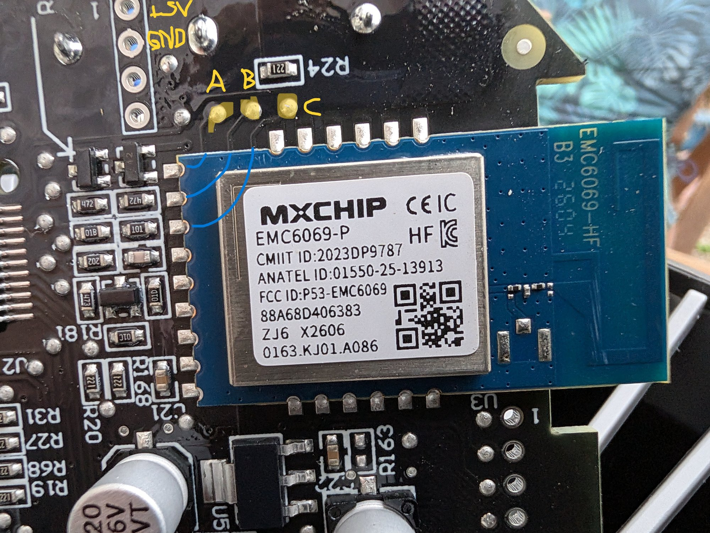
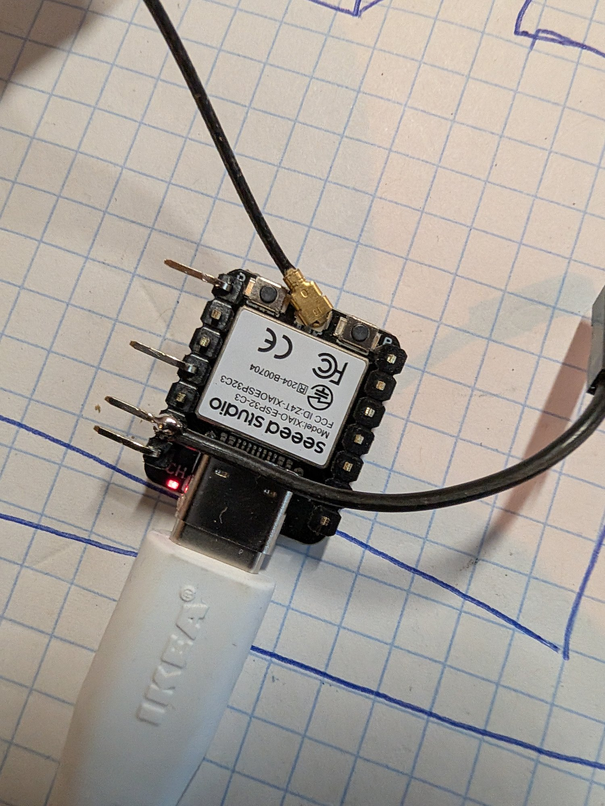
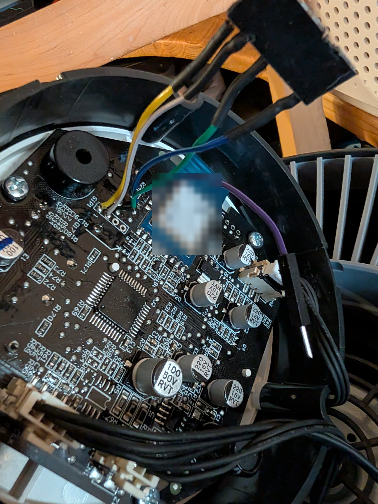
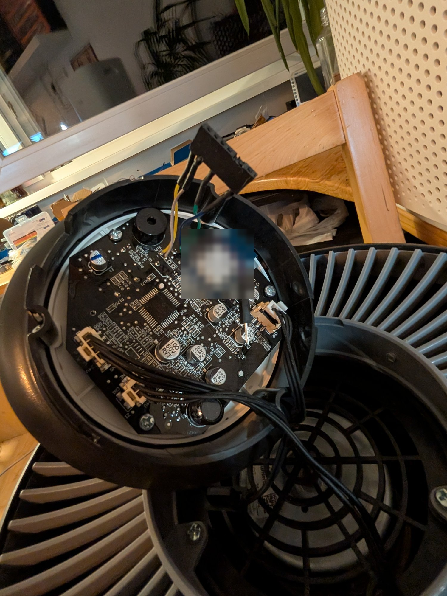
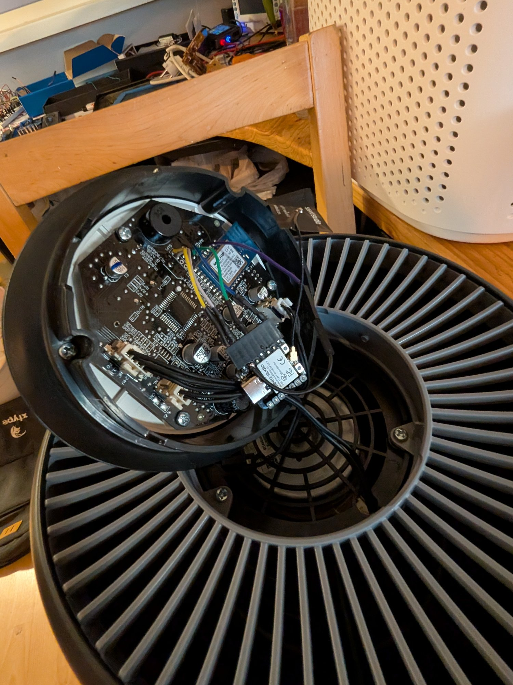
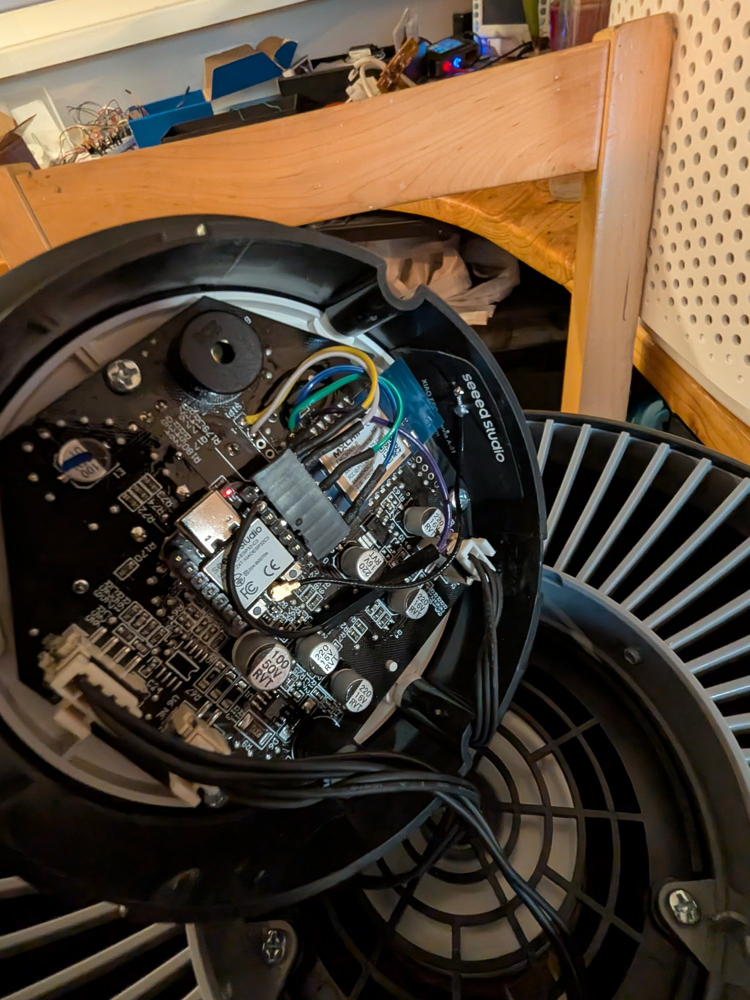
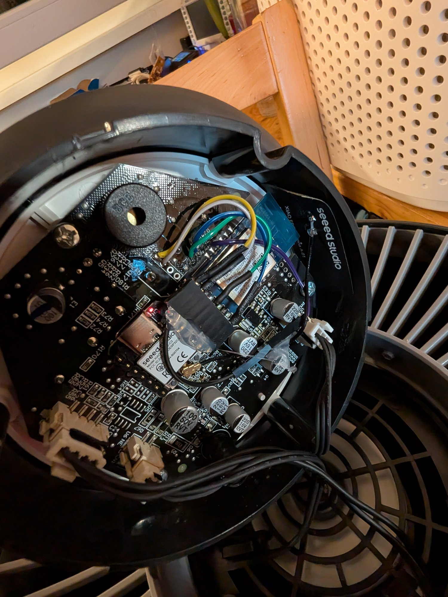
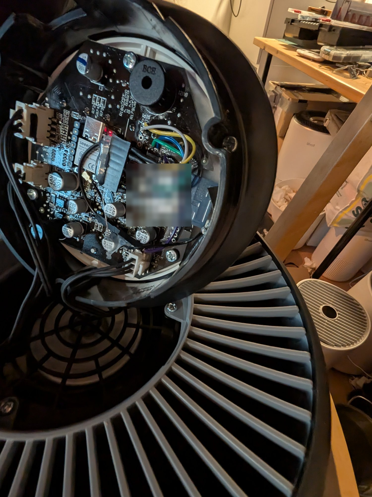
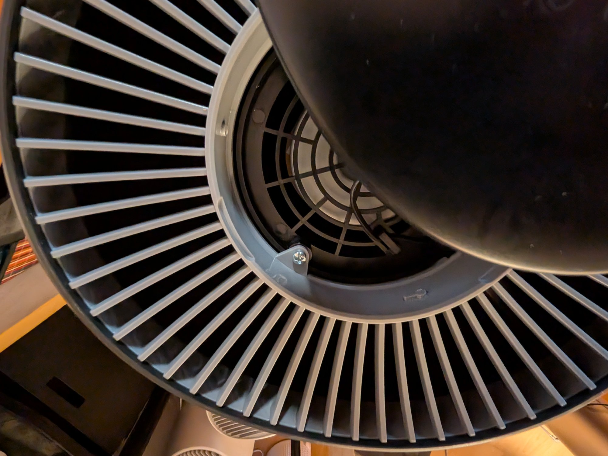
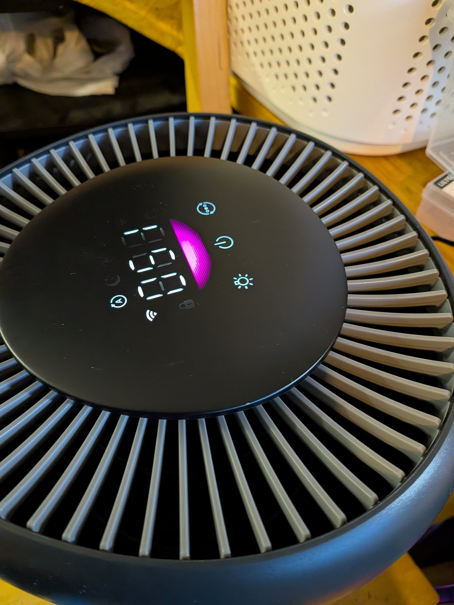

[← Back](../../README.md)
# Philips Series 900 Air Purifier — AC0950 / AC0951

> ✅ **Working on hardware.** An **AC0951** is running an ESP32-C3 on the MCU
> link with the [`philips`](../../components/philips) component, fully local.
>
> The MCU↔module link is the *same* protocol the component already speaks for
> the AC0650/AC0651 — 115200 8N1, almost identical datapoint map — decoded from
> the logic-analyzer captures in [`captures/`](./captures), with every write
> frame checked byte-for-byte against them. See
> [Protocol](./PROTOCOL.md#protocol--decoded-from-the-captures).
>
> ⚠️ The **AC0950** is still unverified: every capture and the working install
> are from an AC0951, and the AC0950 has never been observed.

The goal for these units is the same move as the
[600-series](../philips-600-series): **disable the stock Wi-Fi module and drive
the purifier's MCU from your own ESP32** over the internal UART — fully local,
no cloud, no vendor firmware left in the loop.

The route is adding your own ESP32 ([step 4](#4-add-your-own-esp32-recommended)).
The steps shared by all devices are in the
[install guide](../../docs/installing.md); this page has what is particular to
the 900 series.

## Quick Facts

| Item | Value |
|------|-------|
| Models | AC0950, AC0951 |
| Brand | Philips (Versuni) |
| Stock Wi-Fi module | **MXCHIP EMC6069-P** — 2.4 GHz Wi-Fi + BLE, FCC ID [`P53-EMC6069`](https://fccid.io/P53-EMC6069) |
| Module form | Blue castellated daughterboard (`EMC6069-HF`), soldered to the main PCB |
| Main MCU | Unmarked QFP, centre of the board — part number still unidentified |
| MCU link | ✅ UART, **115200 8N1**, **3.3 V** — verified; same `FE FF` framing as the 600 series |
| MCU firmware | `0.3.3` (module firmware `0.8.6`) |
| Internal model string | `AC0951/13`, codename **`Unicorn`** |
| ESPHome support | ✅ [`philips`](../../components/philips) (`model: AC0951` — confirmed on hardware; `AC0950` untested) |
| Stock local control | ✅ CoAP (`AWS_Philips_AIR`) without opening the case |

## Features

The 600-series entities ([Features](../philips-600-series/README.md#features)),
plus the ones below; [`common.yaml`](./common.yaml) and the per-model yamls
list them.

### Entities the 900 adds

| Platform | `type` | Datapoint |
|----------|--------|-----------|
| `switch` | `child_lock` | `0x03` |
| `switch` | `beep` | `0x30` (written as `0` / `100`, not `0` / `1`) |
| `select` | `display_brightness` | `0x04` — `off` / `low` / `bright` |
| `number` | `timer` | `0x10` — hours, `0` (off) to `12` |
| `sensor` | `timer_remaining` | `0x11` — minutes left, MCU-counted, read-only |

The 900 also inherits the 600-series **`standby_sensor`** switch (DP `0x34`),
which keeps the particulate sensor measuring while the unit is on standby so
PM2.5 and the allergen index stay live with the fan off. It is an AC0951-only
feature, so it lives in
[`philips-ac0951-c3_dev.yaml`](./philips-ac0951-c3_dev.yaml) rather than
[`common.yaml`](./common.yaml) — the AC0950 has no PM sensor to keep running.

Two behaviours are worth knowing when reading those entities back:

- **Display brightness reads `off` whenever the unit is powered off**, because
  the MCU zeroes DP `0x04` along with the power. It only means "the user turned
  the display off" while DP `0x02` is `1`.
- **Physical button presses never produce a SET**, so the component has to poll
  group `0x03` to notice them — there is nothing to subscribe to.

## Component support

`AC0950` / `AC0951` are implemented in
[`components/philips`](../../components/philips) — set `model:` and the rest is
shared with the 600 series. Every write frame the component emits has been
checked byte-for-byte against the captures in [`captures/`](./captures), and an
**AC0951 is confirmed running it on hardware**.

### What differs from the 600 series

| | 600 series | 900 series |
|---|---|---|
| Medium fan mode (DP `0x0C`) | `0x01` | **`0x13`** |
| HEPA total (filter reset) | `4800` (`00 00 12 C0`) | **`9600`** (`00 00 25 80`) |
| Extra datapoints | — | child lock, beep, display brightness, sleep timer |
| Status TLV types | `0x73` string | `0x73` string **+ `0x74` blob** |

Everything else — framing, CRC, command IDs, power, sleep/turbo/auto, filters,
PM2.5, allergen index, standby sensor — is identical.

### Still unknown

- Whether the **AC0950** differs beyond simply not reporting `0x20`/`0x21`.
  Every capture is from an AC0951; the AC0950 support is an assumption modelled
  on the AC0650/AC0651 split.
- What `DP 0x0A`, `0x2A`–`0x2C`, `0x36` and `0x40` are. They never move, so they
  may be config constants and may not be identifiable by observation at all.
- Where the **ambient-light sensor** is reported, if it is reported at all.

## 1. Build the firmware

**With Home Assistant (recommended):** [Levoit ESPHome](https://github.com/tuct/levoit-esphome-ha)
→ *Add device* → **Philips 900 series** (AC0950) → Seeed XIAO ESP32-C3 or
Seeed XIAO ESP32-S3. No Home Assistant template for the AC0951 yet: build it
manually. [Step by step](../../docs/installing.md#with-home-assistant-recommended).

**Manually:** the files in this folder, built with the ESPHome CLI or pasted
into the Device Builder. [Step by step](../../docs/installing.md#manually).

| Model | Board | ESPHome CLI | Device Builder / web builder |
|-------|-------|-------------|------------------------------|
| AC0950 | Seeed XIAO ESP32-C3 | [`philips-ac0950.yaml`](./philips-ac0950.yaml) | [`philips-ac0950-builder.yaml`](./philips-ac0950-builder.yaml) |
| AC0950 | Seeed XIAO ESP32-S3 | [`philips-ac0950-s3.yaml`](./philips-ac0950-s3.yaml) | [`philips-ac0950-builder-s3.yaml`](./philips-ac0950-builder-s3.yaml) |
| AC0951 | Seeed XIAO ESP32-C3 | [`philips-ac0951-c3_dev.yaml`](./philips-ac0951-c3_dev.yaml) | — |
| — (passive UART sniffer) | Seeed XIAO ESP32-C3 | [`philips-900-uart-sniffer.yaml`](./philips-900-uart-sniffer.yaml) | — |

```bash
esphome run philips-ac0951-c3_dev.yaml
```

## 2. Disassembly

> ⚠️ **Unplug it first.** Part of the control board is on mains.

No screws to start with: **twist the top cap counter-clockwise** (to the left)
and lift it off — the same arrangement as the
[600 series](../philips-600-series/README.md#2-disassembly). That exposes the
control PCB.

## 3. Flash the original ESP32

Not an option so far: the stock module is an MXCHIP `EMC6069-P`, whose silicon
MXCHIP does not publish, so nobody can yet say whether it can be reflashed. For
now the working assumption is the 600-series one: **add an ESP32 and park the
stock module**, rather than reflash it. Details in
[What the teardown answered](./PROTOCOL.md#what-the-teardown-answered).

## 4. Add your own ESP32 (recommended)

> ⚠️ **Unplug the unit first.** Part of the control board is on mains.
>
> ✅ **This has been done and works** on an AC0951 — the photos below are that
> install. The pads, pin assignment and parking method are all as used there.

The move is the same as the [600 series](../philips-600-series): park the stock
Wi-Fi module and let your own ESP32 talk to the purifier's MCU over the internal
UART.

**Recommended modules:**
- [Seeed XIAO ESP32-S3](https://www.seeedstudio.com/XIAO-ESP32S3-p-5627.html?sensecap_affiliate=3gGMlPv&referring_service=link)
- [Seeed XIAO ESP32-C3](https://www.seeedstudio.com/Seeed-XIAO-ESP32C3-p-5431.html?sensecap_affiliate=3gGMlPv&referring_service=link)

All the connection points are on the **top edge of the MXCHIP module**:



| Marked | What it is | Goes to |
|--------|-----------|---------|
| `+5V` | 5 V rail, on the 4-pin through-hole header up and left of the module | ESP32 `5V` / `VIN` |
| `GND` | ground, same header | ESP32 `GND` |
| **A** | UART, **MCU → module** (carries `STATUS`) | ESP32 `RX` |
| **B** | UART, **module → MCU** (carries `HS1` / `QUERY` / `SET`) | ESP32 `TX` |
| **C** | module **reset / enable**, 10k pull-up on the PCB | tie to GND to park the stock module |

### Which of A and B is which

Determined from the captures:

- **A carries MCU → module** — the `STATUS` (`cmd 0x0007`) frames. It is the
  **MCU's TX**, so it goes to the **ESP32's RX**.
- **B carries module → MCU** — `HS1` / `QUERY` / `SET` (`0x0001` / `0x0004` /
  `0x0003`). It is the **MCU's RX**, so it goes to the **ESP32's TX**.

If you want to re-confirm this on your own board — worth doing, since a
different revision could route them differently — probe both lines read-only
with the stock module still fitted and running (see
[Capturing the UART](./PROTOCOL.md#capturing-the-uart)) and look at the payloads rather than
the probe order: the line sending `STATUS` is always the MCU's TX. The order
genuinely cannot be trusted — `cap1` and `cap2` came out with the analyzer
channels swapped, which is why the decoder labels in `cap1.txt` are inverted.

### Parking the stock module

The ESP32 and the MXCHIP module cannot both drive the MCU's RX line. Pad **C** is
the module's reset/enable: **hold it low** so the module stays fitted but silent,
the same trick the 600 series uses on the original ESP32's `EN` pin.

**C is pulled up by a 10k resistor on the PCB** (measured). That settles how to
hold it low:

**Use a plain wire to GND.** It is what has been used here and it works, and with
a 10k pull-up and nothing else driving the net it sinks only
`3.3 V / 10k ≈ 0.33 mA` — there is nothing to protect against, so a series
resistor buys you nothing.

**Do not copy the 600 series' ~10k here.** That value works on the 600's ESP32
`EN` pin, but against this board's 10k pull-up it would form an even divider and
leave C sitting at ~1.65 V — squarely in the indeterminate band, where the module
may not stay in reset at all. If you want a resistor rather than a hard tie it has
to be **≤ 3.3 kΩ** to get under the ~0.8 V a 3.3 V input needs to read low; 1 kΩ
gives ~0.3 V with plenty of margin.

Driving C from a spare ESP32 GPIO (output-low) works too, and lets you release
the module without unsoldering.

Until C is held low, keep your ESP32's TX disconnected and treat the setup as
receive-only — two drivers on the MCU's RX line is the one wiring mistake that
can damage something.

### Wiring

```
        ESP32-C3                 AC0951 control board
        --------                 --------------------
  5V / VIN  <--------------------  +5V  (4-pin header)
       GND  <-------------------->  GND  (4-pin header)
  RX GPIO20 <--------------------  A    (MCU TX — STATUS frames)
  TX GPIO10 -------------------->  B    (MCU RX)
                                    C  ---> GND  (parks the stock module)
```



On a **Seeed XIAO ESP32-C3** — the board the configs here assume:

| XIAO pad | GPIO | Purpose | Board pad |
|----------|------|---------|-----------|
| `5V` | — | supply in (through the onboard regulator) | `+5V` header |
| `GND` | — | ground | `GND` header |
| `D7` | `GPIO20` | UART **RX** | **A** (MCU TX) |
| `D10` | `GPIO10` | UART **TX** | **B** (MCU RX) |
| any free pad, e.g. `D0` | `GPIO2` | *optional* — hold **C** low from software | **C** |

Conveniently, **all four connections are on the same edge** of the XIAO: that
side runs `5V`, `GND`, `3V3`, `D10`, `D9`, `D8`, `D7` from top to bottom, so
power, ground and both UART lines come off one row.

These are the defaults in
[`philips-ac0951-c3_dev.yaml`](./philips-ac0951-c3_dev.yaml)
(`rx_pin: GPIO20` / `tx_pin: GPIO10`).

`GPIO20` is the C3's **default UART0 RX**, which is why
[`common.yaml`](./common.yaml) moves the logger to `USB_SERIAL_JTAG` — otherwise
the log output would fight the MCU on the same wire. TX deliberately uses
`GPIO10` rather than `GPIO21` (UART0 TX): it keeps `D6` free and, more
importantly, avoids `D8`/`D9`, which are **strapping pins** on the C3 — `D9` is
also the BOOT button, so a line held low there at reset drops the board into
serial-download mode instead of running your firmware.

The optional GPIO for **C** is only needed if you want to release the stock module
without unsoldering; a wire straight to GND is what has been used so far.

**A and B are 3.3 V logic — measured, not assumed.** So they connect straight to
an ESP32-C3 GPIO with no level shifting. (Only the `+5V` header pad is 5 V, and
that goes to the XIAO's `5V` pin, never to a GPIO.)

### The install

The AC0951 this was done on, start to finish. The MXCHIP module stays soldered in
place — only pad **C** is tied to GND to keep it quiet.





The ESP32-C3 tucks into the cavity above the fan with the antenna clear of the
board. Route the wires so nothing is pinched when the cap goes back on.









### Then flash

1. Flash [`philips-ac0951-c3_dev.yaml`](./philips-ac0951-c3_dev.yaml) (or
   [`philips-ac0950.yaml`](./philips-ac0950.yaml) for the non-sensor model; in
   the ESPHome Device Builder, [`philips-ac0950-builder.yaml`](./philips-ac0950-builder.yaml)).
   With a **Seeed XIAO ESP32-S3** instead of a C3:
   [`philips-ac0950-s3.yaml`](./philips-ac0950-s3.yaml) / [`philips-ac0950-builder-s3.yaml`](./philips-ac0950-builder-s3.yaml),
   on the same pads (D7 = pad A, D10 = pad B; GPIO44 / GPIO9 on the S3). Untested.
2. Watch the log. `MCU link up` means the handshake completed. If it does not
   appear, see [Boot sequence](./PROTOCOL.md#boot-sequence) — the stock module's *first*
   handshake attempt reliably fails and only the second, about two minutes later,
   succeeds, so the component retries rather than assuming the first `HS1` is
   answered.

[Wiring, parking the original, strapping pins](../../docs/installing.md#4-add-your-own-esp32)
in the install guide.

## 5. Assembly

### Refitting the top cap — watch the orientation

The cap only goes back on one way. The slats around the inner ring are evenly
spaced **except for one, which is noticeably wider** — line that up with the
matching gap on the housing before twisting the cap clockwise to lock it.



Get it wrong and the cap will not seat; there is no force needed either way, so
if it resists, back off and re-check the wide slat rather than pushing.

### Running



[What to check](../../docs/installing.md#5-assembly) once it is powered.

## Other routes

Until that works, an AC0950/AC0951 on stock firmware can already be run
cloud-free over local CoAP — see
[Cloud-free without ESPHome](../../docs/philips-coap.md)
in the docs.

## Hardware & protocol notes

The reverse-engineering log, what the teardown answered, board observations,
the protocol as decoded from the captures, how to capture the UART and the list
of captures are in [PROTOCOL.md](./PROTOCOL.md).

## Files

| File | Status | Purpose |
|------|--------|---------|
| [`philips-900-uart-sniffer.yaml`](./philips-900-uart-sniffer.yaml) | ✅ usable | Passive both-direction UART capture — the only flashable config here |
| [`common.yaml`](./common.yaml) | ✅ | Shared entity config |
| [`philips-ac0950.yaml`](./philips-ac0950.yaml) | ⚠️ untested | AC0950 board config — same protocol assumed, never verified |
| [`philips-ac0951-c3_dev.yaml`](./philips-ac0951-c3_dev.yaml) | ✅ working | AC0951 board config; adds PM2.5, allergen index and the standby-sensor switch |
| [`secrets-example.yaml`](./secrets-example.yaml) | ✅ | Template — copy to `secrets.yaml` |
| [`captures/`](./captures) | — | UART captures — see [Captures](./PROTOCOL.md#captures) |
| [`images/`](./images) | — | Teardown / PCB photos |
