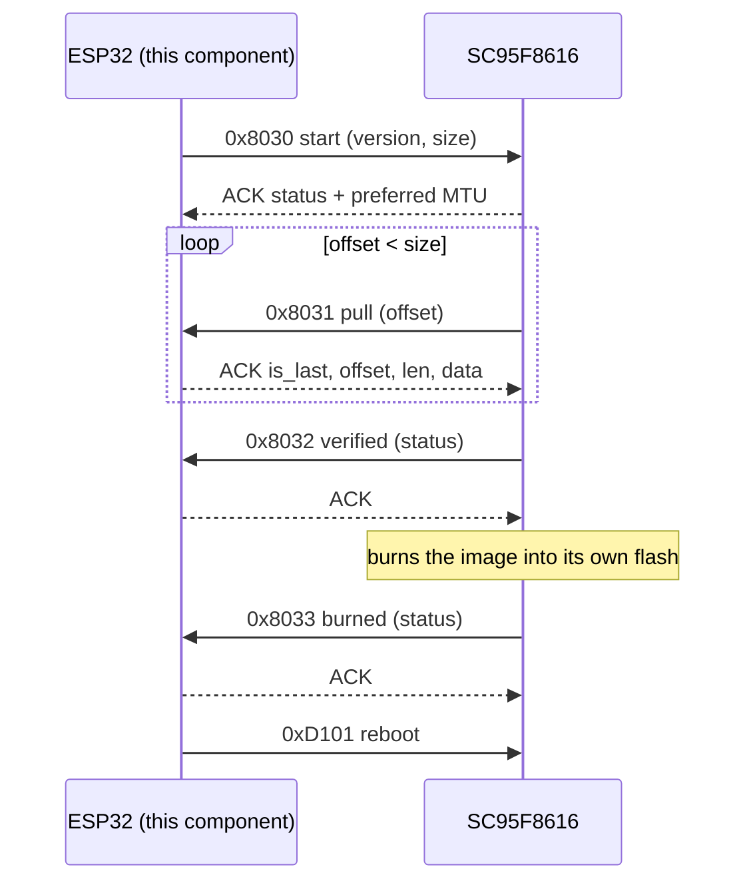

[← Back to the project README](../README.md)

# Flashing the appliance MCU

There are two processors in the purifier. The ESP32 runs this component and talks to the cloud; a second chip, the **SinOne SC95F8616** (1T 8051 core, 16 KB flash, 115200 8N1 UART), drives the fan, the sensors and the panel. The ESP32 is the only thing wired to that chip (GPIO17 TX / GPIO16 RX), so every path to its flash goes through the ESP. The stock firmware uses that link to update the MCU, and `McuDfu` implements the same host side for custom firmware.

This is the appliance controller's flash, not the ESP's. A wrong image bricks the board and the ESP cannot recover it — there is no exposed ICP/SWD header. Only flash an image you have a known-good copy of.

## How it works

The MCU runs its own in-application-programming (IAP) routine. The ESP does not push the image: it announces it, then the **MCU pulls** the bytes it wants. That means the MCU controls the pace, and the ESP only has to answer requests.



### 1. Start

The ESP sends `0x8030` with the three version bytes and the image size. The stock firmware takes them from the cloud's `newVersion` string (it formats `V%d.%d.%02d`) and the file size.

```
A5 22 <seq> <len> <len> <chk> 01 30 80 00 00 04 <maj> <min> <patch> <size LE32> FF FF
```

Length is the number of bytes after the checksum (`0x0F` here). The MCU answers with a `0x12` ACK whose payload is `status` (0 = ready) and `mtu` (little-endian). The stock firmware advertises `0x400`; `McuDfu` clamps whatever comes back to 64..1024.

### 2. The pull loop

For every chunk the MCU sends a `0x8031` request with a 32-bit offset:

```
A5 22 <seq> <len> <len> <chk> 01 31 80 00 <offset LE32>
```

The ESP answers with an ACK carrying the chunk. The payload is `is_last` (1 on the final chunk), the offset, the chunk length and the data itself:

```
A5 12 <seq> <len> <len> <chk> 01 31 80 00 <is_last> <offset LE32> <len LE16> <data...>
```

The reply echoes the request's sequence number, which is why the DFU must run before the generic `ackMessage()` in `dispatch_decoder` — otherwise each request gets two replies, one empty and one with data.

### 3. Verify, burn, reboot

When the MCU has all the bytes it sends `0x8032` with a status. The ESP ACKs it, and on status 0 the MCU burns the image into its own flash. When that finishes it sends `0x8033` with the result; the ESP ACKs and, on success, sends `0xD101` with payload `01` to restart the MCU.

```
A5 22 <seq> <len> <len> <chk> 01 32 80 00 <status>     (MCU → ESP)
A5 22 <seq> <len> <len> <chk> 01 33 80 00 <status>     (MCU → ESP)
A5 22 <seq> <len> <len> <chk> 01 01 D1 00 01           (ESP → MCU)
```

`McuDfu` gives up after 10 s without progress (`FAILED`); the MCU does the same, so a retry starts again at `0x8030`.

## The stock firmware's version of this

The vendor firmware does exactly the same sequence, with three extra pieces:

1. The cloud sends `upFirmware` for plugin `mcuFw` (or `mcu2Fw`/`mcu3Fw` for a second/third MCU) with a URL and a version.
2. The ESP downloads the image over HTTP and writes it **raw into the `storage` partition** (`0x340000`, 128 KB) with `vhal_ota_save_bin_file`; metadata goes to the NVS namespace `otaSubDev`.
3. `vesync_ota_mcu_start` (`0x400eb184`) sends `0x8030`, and `ota_mcu_bin_requst` (`0x400eb040`) serves the chunks by reading the `storage` partition on demand.

So the stock image is not in RAM: it lives in flash until the MCU has pulled all of it. `McuDfu` keeps the same pull model but takes the bytes from a `Reader`, which can be an embedded array, that same partition, or anything else.

## Using it

```cpp
// embedded image, generated with: xxd -i mcu_fw.bin > mcu_image.h
device_.mcu_dfu().start(
    [](uint32_t off, uint8_t *dst, size_t len) -> size_t {
      if (off >= kMcuImageSize) return 0;
      size_t n = std::min(len, kMcuImageSize - off);
      memcpy(dst, kMcuImage + off, n);
      return n;
    },
    kMcuImageSize, /*major=*/1, /*minor=*/0, /*patch=*/5);
```

The ESPHome shell can expose that as a button:

```yaml
button:
  - platform: template
    name: "Flash MCU"
    entity_category: config
    on_press:
      - lambda: id(levoitcore300).start_mcu_dfu(1, 0, 5);
```

While a transfer runs, `LevoitDevice::sendCommand()` drops normal commands, as the stock firmware does with its busy semaphore.

### Where the image can live

* **Embedded** (`xxd -i`): works on a fresh unit and costs the image size (≤ 16 KB) of flash. This is the only option that needs no prior download.
* **`storage` partition** (`0x340000`, label `storage`): what the stock firmware does. ESP32-only; record the size and version yourself (for example a small `[u32 size][u8 maj][u8 min][u8 patch]` header at offset 0).
* NVS is too small for 16 KB, so it is not an option.

## Safety

* The SC95F8616 has 16 KB of flash and no documented recovery interface on this board. A corrupt image leaves the appliance controller dead; the ESP cannot reflash it.
* Read and keep the current image first if you can (the stock firmware leaves it in the `storage` partition after a vendor update).
* The version bytes are not a downgrade guard by themselves; the MCU decides whether to accept the image.
